# Cosiety – Software Design Specification (SDS)

| | |
|---|---|
| **Project** | Cosiety – Village Cooperative Society Portal |
| **Document** | Cosiety SDS (file `Cosiety_SDS_v1.0.md`, content version 1.1) |
| **Version** | 1.1 (Draft for stakeholder review) |
| **Prepared** | 17 November 2026 |
| **Status** | DRAFT – technical recommendations, not approved policy |
| **Implements** | Cosiety SRS content version 1.1 (`FR-`, `NFR-`, `BR-`, `OD-` IDs refer to the SRS) |
| **Source** | "Cosiety: Village Cooperative Society – Design Note", Draft v1, 16 Nov 2026 (revised, 7 pages) |

## Revision history

| Version | Date | Change |
|---|---|---|
| 0.1 | 16 Nov 2026 | Architecture options and ledger design |
| 1.0 | 16 Nov 2026 | First complete SDS |
| 1.1 | 17 Nov 2026 | Re-based on revised note: vote-points engine, gender-specific weighted elections, co-presidents/teams, removal of neighbourhood groups; module design, reports matrix, per-phase roadmap, design risks and Google AI Studio build guide added; implementation code removed |

## What changed from v1.0 (design impact)

| Change in note | Design impact |
|---|---|
| Vote weight follows points | New `DC-PTS` component; weighted tally; secrecy design revisited (§7) |
| Two co-presidents, gender-specific contests | Election model has *contests*; voter lists per contest |
| No neighbourhood groups | All group tables, reserved seats and group dashboards removed |
| Candidate qualification + Presidency Book training | Candidate application, evidence, training records |
| Teams named by co-presidents | Team/appointment model; cross-team maker–checker approvals |
| Members need education/work/exposure documents | Document store, verification queue, tighter privacy controls |

## Conventions
**[REC]** recommendation (not approved) · **[ASM]** assumption · **[DEP]** external dependency. Design IDs: `DC-xxx` component, `DD-nn` decision, `API-nn` endpoint, `TC-nn` test. No governance value (points table, quorum, thresholds, cap, terms, turnout) is hard-coded; values are read from versioned configuration linked to an approving resolution. **This document contains no implementation code.**

## Table of contents
1 Design Overview · 2 System Architecture · 3 Technology Stack · 4 Module-Level Design · 5 Database Design · 6 Authentication, Authorization, Privacy · 7 Voting and Election Architecture · 8 Financial Architecture · 9 API Design · 10 User Interface and Experience · 11 Reports and Dashboards · 12 Security Architecture · 13 Deployment and Infrastructure · 14 Testing Strategy · 15 Maintenance and Future Expansion · 16 Implementation Roadmap · 17 Design Risks · 18 Consistency Review · Appendix A Google AI Studio Build Guide · Appendix B Glossary and References

---

# 1. Design Overview

## 1.1 Design objectives
Security · financial integrity · democratic accountability · inclusion (low literacy, low bandwidth) · modularity · low operating cost · easy hand-over · separation between Cosiety and VilloThar · readiness for more villages.

## 1.2 Architectural principles
1. **Structure over procedure:** rules that protect people (one ballot per voter, no mixing of money, append-only records) are enforced by the system structure, not by trusting operators.
2. **Configuration, not code, for policy:** points tables, quorum, thresholds, caps and terms are data with versions and approvals.
3. **Truthful status:** the interface never shows a vote or payment as done until the server confirms.
4. **Least privilege and two-person control** for sensitive actions.
5. **Public by default for money and decisions; private by default for people.**
6. **Boring, maintainable technology** that a small local team can run.

## 1.3 Technology-neutral considerations
The design needs: transactions (atomic ballots and ledger postings), uniqueness guarantees (one ballot, one CNIC), append-only storage, separation of financial data by stream, scheduled jobs, encrypted fields, object storage for documents/media, and an audit chain. Any platform that can provide these can host the design (see §3 and Appendix A).

## 1.4 Architectural style, boundaries, assumptions
Modular monolith (DD-01); boundary with VilloThar per SRS §1.8; assumptions per SRS §14; constraints per SRS §2.7.

---

# 2. System Architecture

## 2.1 Style evaluation

| Option | Strengths | Weaknesses for Cosiety | Verdict |
|---|---|---|---|
| **Modular monolith** | One deployment; ballot/payment and their records commit together; cheap; easy hand-over | Needs discipline in module boundaries | **Recommended (DD-01)** |
| Service-oriented | Clear boundaries | Distributed transactions for money/votes; more servers | Not needed |
| Microservices | Independent scaling | Operating cost, consistency risk, too heavy for a village | Rejected |

## 2.2 System context
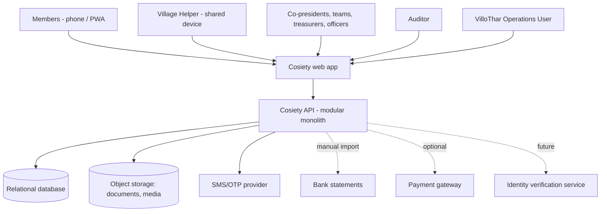

## 2.3 Component architecture
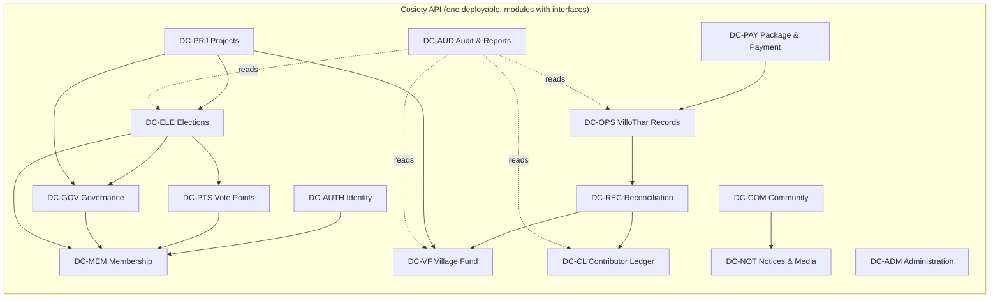
Modules call each other only through exported interfaces. **VF, CL and OPS never import each other's data code**; only `DC-REC` compares them and it cannot post entries itself (DD-02).

## 2.4 Module interaction – key flow
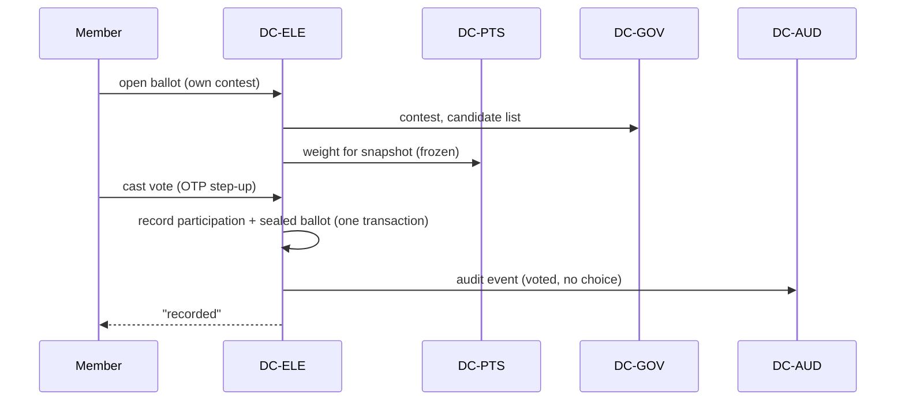

## 2.5 Deployment architecture
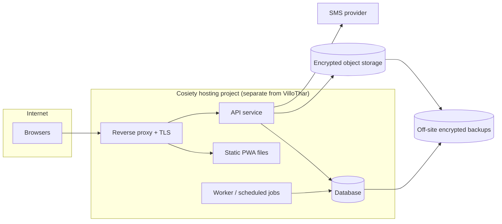

## 2.6 Integration architecture
Every external integration sits behind an adapter interface (`SmsPort`, `PaymentPort`, `IdentityPort`, `BankStatementPort`, `MediaPort`) so providers can change. Status of each (required / optional / future / dependent) is in SRS §5.

---

# 3. Technology Stack

## 3.1 Recommended stack **[REC]**

| Concern | Recommendation | Why it suits Cosiety |
|---|---|---|
| Frontend | React + TypeScript as a PWA; Tailwind CSS with logical (RTL-safe) properties; i18next for Sindhi/Urdu/English; TanStack Query; react-hook-form + zod | Large local talent pool; small bundles; offline-capable shell; shared validation |
| Backend | Node.js (LTS) + TypeScript with Express (or Fastify) in a modular layout; REST/JSON with OpenAPI | Same language as frontend; simple; widely known |
| Database | **PostgreSQL** (relational) | Needs ACID transactions, unique/check constraints, append-only enforcement, schemas and roles per financial stream, deferred balance checks |
| Authentication | Mobile OTP + optional PIN; server-side sessions; Argon2id for PINs | Fits phone-based users; revocable |
| API | Versioned REST; idempotency keys on money/vote requests | Testable, cacheable |
| Files/video | S3-compatible private object storage; 360p video + audio-only | Low bandwidth, low cost |
| Hosting | Single VPS with containers for the pilot; managed database later | Affordable, simple |
| Backups | Nightly database dump + continuous log archive, encrypted, second provider | Meets RPO/RTO |
| Monitoring/logging | Structured logs, uptime probe, error tracker with PII scrubbing | Early warning |
| Notifications | Local SMS aggregator (with fallback), portal notices | OTP and critical notices |
| Jobs | Queue in the database (e.g. pg-boss) | No extra service |

## 3.2 Alternatives considered

| Area | Alternative | Why not primary |
|---|---|---|
| Frontend | Vue, Svelte | Fine; no clear gain |
| Backend | NestJS, Django, Laravel, Spring | Acceptable if the team knows them better; Express/TypeScript keeps one language |
| Database | MySQL/MariaDB | Weaker constraint/row-security support |
| Database | MongoDB/Firestore (document stores) | No enforced relational constraints; ledger/ballot uniqueness must be re-created in application code; **see Appendix A for how to build on Firebase if the team uses Google AI Studio** |
| Database | SQLite | No role/schema separation; weak concurrency in election peaks |
| Hosting | Fully managed cloud | Higher cost; fine if donor-funded |
| Auth | Third-party identity platform | Lock-in; local OTP gateway needed anyway |

## 3.3 Design decisions
* **DD-01** Modular monolith. **DD-02** Financial separation is structural (separate schemas, roles, no cross-stream links). **DD-03** PostgreSQL as reference database. **DD-04** Secret ballots use a participation register and a sealed ballot store with no link between them (§7). **DD-05** `society_id` on every record. **DD-06** Double-entry bookkeeping inside each stream. **DD-07** Identity, points and voting authorisation are separate states. **DD-08** Idempotent postings. **DD-09** All policy values are versioned configuration. **DD-10** Co-president-weighted tally never publishes per-points breakdowns by default.

---

# 4. Module-Level Design

Each module lists: purpose and responsibilities · main operations · business logic · permissions (SRS roles) · data in/out · API · error handling · audit.

| ID | Module | Purpose and responsibilities | Main operations and business logic | Permissions | Data in / out; API | Errors | Audit |
|---|---|---|---|---|---|---|---|
| DC-AUTH | Identity | Registration, OTP, login, sessions, verification workflow, suspension | Create applicant; hash CNIC; duplicate check; OTP; checker≠approver; account suspension | Applicant, Helper, Verification Officer, Portal Admin | In: person details/documents; Out: status. API-01..05 | Duplicate (neutral), rate limit, expired code | Every step with actor |
| DC-MEM | Membership | Member, household, status history, directory | Maintain register; household links; masked directory; consent | Member (own), officers masked | API-05..07 | Not found (no leak) | Status changes |
| DC-PTS | Vote points | Formula versions, factor verification, points calculation, trial review | Load draft formula; approve factors; compute points only from approved factors; block opening on undecided factors; freeze per election | Verification Officer (verify); Portal Admin dual control (config); member (view own) | In: factor values, documents; Out: points, formula version. API-30..33 | Undecided factor, missing document, total above maximum | Factor decisions, formula changes |
| DC-GOV | Governance | Meetings, agenda, resolutions, co-president terms, teams, training, recall, COI, expense claims | Appointment rule checks (household, term); training gate; recall petitions; recusal; term expiry job | Co-presidents, team, Election Admin, members (propose) | API-08, 14, 15, 34..38 | Rule violation (422) | Appointments, rule changes |
| DC-ELE | Elections | Contests, candidates, snapshots, ballots, tally, certification | Gender-contest eligibility; freeze; cast; weighted tally; turnout/quorum/tie checks; certify | Election Admin, voters; Auditor read | API-08..13 | Already voted, not eligible, not open | Config hash, snapshot hash, counts, certification |
| DC-VF | Village Fund | Levy configuration, ledger, allocations | Post entries; enforce cap, approved-project rule; balance | Treasurer (maker), co-president (checker) | API-16, 17, 25 | Over cap, no project, over budget | All postings |
| DC-CL | Contributor Ledger | Contributors, agreements, capital, returns | Agreement-before-payment; returns per agreement parameters | Treasurer, Contributor (own) | API-21..24 | No agreement; cap exceeded | Agreements, returns |
| DC-OPS | VilloThar records | Versioned weekly sales/collection/revenue reports | Accept reports; compute levy due | VilloThar Ops User | API-18 | Overlap, hash mismatch | Submissions |
| DC-REC | Reconciliation | Compare reported, declared, bank lines; call VF/CL to post | Match lines; disputes; unidentified receipts | Treasurer, second confirmer | API-20 | Amount mismatch | Matches, disputes |
| DC-PAY | Package & Payment | Package list, price/levy split, purchase states | Idempotent purchase; levy at purchase date | Member, VilloThar Ops User | API-19 | Duplicate callback ignored | Purchases |
| DC-PRJ | Projects | Proposal lifecycle, budgets, expenses, reports | Ordered states; explainer gate; allocation limit | Members, team, co-presidents | API-14, 25 | Out-of-order state | State changes |
| DC-COM | Community | Issues, public questions | Visibility; deadlines; overdue flag | Members, team | API-15, 27 | – | Responses |
| DC-NOT | Notices & Media | Notices, videos, translations, SMS | Versioned publication; audio-only; text summary | Team, Portal Admin | API-28 | – | Publications |
| DC-AUD | Audit & Reports | Hash-chained log, monthly report, auditor exports | Chain verification; report drafting with unreconciled list | Auditor, treasurer, approver | API-26, 29 | Chain break alert | Self-protecting |
| DC-ADM | Administration | Roles, assignments, configuration with resolution references, multi-society | Dual-control config changes | Portal Admin, System Admin (infra only) | API-39..40 | Missing resolution | All changes |
| DC-UI | Front end | PWA, localisation, voice/icons | Draft saving; cache; truthful status | All | – | – | – |

---

# 5. Database Design

Reference design: **relational (PostgreSQL)**. Appendix A shows how the same model maps to Firebase for a Google AI Studio build.

## 5.1 Principles
1. **Schemas as boundaries:** `core` (people, roles, config), `pts` (formula, factors), `gov`, `vote`, `vf` (Village Fund), `cl` (Contributor Ledger), `ops` (VilloThar reports), `recon` (matching), `prj`, `comm`, `audit`. Each financial schema has its own database role; modules connect with different roles, so VF code cannot write CL tables (DD-02).
2. **No foreign keys between `vf`, `cl` and `ops`.** Only `recon` holds references (as stream + entry id), and it has no right to post entries.
3. **`society_id` on every table**, with row-level security so one society cannot read another's rows (DD-05).
4. **Append-only** for ledger lines, ballots, audit events, certified results and published documents: update/delete privileges revoked, plus protective triggers.
5. UUID primary keys; money as exact decimal (PKR); UTC timestamps; `created_at/created_by` everywhere; `voided_at` instead of deletion (soft deletion/archival).
6. Normalisation: third normal form for operational tables; derived values (balances, points totals, public summaries) are computed or kept in controlled summary tables.

## 5.2 ERD – people, points, governance, elections
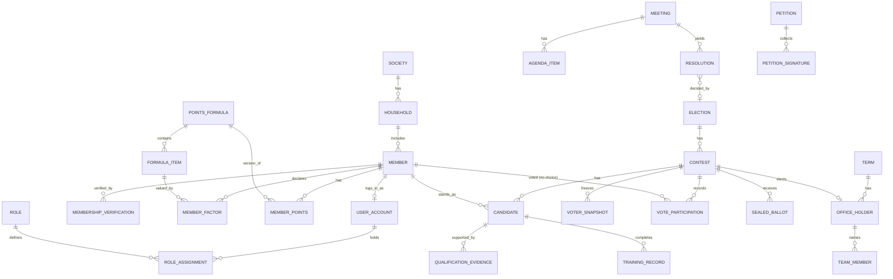

## 5.3 ERD – money (three separate schemas)
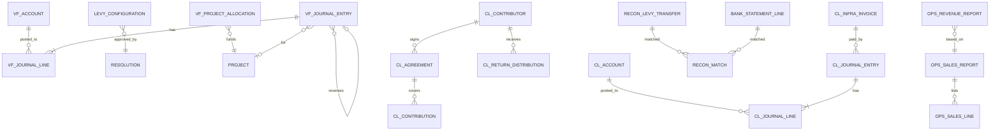
`RECON_MATCH` stores stream and entry id as plain values restricted to VF/CL; there are no foreign keys from `vf`↔`cl`↔`ops`.

## 5.4 Table definitions (key tables)
All tables also carry `society_id`, `created_at`, `created_by`. PK = primary key, FK = foreign key, N = nullable.

**core.member** – `id PK`; `household_id FK`; `full_name`; `gender` (as on CNIC; allowed list incl. an "other" value pending OD-20); `date_of_birth`; `mobile_e164` (unique among active); `cnic_enc` (encrypted); `cnic_hmac` (keyed hash, **unique** among non-deactivated – duplicate detection without revealing CNIC); `status` (applicant|active|suspended|deactivated|left); `identity_status`; `voting_suspended_until` (N).
No columns exist for caste, race, ethnicity, religion or neighbourhood.

**core.household** – `id PK`. **core.membership_verification** – `id, member_id FK, step (otp_confirmed|documents_checked|approved|rejected), actor_user_id, at, note`; trigger: approver ≠ checker.

**pts.formula** – `id, version, status (draft|approved|retired), resolution_id (N until approved), trial_start, trial_end`. **pts.formula_item** – `formula_id FK, factor (education|age|work|exposure), key (e.g. class_1_5, bachelor_plus, age_18_24, govt_job, big_city), value_points (N)`; `value_points` is **null for undecided categories** (no schooling, no exposure) – elections cannot open while a needed null remains. Unique `(formula_id, factor, key)`; check: age bands do not overlap.
**pts.member_factor** – `member_id, factor, item_key, document_id, status (submitted|approved|rejected), verified_by, verified_at`. **pts.member_points** – `member_id, formula_id, education_pts, age_pts, work_pts, exposure_pts, total_pts, basis (registration|snapshot), computed_at`; check: total = sum and total ≤ formula maximum.

**core.user_account** – `id, member_id FK, pin_hash (N), status`. **core.role / role_assignment** – `role_assignment(id, user_id, role_id, valid_from, valid_to, source (term|appointment|system), term_id N)`; check valid_to > valid_from; partial index on active rows.

**gov.term** – `id, kind (co_president), start, end, parameters_ref`. **gov.office_holder** – `id, term_id, contest_id N, seat (woman_co_president|man_co_president), member_id, start, end`. **gov.team_member** – `id, office_holder_id FK, member_id, role (treasurer|member|…), household_id (snapshot), start, end`; unique `(term_id, household_id)` when the household rule is active (scope per OD-23); check: a co-president's treasurer household ≠ that co-president's household.
**gov.rule** – configuration `key, value (json), version, resolution_id, effective_from`. Keys include `turnout.min`, `quorum.<type>`, `threshold.<type>`, `levy.cap`, `term.length_months`, `term.max_consecutive`, `team.size_min/max`, `recall.petition_share`, `tie.rule`, `household.scope`. **Values start empty**; an election or levy vote cannot open until required keys exist and link to an approving resolution.
**gov.meeting / agenda_item / resolution / petition / petition_signature / coi_declaration / expense_claim** – standard tables; `coi_declaration(member_id, kind, text, from, to)`; `expense_claim(office_holder or team member, amount, receipt, status)`.

**vote.election** – `id, type (co_president|levy|budget|project|recall|other), state (draft|nomination|ready|open|closed|tallied|certified|void), ballot_mode (secret|open), opens_at, closes_at, config_json, config_hash, snapshot_hash`; check closes_at > opens_at.
**vote.contest** – `id, election_id, name, eligible_gender_rule (woman|man|any), weighting (points|equal), formula_id N`.
**vote.candidate** – `id, contest_id, member_id, status (applied|qualified|rejected|withdrawn), eligibility_decision_by, decided_at`; **vote.qualification_evidence** – `candidate_id, kind (degree|intermediate_plus), document_id, assessor, outcome`; **vote.training_record** – `candidate_id, material_version, test_date, result, pass_mark_ref`.
**vote.voter_snapshot** – `contest_id, member_id, points_at_snapshot` PK (contest_id, member_id). Frozen at opening.
**vote.vote_participation** – `contest_id, member_id, cast_at, channel (self|assisted_kiosk)` **PK (contest_id, member_id)** – a second ballot is impossible.
**vote.sealed_ballot** – `ballot_id (random), contest_id, payload (encrypted: choice and weight)`; **no member id, no ordering key**. Insert-only.
**vote.result** – `contest_id, candidate_id, total_points, voters_count, rule_hash, certified_by(2), certified_at`; immutable after certification.

**vf.account** – `id, code, name, type, project_id N`. **vf.journal_entry** – `id, ref_no UNIQUE, entry_date, category, description, source_type, source_id, idempotency_key UNIQUE, reverses_entry_id N, approval_id N, project_id N, evidence_doc_id N`. **vf.journal_line** – `entry_id, account_id, debit ≥ 0, credit ≥ 0` (exactly one non-zero); a deferred check ensures each entry balances. **vf.levy_configuration** – `amount, cap_at_time, effective_from, resolution_id`; check amount ≤ cap. **vf.project_allocation** – allocation ≤ unallocated balance (checked in the same transaction).
**cl.***: `contributor(id, member_id N, display_name, contact_enc, payout_account_enc)`, `agreement(id, contributor_id, version, document_id, accepted_at, terms_json)`, `contribution(agreement_id, amount, received_entry_id)`, `infra_invoice`, `return_calculation(period, revenue_ref, formula_version, status)`, `return_distribution(calc_id, contributor_id, amount, status, paid_entry_id)`, plus `account/journal_entry/journal_line` as VF. **No link between `cl` and roles, permissions or elections.**
**ops.***: `sales_report(period, version, status, submitted_by, file_hash)`, `sales_line(package_id, paid_count, gross, levy)`, `revenue_report(period, basis, version)`; corrections create new versions.
**pay.package / pay.purchase** – `purchase(id, member_id, package_id, price_amount, levy_amount, status, external_ref, idempotency_key UNIQUE)`.
**recon.levy_transfer** – `period, amount_expected, amount_declared, reference_no, state (announced|sent|confirmed|disputed|cancelled), declared_by, confirmed_by`; trigger: confirmer ≠ declarer. **recon.bank_account** (stream VF|CL), **recon.bank_statement_line** (unique per account + bank reference), **recon.match**.
**prj.proposal** – `id, reference_no UNIQUE, member_id, title, description, category, est_budget, impact_text, state`; transition table enforces order. **prj.expense_request** – maker≠checker; conflict check against `coi_declaration`.
**comm.issue / question / notice / notice_version / media_asset**; **audit.event_log** – `seq, at, actor, action, entity, before, after, reason, ip_hash, prev_hash, hash` (hash chain), insert-only.

## 5.5 Important constraints

| # | Constraint | Purpose |
|---|---|---|
| K-1 | Unique CNIC keyed hash | One identity, one member |
| K-2 | PK (contest, member) on participation | One ballot per voter per contest |
| K-3 | Voting rows only while election open and now() within window (database clock) | Voting period |
| K-4 | Election config, formula version, snapshot immutable after opening | Protect settings |
| K-5 | Deferred balanced-entry check per ledger entry | Correct balances |
| K-6 | Update/delete privileges revoked on ledger lines, ballots, audit, results | Immutability |
| K-7 | Levy ≤ cap and linked resolution | Cap and approval |
| K-8 | No cross-stream foreign keys; separate roles | Stream separation |
| K-9 | Unique idempotency key on purchases and entries | No duplicates |
| K-10 | Unique household per term (scope per rule); treasurer-household check | Household restriction |
| K-11 | Approver ≠ preparer triggers | Maker–checker |
| K-12 | Row-level security by society | Multi-society isolation |
| K-13 | Check: points total = sum of factors ≤ maximum; null factor blocks election opening | Points integrity |
| K-14 | Candidate gender rule matches contest | Gender-specific contests |

## 5.6 Transaction handling, indexing, archival
Each ballot, posting, transfer confirmation and approval is a single transaction with its audit event and outbox event. Indexes: (society, status) on member; (contest) on snapshot/participation/ballot; (entry_date, id) and (account, entry) on lines; (state) on proposals; (period) on reports; partial index on active role assignments. Archival: closed elections and old formula versions stay readable; nothing financial or electoral is deleted; documents purged per retention schedule (OD-31) while the verification *decision* stays.

## 5.7 Ledger approach: double-entry or simple?
**DD-06: Use double-entry bookkeeping inside each stream; keep the three streams as three separate sets of books.**

* *Why double-entry:* every movement has a source and a destination, so a payment cannot "appear" without a matching change elsewhere; balances are derived from lines, not stored; reversals are natural; auditors recognise it.
* *Why not one shared ledger with a `type` column:* a coding mistake could mix streams. Separate schemas/roles prevent it.
* *Simplicity:* entries are mostly two lines, and chart of accounts per stream is short; the UI shows plain words ("Money received", "Money spent"), not debits and credits.
* *OPS is different:* Cosiety does not own VilloThar's books, so `ops` is a **controlled report register** (versioned reports), not a ledger. Only amounts that reach Cosiety's bank accounts become entries – in VF or CL.

**Starter charts of accounts [REC]** (names deliberately neutral; legal/accounting review needed):

| VF | CL |
|---|---|
| 1100 VF Bank · 1200 Levy due from VilloThar · 3000 Village Fund (unallocated) · 4000 Levy income · 5xxx Project spending (per project) | 1100 CL Bank · 1200 Contribution returns due from VilloThar · 1300 Infrastructure paid for · 2100 Contributor capital (sub-account per contributor) · 2200 Amounts due to contributors (sub-account per contributor) |


## 5.8 Example records (illustrative figures)
```text
core.member       (M-0412, hh H-077, status active, gender as per CNIC, identity approved)
pts.member_points (M-0412, formula v1 draft-trial, education 10, age 2, work 3, exposure 2, total 17)
vote.participation(contest "Woman co-president", M-0771, channel self)      -- no choice stored
vote.sealed_ballot(a9c3…e71, contest, encrypted payload)  x 17 for a voter with 17 points -- no member, no time, no weight
recon.levy_transfer (T-004, week 9, expected 12,350.00, declared 12,350.00, ref "IBFT-77231", state confirmed)
vf.journal_entry  (VF-2027-0031, "Levy received wk 9", source T-004)
    Debit 1100 VF Bank 12,350.00 / Credit 1200 Levy due from VilloThar 12,350.00
cl.journal_entry  (CL-2027-0005, "Capital received – C-07, agreement v1")
    Debit 1100 CL Bank 100,000.00 / Credit 2100 Contributor capital C-07 100,000.00
```


## 5.9 Financial transaction lifecycle
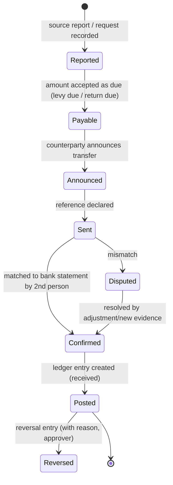
Only the **Posted** state changes a balance. *Reported / Payable / Announced / Sent* appear on the portal as "expected" or "on the way", never in the balance.

---


---


# 6. Authentication, Authorization and Privacy

## 6.1 Registration and verification flow
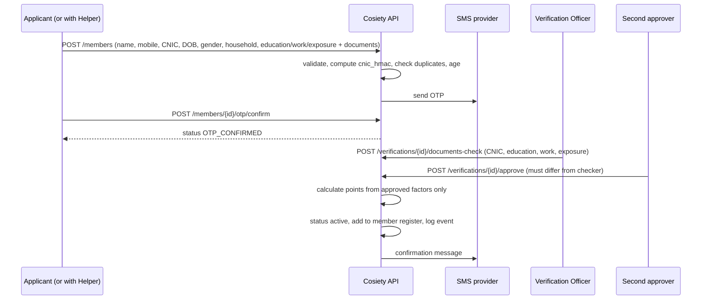
**DD-07:** *Identity verification* (a human, later maybe a provider, confirms who the person is) and *phone verification* (OTP) are separate statuses; *voting authorization* is a third, computed value: `Active ∧ identity approved ∧ age ≥ rule ∧ not voting-suspended`. None of them grants a role.

## 6.2 Login, sessions, recovery
* Login: mobile + OTP (default). Optional 4–6 digit PIN stored with Argon2id for faster return visits. Officers and admins: OTP **and** PIN (two factors); optional TOTP app.
* Sessions: opaque random token in `HttpOnly; Secure; SameSite=Lax` cookie, stored hashed in `core.session` (device label, IP hash, last seen); idle timeout 30 min (officers 10 min); revocable by user, admin or on suspension. CSRF double-submit token on state-changing requests.
* Recovery: lost phone → re-verification (OTP to new number + in-person check by two people); every recovery is logged and notified to the old number.
* Rate limits: per mobile and per IP on OTP send/verify; progressive back-off; SMS cost caps.

## 6.3 Authorization
* **RBAC with scoped, time-bound assignments** (`role_assignment`): permission = `(action, resource_type)` with scope `society | own | masked`. Co-president roles are created by the system from *certified election results*; team roles from the co-presidents' recorded appointments; both with `valid_to = term end` and they expire automatically (FR-EXC-006).
* One server-side policy function `authorize(user, action, resource)` is called by every route handler (middleware denies by default). A test enumerates every route and asserts a policy is declared.
* **Separation of duties** rules in a table (`sod_rule`): Treasurer ≠ expenditure approver; checker ≠ preparer; officer cannot act on a household-linked or conflict-declared item; a co-president's treasurer cannot share that co-president's household; expenditure entries prepared by one team are approved by the other team where possible; the Verification Officer cannot be a candidate in the contest being verified; VilloThar Ops Admin cannot confirm a transfer they declared.
* **Application administrators** (Cosiety Admin, VilloThar Ops Admin, System Admin) are distinct permission sets; none includes `approve` on money, `vote` on others' behalf, or `read` of ballots. System Admin has OS/database-operator access outside the app but no application credentials that decrypt business data.
* **Account suspension:** sets status, revokes sessions, removes voting authorization; reversible by two-person approval with reason.

## 6.4 Enforcing one ballot per voter with secrecy
Identity is established in §6.1; at vote time the voter re-authenticates (OTP step-up). Contest eligibility (gender rule) and weight are read from the frozen `vote.voter_snapshot`. The *primary key* of `vote_participation` prevents repeats. Secrecy comes from storing the *choice* in a different table with no member link (§7).

---

## 6.5 Handling of identity, points and document data
* **Three separate states** (DD-07): identity verified · points verified · voting authorised (computed). None creates an administrator.
* Education, work and exposure **documents** are stored in a private bucket, accessible only to the Verification Officer through logged, justified requests; thumbnails/ids only elsewhere. Documents are deleted per the retention schedule (OD-31); the decision and the points stay.
* Individual points are visible to the member, the Verification Officer and the Auditor; the public sees the formula and aggregate statistics only.
* Gender is used only for contest eligibility and aggregated statistics; it is never public per person.

---


# 7. Voting and Election Architecture

## 7.1 Model
An **election** has one or more **contests**. The co-president election has two contests: *woman co-president* (women candidates, women voters) and *man co-president* (men candidates, men voters) **[P]**. Levy, budget, project and recall votes are single-contest ballots. Each contest records its weighting (`points` or `equal`) and the formula version used.
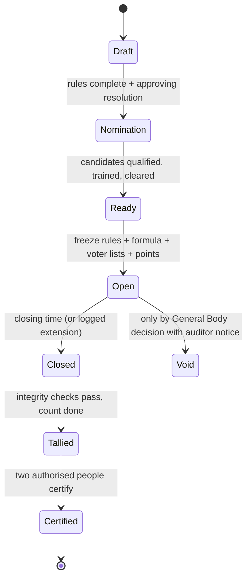

## 7.2 Pre-conditions for opening (all checked automatically)
* Required rule keys exist and link to an approving resolution: turnout minimum, quorum, tie rule, term parameters, formula version (OD-01, 11, 19, 18).
* No eligible voter has an **undecided points factor** (OD-03, OD-04); otherwise opening is blocked and voters are listed.
* Every candidate is qualified (OD-05), trained (OD-30) and within term limits (OD-08), and matches the contest's gender rule.
* Election Administrator and Verification Officer are not candidates in the contest.

## 7.3 Voter eligibility
A voter must be *Active*, identity-verified, aged at least the configured minimum, not voting-suspended, have fully approved points factors, and match the contest's gender rule. Members whose CNIC records another gender category are handled by the explicit mapping decided in OD-20; the system does not guess.

## 7.4 Snapshot freeze
At opening the system stores, per contest: the eligible voter list with each voter's points (computed with the chosen age basis, OD-18), the formula version, a hash of the configuration and a hash of the voter list. Counts and hashes are published; names are not (unless the society chooses). Later membership or points changes never affect that election.

## 7.5 Casting a ballot (steps)
1. Voter authenticates and passes an OTP step-up; assisted sessions follow §7.10.
2. The system checks: election open (database clock), voter in the contest snapshot, no participation record yet.
3. **In one transaction**: (a) write the participation record (contest, member, time, channel) — a second attempt fails because the pair is unique; (b) write *N* sealed ballot units, where *N* is the voter's snapshot points (1 for equal-weight ballots); (c) write the audit event "member voted" — never the choice.
4. Only after the transaction commits does the server tell the voter "recorded". If anything fails, nothing is stored and the voter may retry safely (idempotency key).

## 7.6 Secret ballot design with weighted votes **[REC]**
**Problem.** Points differ by person. If each ballot stored its weight next to the choice, a rare weight (e.g. 22) could point to a specific voter. Hiding names in the screen is not enough.

**Design (DD-04, DD-10).**
* **Points as ballot units.** A voter with 17 points casts 17 identical sealed units for their chosen candidate. No ballot carries a weight, a member id, a timestamp or a sequence number.
* **Sealed content.** Each unit holds the choice encrypted with an election key created at opening. The key is available only to the tally process after closing (optionally split among custodians such as the Election Administrator, the Auditor and a General Body representative).
* **Separation.** The participation register says *who voted*; the sealed store says *what was chosen*; nothing connects them.
* **Mixing at close.** Before counting, the sealed store is rewritten in random order and the original is discarded, so storage order cannot reveal casting order.
* **Integrity check.** Number of units must equal the sum of snapshot points of everyone who participated; mismatch blocks tallying (detects inserted or removed ballots without revealing anyone's choice).
* **Publication.** Totals per candidate, number of voters, turnout and quorum status; **no per-points breakdown**; no individual choice.
* **Anonymity warning.** If turnout in a contest is below a configured minimum group size, or a candidate's total equals exactly one voter's possible points, the system warns the Election Administrator (FR-ELE-011).

**Limits (honest).** A person controlling both the database host and the election key could attempt correlation using timing metadata; mitigations are key custody, observer-witnessed counting, separate credentials and the audit chain, but this risk is reduced, not eliminated (RK-06, RK-07). Very small electorates inherently reveal more from totals.

## 7.7 Quorum, turnout, result calculation
* **Quorum:** required = ceil(snapshot voter count × quorum fraction for the decision type); measured from participation records.
* **Minimum turnout:** per contest, from configuration (OD-01); below it the outcome is *No valid result*.
* **Score:** units per candidate = sum of points of the members who voted for them. **Winner = highest total points, not highest number of voters.**
* **Tie:** apply the configured rule (OD-19); if none, show *Tie – decision required*; no automatic winner.
* **Re-run:** the result function is deterministic and versioned; an independent script given to the auditor recomputes it from exported data.

## 7.8 Certification, publication, disputes, recounts
Two authorised people certify; publication shows turnout, totals, quorum status, formula version and rule hashes. A dispute record can be filed within a configured period; a recount repeats the deterministic count in the presence of the auditor/observers; the procedure and who may order it follow approved policy (OD-36). Certified results are immutable; a successful dispute produces a new, linked result record rather than an edit. Term start requires the training gate (FR-EXC-003).

## 7.9 Preserving integrity against an administrator

| Threat | Defence |
|---|---|
| Admin changes rules, formula or voter list after opening | Locked after opening; configuration and voter-list hashes published and re-verified by a scheduled job |
| Admin adds a voter or ballots | Participation needs a snapshot row; sealed units created only by the casting procedure; unit-count check |
| Admin deletes ballots/participation | Delete privileges revoked; unit-count check; daily digests sent to the auditor |
| Admin rewrites the audit log | Hash chain; daily head hash published and sent to auditor |
| Admin inflates someone's points | Points come only from officer-approved factors with second approval; formula public; points distribution reviewed before opening |
| Database/host operator tampers | Cannot be fully prevented by software: tamper-evident, not tamper-proof; separate credentials, key custody, observers |
| Pressure or vote-selling | Receipt says only "you voted"; no proof of choice; private kiosk practice; training |

## 7.10 Assisted voting
A Village Helper opens an assisted session on a shared device; the **voter authenticates with their own one-time code**; the helper's account has no permission to cast; screens use voice and icons; the voter touches their own choice; the session is wiped; the log records channel "assisted" and the helper's identity, never the choice. Further rules (who may be assisted, whether witnesses are allowed, how many sessions a helper may run) are OD-27.

## 7.11 Other ballots and recall
Levy, budget and project votes use equal weight by default (OD-02) with thresholds and quorum from configuration; secret by default (OD-32). Recall: a valid petition (signatures from verified members meeting the configured share, OD-16) automatically schedules a recall vote for the named co-president or team member.

## 7.12 Network interruptions
Casting uses an idempotency key and a status endpoint: after any interruption the app asks the server whether a ballot was recorded and shows the true answer. Ballots are never queued offline. If an outage disrupts voting, the Election Administrator may extend the window with a logged, published decision approved by a second person.

## 7.13 Configurability
Points table, age basis, turnout, quorum, thresholds, ties, term parameters, weighting per ballot type and contest gender mapping are all configuration. A future decision (e.g. extend points to levy votes) changes configuration and creates a new formula/rule version; historical elections keep their frozen rules.

---


# 8. Financial System Architecture

## 8.1 Structure
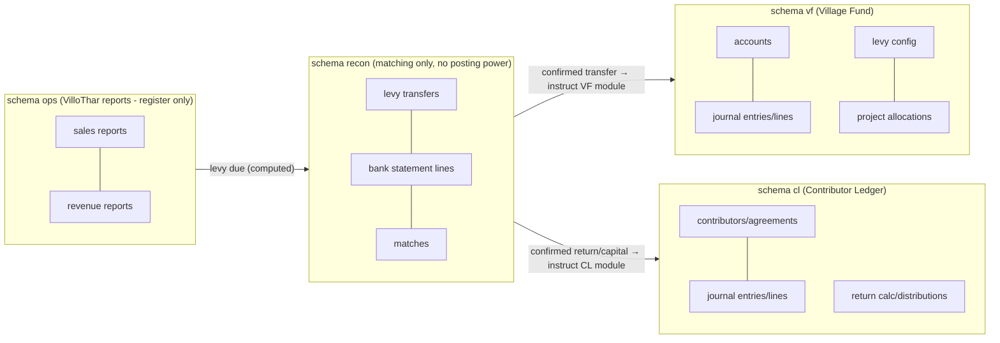
*The `recon` component never writes ledger rows itself; it calls the VF or CL module's `post()` interface, which validates and posts in that module's own schema.*

**DD-08 (idempotency and money rules):** every posting has an `idempotency_key` derived from the business event (e.g. `levy-transfer:T-004:confirmed`); retries return the same entry. Amounts in integer paisa at the API boundary. All postings in one DB transaction with the state change that caused them.

## 8.2 Workflow 1 – Package payment

| Aspect | Design |
|---|---|
| Actors | Member (or helper-assisted), VilloThar Ops Admin, payment channel [DEP] |
| Trigger | Member selects a package |
| Steps | Show price + levy + total → create `pay.purchase(initiated)` with idempotency key → payment via channel or recorded by VilloThar → status `paid` → purchase appears in VilloThar's sales report |
| DB changes | `pay.purchase` row & status transitions; later `ops.sales_line` rows (reported by VilloThar) |
| Validation | Package active; levy amount equals current approved `levy_configuration` at purchase date; one price for everyone; member active |
| Transaction boundary | Purchase creation and status change are each atomic; payment-gateway callback handled idempotently |
| Failure handling | `failed`/`pending` purchases do not count; a reconciliation job ages pending ones and alerts; gateway timeout → remains `pending` until confirmed |
| Audit | `purchase.created/paid/failed` |
| Notifications | SMS/portal receipt in Sindhi/Urdu |
| Note | The money is **VilloThar's collected money**; the levy part is recorded as **payable to Cosiety**, not as received (no VF entry yet). |

## 8.3 Workflow 2 – Village Fund transfer (levy)

| Aspect | Design |
|---|---|
| Actors | VilloThar Ops Admin (declare), Treasurer (confirm), a co-president (review on dispute) |
| Trigger | End of reporting period (schedule per OD-12) |
| Steps | 1 VilloThar submits sales/collection report (version n) → 2 system computes `levy_due = Σ paid_count × levy_at_purchase`, posts **Dr Levy due from VilloThar / Cr Levy income** in VF (money *payable*, not received) → 3 VilloThar declares transfer (reference, amount, date) → state `sent` → 4 Cosiety uploads bank statement; Treasurer matches line to transfer (second person confirms) → state `confirmed` → 5 posts **Dr VF Bank / Cr Levy due**; public ledger updates |
| DB changes | `ops.sales_report`, `recon.levy_transfer`, `recon.bank_statement_line`, `recon.match`, `vf.journal_entry/line` |
| Validation | Declared amount vs levy due; reference unique; bank line unique and unmatched; confirmer ≠ declarer |
| Transaction boundary | Step 5: match + state change + VF posting + outbox event in one transaction |
| Failure handling | Amount differs → `disputed`, difference shown as "unreconciled"; no bank line after N days → alert; wrong match → reversal entry |
| Audit | Each state change with actor and evidence |
| Notifications | Treasurers and co-presidents on overdue; public "levy transfer received" note |
| Rule | **A pending or initiated transfer is never counted as received (BR-22).** |

## 8.4 Workflow 3 – Infrastructure contribution

| Aspect | Design |
|---|---|
| Actors | Contributor, Treasurer, Cosiety Admin, VilloThar (invoice) |
| Trigger | Contributor wishes to contribute |
| Steps | Register contributor → create agreement (version, formula parameters, cap) and obtain acceptance record (document) → contributor pays to Cosiety **CL bank account** → bank line matched → `cl.contribution` + **Dr CL Bank / Cr Contributor capital (c)** → Cosiety pays VilloThar for equipment → **Dr Infrastructure paid for / Cr CL Bank** with `cl.infra_invoice` attached |
| Validation | Agreement exists and accepted before any payment is recorded; payment amount ≥ 0; invoice document hash stored; approver ≠ preparer; spending cannot exceed CL bank balance |
| Transaction boundary | One DB transaction per posting; document upload before posting (orphan files cleaned by worker) |
| Failure handling | Unmatched receipt stays in "unidentified receipts" (not credited to anyone) until resolved |
| Audit | Agreement acceptance, receipt, invoice, payment |
| Notifications | Contributor receives their own statement update; public aggregate changes only |

## 8.5 Workflow 4 – Contributor return distribution

| Aspect | Design |
|---|---|
| Actors | VilloThar Ops Admin (revenue basis), Treasurer (prepare), a co-president (approve), Contributors |
| Trigger | Period end with revenue report available |
| Steps | `ops.revenue_report` submitted → return pool determined **according to the agreement formula parameters (OD-25)**, bounded by cap → per-contributor amounts computed proportional to contributions → approval → **Dr Returns due from VilloThar / Cr Amounts due to contributor (c_i)** → VilloThar transfers the return amount, bank match → **Dr CL Bank / Cr Returns due** → distribution to each contributor: **Dr Amounts due to (c_i) / Cr CL Bank**, reference recorded |
| Validation | Sum of individual amounts = pool; no amount above cap; contributor active; payout account present; formula version stored |
| Failure handling | Short payment → distribute only after resolving per agreement (rule parameter), or pro-rata if the agreement says so; failed payout → stays "due" |
| Audit | Calculation inputs, formula version, approvals |
| Notifications | Each contributor sees own statement; public sees only totals |
| Note | The software does **not** decide how returns are legally classified; labels are neutral ("contribution return"). |

## 8.6 Workflow 5 – Village project expenditure

| Aspect | Design |
|---|---|
| Actors | Member (proposer), Executive, General Body, Treasurer (maker), a co-president of the other team (checker) |
| Trigger | Project proposal |
| Steps | Proposal → explainer → discussion → **vote** (thresholds from `gov.rule`) → *Approved* → `vf.project_allocation` created (≤ unallocated balance) → expense request with invoice → conflict check → maker–checker approval → payment recorded (**Dr Project spending / Cr VF Bank**) → receipt attached → public ledger shows → final report |
| Validation | Project state `approved/execution`; amount ≤ remaining project budget; approver has no declared conflict; evidence required above a configurable amount |
| Transaction boundary | Approval, posting and project budget update in one transaction |
| Failure handling | Over-budget → rejected; payment returned → reversal entry and new request |
| Audit | Full approval chain per expense |
| Notifications | The team publishes progress; members see updated project page |

## 8.7 Reconciliation
Weekly job and manual screen produce a **three-way comparison** for each period: (a) VilloThar-reported levy due, (b) declared transfers, (c) bank statement lines. Outcomes:

| Case | Treatment |
|---|---|
| a = b = c | Auto-ready for confirmation |
| b ≠ a | `disputed`; difference listed publicly as "being checked" |
| c missing | Stays `sent`; not in balance |
| c without b | "Unidentified receipt"; held outside both streams until classified by two people |
| Duplicate bank line | Rejected by unique key |
| Later correction by VilloThar | New report version; difference becomes an adjustment entry, never an overwrite |
The same logic applies to CL (capital receipts and return receipts) against the CL bank account. Monthly reports list unreconciled items.

## 8.8 Audit events (examples)
`purchase.paid`, `report.submitted`, `levy.due_posted`, `transfer.declared/confirmed/disputed`, `ledger.entry_posted/reversed`, `agreement.accepted`, `return.calculated/approved/paid`, `expense.requested/approved`, `rule.changed`, `election.opened/closed/certified`, `admin.break_glass_cnic_view`.

## 8.9 Allowances and reimbursements (pending OD-24)
The note says co-presidents receive no pay or a very small allowance and that real expenses (transport, phone) are reimbursed and published. Because the levy funds *approved projects only*, the design records every claim in `gov.expense_claim` with receipts and publishes it, but **does not post it to any ledger until the General Body decides the funding source (OD-24)**. Once decided, payment is posted in the chosen stream's ledger through the normal maker–checker path (claimant cannot approve own claim; approver from the other team).

---


# 9. API Design

## 9.1 Conventions
* **Base:** `/api/v1` (URL versioning; breaking changes → `/v2`, old version kept ≥ 6 months). JSON, UTF-8, ISO-8601 UTC, money as integer **paisa** plus display string.
* **Auth:** session cookie + CSRF header; officers also pass step-up. `/api/v1/public/*` needs no login and returns only public-level data from non-personal views.
* **Idempotency:** all money and vote `POST`s require an `Idempotency-Key`; same key = same result; a status endpoint reports the outcome after interruptions.
* **Pagination:** cursor style `?limit=25&cursor=…` with `{ "data": [], "next_cursor": "" }`; max 100.
* **Filtering/sorting:** `?filter[status]=active&filter[from]=2027-01-01&sort=-date`.
* **Errors:** `application/problem+json` with `type`, `title`, `status`, `code`, `detail`, `request_id`. Standard statuses: 400 validation, 401 not logged in, 403 not permitted, 404 not found (also where existence must not leak), 409 conflict/duplicate/state, 422 rule violation, 429 rate limit, 503 maintenance.

## 9.2 Endpoint catalogue

| ID | Method & path | Purpose | Auth / permission | Request (key fields) | Success | Validation / errors |
|---|---|---|---|---|---|---|
| API-01 | `POST /members` | Register applicant | public, rate-limited | name, mobile, CNIC, DOB, gender, household, factor declarations (education, work, exposure), consent | 201 `{member_id,status:"applicant"}` | CNIC 13 digits; age ≥ minimum else `not eligible`; duplicate → 202 *under review* (no leak) |
| API-02 | `POST /members/{id}/otp/confirm` | Confirm phone | token for that applicant | code | 200 | 400 wrong; 429 attempts |
| API-03 | `POST /members/{id}/documents` | Upload documents | applicant / helper (assisted) | file, factor | 201 | size/type limits; compressed |
| API-04 | `POST /verifications/{id}/documents-check` | Record document check | `verify.check` (Verification Officer) | per factor: approve/reject, note | 200 | 403 candidate-conflict |
| API-05 | `POST /verifications/{id}/approve` | Activate member | `membership.approve` | note | 200 `{status:"active"}` | 409 approver = checker |
| API-06 | `GET /me` · `PATCH /me` | Own profile and points | login | limited fields | 200 incl. points breakdown | CNIC/DOB/gender not editable |
| API-07 | `GET /members?filter…` | Masked directory | `members.read` | – | masked page | 403 ordinary members |
| API-08 | `POST /elections` · `POST /elections/{id}/open` | Create / open election | Election Admin (open needs 2nd person) | type, contests, window, rule refs | 201 / 200 `{config_hash,voter_hash,counts}` | 422 missing rules, undecided factors, ineligible candidates |
| API-09 | `POST /contests/{id}/candidates` | Apply as candidate | member | evidence refs | 201 | 422 wrong gender contest, term limit |
| API-10 | `GET /contests/{id}/ballot` | Ballot (icons, audio) | voter in snapshot | – | candidates + audio | 403 not eligible / wrong contest |
| API-11 | `POST /contests/{id}/votes` | Cast ballot | `vote.cast`, OTP step-up | `{choice_code}` | 201 `{recorded:true}` | 409 already voted; 409 not open; 422 invalid choice |
| API-12 | `GET /contests/{id}/vote-status` | Truthful status after interruption | voter | – | `{voted:true/false}` | 404 if not eligible |
| API-13 | `GET /elections/{id}/results` | Results and turnout | public after certification | – | totals, turnout, quorum, formula version | 404 until certified |
| API-14 | `POST /proposals` · `GET /proposals` · `POST /proposals/{id}/transition` | Project lifecycle | member / team | title, description, category, est_budget, effect | 201 + reference no. | order enforced → 422; explainer required before discussion |
| API-15 | `POST /proposals/{id}/questions` · `POST /questions/{id}/answer` | Public Q&A | member / team | text / answer | 201 | deadline stored |
| API-16 | `GET /public/ledger/vf?from&to&cursor` | Village Fund ledger | none | – | opening, in, out, balance, entries | VF only |
| API-17 | `GET /public/ledger/summary` | Three streams side by side | none | – | separate blocks, no grand total | – |
| API-18 | `POST /ops/sales-reports` | VilloThar weekly sales/collections | `ops.report.submit` | period, lines, file_hash | 201 `version:n` | overlapping period → new version |
| API-19 | `POST /packages/{id}/purchases` | Buy package | member | idempotency key | 201 `{price,levy,total,status}` | levy must equal approved levy |
| API-20 | `POST /levy-transfers` · `POST /levy-transfers/{id}/confirm` | Declare / confirm transfer | `transfer.declare` / `transfer.confirm` | reference, amount, period / bank line | 201 / 200 | confirmer ≠ declarer; mismatch → `disputed` |
| API-21 | `POST /contributors` · `GET /me/contributor` | Contributor profile | treasurer / own | profile, agreement | 201 | agreement required |
| API-22 | `POST /contributors/{id}/contributions` | Record capital | `cl.post` (maker) | amount, bank line, agreement | 201 | second approval to post |
| API-23 | `GET /me/contributor/payouts` | Own payouts | own only | – | list | 404 for others |
| API-24 | `POST /return-calculations` · `/approve` | Calculate / approve returns | treasurer / co-president | period, revenue report | 201 / 200 | approver ≠ preparer; limits enforced |
| API-25 | `POST /projects/{id}/expenses` · `/approve` | Request / approve expenditure | treasurer / co-president (other team) | amount, vendor, invoice | 201 / 200 | within budget; no conflict; approver ≠ preparer |
| API-26 | `GET /audit/export?scope=…` | Auditor export | `audit.export` | scope, period | signed file | access logged |
| API-27 | `POST /issues` · `PATCH /issues/{id}` | Community issues | member / team | category, place, text, visibility | 201 | attachment limits |
| API-28 | `POST /notices` · `/publish` | Notices and videos | team member | text sd/ur/en, media | 201 / 200 | published version immutable |
| API-29 | `GET /public/reports/monthly/{yyyy-mm}` | Monthly report | none | – | report + PDF | 404 until published |
| API-30 | `GET /public/points-formula` | Public formula and version | none | – | table, version, status | – |
| API-31 | `GET /me/points` | Own points and factors | login | – | factors, total, formula version | pending factors flagged |
| API-32 | `POST /formulas` · `/formulas/{id}/approve` | Draft / approve formula | Portal Admin (dual control) | tables, resolution ref | 201 / 200 | resolution required; overlapping bands rejected |
| API-33 | `POST /members/{id}/reverify` | Re-verification of a factor | Verification Officer | factor, evidence | 200 | logged reason |
| API-34 | `POST /terms/{id}/team` | Co-president names team | co-president | member ids, roles | 201 | 422 household rule, treasurer household |
| API-35 | `POST /candidates/{id}/training` | Record training/test | Verification Officer | material version, result | 201 | pass mark rule |
| API-36 | `POST /petitions` · `POST /petitions/{id}/sign` | Recall petition | member | target, reason | 201 | one signature per member |
| API-37 | `POST /coi-declarations` | Conflict declaration | member in office | kind, text | 201 | – |
| API-38 | `POST /expense-claims` · `/approve` | Allowance/reimbursement | office holder / approver | amount, receipt | 201 / 200 | source of funds pending OD-24 |
| API-39 | `PUT /config/rules/{key}` | Change rule parameter | Portal Admin (dual control) | value, resolution ref | 200 | no resolution → 422 |
| API-40 | `POST /role-assignments` | Assign role with dates | Portal Admin | user, role, from, to | 201 | auto-expiry |

## 9.3 Example – Member registration
```http
POST /api/v1/members
{ "full_name": "…", "mobile": "+92…", "cnic": "…", "date_of_birth": "1990-05-04",
  "gender": "female", "household_id": null, "new_household_name": "…",
  "factors": { "education": "bachelor_plus", "work": "private_or_self_employed", "exposure": "big_city" },
  "consent_version": "2027-01", "language": "sd" }
```
`201 Created` → `{ "member_id": "…", "status": "applicant", "next": "otp_confirm" }`. Errors: 400 `VALIDATION`, 422 `NOT_ELIGIBLE_AGE`, 429 `OTP_RATE_LIMIT`, 202 `UNDER_REVIEW` (duplicate; neutral).

## 9.4 Example – Cast vote
```http
POST /api/v1/contests/9f2…/votes
Idempotency-Key: 7c1…
{ "choice_code": "CAND_03", "otp": "482913" }
```
`201 { "recorded": true }` — response and logs contain no choice. Errors: `409 ELE_ALREADY_VOTED`, `403 ELE_NOT_ELIGIBLE`, `409 ELE_NOT_OPEN`. After an interruption: `GET /contests/9f2…/vote-status` → `{ "voted": true }`.

## 9.5 Example – Declare and confirm a levy transfer
```http
POST /api/v1/levy-transfers
{ "period_start":"2027-03-01","period_end":"2027-03-07","reference_no":"IBFT-77231","amount_paisa":1235000 }
→ 201 { "id":"T-004","state":"sent","expected_paisa":1235000,"difference_paisa":0 }
POST /api/v1/levy-transfers/T-004/confirm   { "bank_statement_line_id":"…" }
→ 200 { "state":"confirmed","ledger_ref":"VF-2027-0031" }
```

## 9.6 Security notes
Server-side authorisation on every route; schema validation at the edge; response filtering by role (no CNIC anywhere); `/public/*` served from non-personal views; OpenAPI generated and contract-tested.

---

# 10. User Interface and Experience

## 10.1 Principles
Welcoming and village-oriented, not a corporate dashboard: large cards, big icons, plain Sindhi/Urdu words ("Money received", "Money spent", "Your vote"). One main task per screen. Every key screen: **icon + short text + "listen" button**. Colour never the only signal. Touch targets ≥ 48 px, text ≥ 16 px, high contrast. First load < 300 KB; "text only" mode. Clear confirmation after every important action.

## 10.2 Multilingual approach
Sindhi, Urdu and English resource files; right-to-left layout for Sindhi/Urdu using direction-independent spacing; web font subset covering Sindhi letters; pre-recorded Sindhi/Urdu audio per screen and ballot option (speech synthesis only as fallback); language chosen at first visit and remembered; every notice/video carries sd/ur/en versions with translation status.

## 10.3 Navigation structure
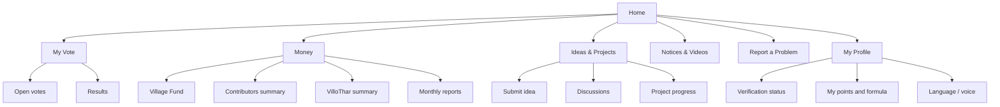
Role areas appear as extra tabs: **Leadership** (co-presidents/team), **Treasurer**, **Verification**, **Elections**, **Contributor**, **Helper**, **Auditor**, **Admin**.

## 10.4 Screens (summary)

| Screen | Contents |
|---|---|
| Public home | What Cosiety is; public Village Fund summary; notices; join button; language |
| Registration | 4-step progress; details; education/work/exposure with document upload; OTP; helper-assisted option |
| Member dashboard | Open votes, money summary, my package + levy, notices, my ideas/issues |
| Member profile | Status, factors, points and formula version, consent, language |
| General Body dashboard | Agenda, meetings, resolutions, results |
| Election interface | Own contest only; candidate cards with photo, symbol, audio; confirm; "recorded" screen |
| Financial dashboard | Three separate panels (Village Fund / Contributors summary / VilloThar reported) with the line "these are separate accounts"; pending vs received styled differently |
| Contributor dashboard | Own capital, agreement, statements, payouts (confidential) |
| Project proposal / tracking | Lifecycle strip (Idea → Reviewed → Explained → Talking → Vote → Approved → Doing → Report); video; question box; receipts |
| Public ledger | Balance, in/out, monthly statements, reversals shown |
| Notices and videos | Library with audio-only option and text summary |
| Executive (leadership) dashboard | Pending proposals, questions with deadlines, team appointments, approvals waiting, accountability scorecard |
| Treasurer dashboard | Reconciliation board (reported / sent / confirmed / disputed), entries to prepare, expense requests, month-end checklist |
| Verification dashboard | Document queue, points factors, candidate qualifications, training records |
| Election Administrator dashboard | Setup checklist, opening gate (blocking reasons), integrity checks, certification |
| Village Helper | Assisted registration queue, kiosk mode |
| Auditor | Read-only browser, exports, integrity checks |
| Administrator | Rules with resolution references, roles and dates, system health (no business data for system admin) |

---

# 11. Reports and Dashboards

| Report | Contents | Audience | Source modules |
|---|---|---|---|
| Public Village Fund dashboard | Balance, in/out, per-project budget vs spending | **Public** | DC-VF |
| Financial summary (three streams side by side) | Separate blocks, no grand total | **Public** | DC-VF, DC-CL (aggregate), DC-OPS |
| Monthly income and expenditure report | Money in, out, balance per stream; unreconciled items | **Public** | DC-AUD |
| Contributor statement | Own capital, returns, payouts | **Contributor only** | DC-CL |
| Contributor aggregate | Totals only | **Public** | DC-CL |
| Election report | Turnout, quorum status, totals, formula and rule versions, certification | **Public** | DC-ELE |
| Voter-list integrity (hashes, counts) | Hashes and counts | **Public** | DC-ELE |
| Points distribution check | Distribution of totals, anomalies | **Auditor / Election Administrator** | DC-PTS |
| Project progress report | Budget, expenses, receipts, status | **Public** | DC-PRJ |
| Annual audit report | Full audit with responses | **Public** | DC-AUD |
| Membership statistics | Totals, verified, by gender (aggregate) | **Public** | DC-MEM |
| Package collection report | Sales, levy due, failed/pending | **Executive and treasurers; summary public** | DC-OPS, DC-PAY |
| Reconciliation report | Reported vs declared vs bank | **Treasurers, co-presidents, Auditor** | DC-REC |
| Administrative activity report | Privileged actions | **Auditor only** | DC-AUD |
| Participation history | Own participation | **Member only** | DC-MEM |

---


# 12. Security Architecture

| Area | Design |
|---|---|
| Authentication | §6; OTP + optional PIN (Argon2id); back-off and lock-out; officers use two factors |
| Authorization | Central policy function, deny by default; separation-of-duty table; row-level security by society |
| Encryption | TLS 1.2+/HSTS; field encryption for CNIC, contributor contacts, payout accounts; document store encrypted; backups encrypted; keys in a secrets store with rotation procedure |
| API protection | Rate limits, request-size limits, CORS allow-list, security headers, request ids |
| Input validation | Schema validation at every route; parameterised queries only |
| Injection / XSS / CSRF | Bound parameters; output escaping and sanitised rich text with strict content policy; SameSite cookies + CSRF token |
| Audit logging | Hash-chained log; daily head hash published to auditor and public integrity page; alerts on privileged actions |
| Backup security | Encrypted, access-restricted, restore drills; no access for VilloThar |
| Secrets | Not in source control; per-environment; rotated after staff changes |
| Administrative access | Named accounts, two factors, break-glass (two people, logged, time-boxed) for any CNIC/document view |
| CNIC and documents | Never in logs, URLs, exports or notifications; masked display; decrypt only via break-glass or Verification Officer's logged review; retention per OD-31 |
| Points data | Visible to the member, Verification Officer, Auditor; public sees formula and aggregates |
| Voting records | §7: participation separate from sealed ballots; no choice in logs; separate database role for `vote`; election key custody |
| Financial transactions | §8: append-only, maker–checker, idempotency, separate streams |
| Contributor profiles | Field encryption; owner, treasurer (function-limited) and auditor (masked) only |
| Bank references | Unique constraints; truncated on public views |
| Supply chain | Locked dependencies, vulnerability scan in CI, minimal images |
| Monitoring | Failed-login spikes, OTP abuse, unusual admin actions, hash-chain failures, unit-count mismatches in elections |

---


# 13. Deployment and Infrastructure Architecture

## 13.1 Environments

| Env | Purpose | Data |
|---|---|---|
| Development | Developer machines (Docker Compose) | Synthetic only |
| Staging | Same stack as production; UAT; mock SMS | Synthetic/anonymised; **never real CNIC, documents or ballots** |
| Production | Live | Real |

## 13.2 Hosting
Single VPS with Docker Compose (Caddy, api, worker, PostgreSQL) for the pilot; separate managed object storage; upgrade path: separate DB host, then read replica. Resource sizing validated by load test (§14).

## 13.3 CI/CD
GitHub Actions: lint → unit tests → integration tests with ephemeral PostgreSQL → build images → deploy staging → smoke tests → manual approval → deploy production with migration step (forward-only, reviewed). Rollback: previous image + migration down-script or restore point. No deployments during open elections (freeze calendar).

## 13.4 Domain and separation from VilloThar
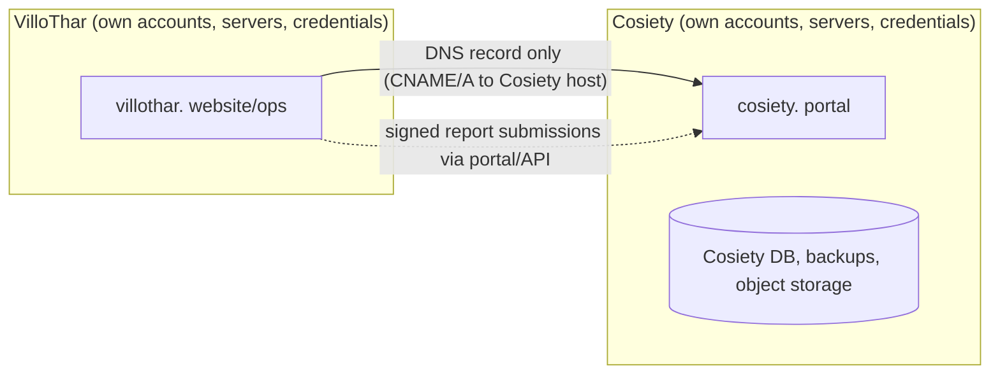
* The subdomain is **just a DNS pointer** (or delegated NS records) to Cosiety's host. VilloThar's DNS admin can *redirect* the name but cannot read Cosiety data; for continuity the society should register its own domain once registered (recommended roadmap item), and the MoU should say who controls the name.
* Separate: hosting account, SSL private keys, database credentials, Git organisation, CI secrets, backup storage, and admin users. No shared database; no VilloThar network access to Cosiety DB.
* Information flows: VilloThar → Cosiety (weekly sales/collection records, transfer declarations) through authenticated submission; Cosiety → VilloThar only what VilloThar needs (levy due summary), nothing about members' identities or votes.
* Deployment permissions: only Cosiety-appointed System Admin(s); VilloThar staff receive a *VilloThar Ops Administrator* application role, nothing at server level.

## 13.5 Backups, monitoring, disaster recovery

| Item | Design |
|---|---|
| Backups | Nightly full + continuous WAL; retention 30 days daily / 12 months monthly *(proposed)*; off-site, encrypted, tested restore quarterly |
| Monitoring | Uptime probe, CPU/disk/memory, DB size, queue depth, certificate expiry, hash-chain verification |
| Error reporting | Central error tracker with PII scrubbing |
| DR | RPO ≤ 24 h, RTO ≤ 8 h *(proposed)*; documented rebuild from Git + backup on a new VPS; copy of runbook printed with officers |


## 13.6 Environment configuration, updates and scalability
* **Configuration:** environment variables and a secrets store per environment; policy values (points table, quorum, etc.) live in the database as versioned rules, not in deployment files.
* **Updates:** monthly dependency/security patching window; database migrations forward-only and reviewed; no deployment during an open election; release notes in Sindhi/Urdu for visible changes.
* **Scalability:** vertical first (larger VPS), then separate database host and read replica; media on object storage/CDN; a second society needs configuration (new `society_id`, bank accounts, rules), not new infrastructure.

## 13.7 Behaviour during network interruptions

| Situation | Behaviour |
|---|---|
| Connection lost while reading | Cached public pages shown with an "as of" date |
| Connection lost while filling a form | Draft kept on the device; resumes later |
| Connection lost after pressing Vote or Pay | App shows "checking…", asks the server for the true status (vote-status / purchase status) and never resubmits blindly; the idempotency key makes a retry safe |
| Server restarts mid-transaction | Transaction rolls back; no half-recorded ballot or ledger entry |
| Outage during an open election | Window may be extended by a logged, published decision with a second approver |
| Webhook or report delivered twice | Duplicate ignored via idempotency key / unique reference |

---


# 14. Testing Strategy

| Level | Scope | Tools |
|---|---|---|
| Unit | Rule engines (quorum, thresholds, turnout, ties, household/term), points calculation, weighted tally, levy split, return formulas | Vitest/Jest |
| Integration & DB | Constraints, triggers, RLS, transactions, migrations, role privileges | Jest + ephemeral PostgreSQL; pgTAP optional |
| API | Contract tests from OpenAPI, permissions per route | Supertest/Schemathesis |
| Frontend | Components, RTL rendering, accessibility checks | Testing Library, Playwright, axe |
| Security | OWASP ASVS-based checks, dependency audit, authorization fuzzing | ZAP, npm audit |
| Voting integrity | See below | custom suite |
| Financial reconciliation | See below | custom suite |
| Accessibility and multilingual | Sindhi/Urdu rendering, RTL, audio availability, keyboard/screen-reader checks | axe, manual review with native speakers |
| Backup and recovery | Restore drills, chain verification after restore | scripted drills |
| Performance | 300 concurrent voters; ledger paging; low-bandwidth profile (throttled 1 Mbps, 300 ms) | k6, Lighthouse |
| Usability | Sessions with villagers, women's groups, helpers; mock vote | Observation, task success rate |
| UAT | Treasurer month-end close; contributor statement; full mock election | Checklists |

**Special scenarios**

| ID | Scenario | Expected |
|---|---|---|
| TC-01 | Same voter submits twice concurrently from two devices | One succeeds; one gets `ELE_ALREADY_VOTED`; ballot units equal voter points |
| TC-02 | Cast with network drop after server commit | Status reflects recorded; no second ballot |
| TC-03 | Admin tries SQL/API update of election window or snapshot after open | Rejected; attempt logged; hash check unchanged |
| TC-04 | Query joins participation and sealed ballots | No common key; no member id, weight, timestamp or sequence in ballots; order randomised at close |
| TC-05 | Edit/delete a ledger line (as app role, as DB owner role) | Blocked by revoked privileges/trigger; only reversal works |
| TC-06 | Post VF entry to CL account (direct and via crafted API) | Rejected; no FK path; separate roles |
| TC-07 | Sent-but-unconfirmed transfer | Not in balance; shown as "on the way" |
| TC-08 | Treasurer approves own entry | Blocked |
| TC-09 | Ordinary member/contributor/helper requests CNIC via API, export, log search | Not present anywhere; 403/404 |
| TC-10 | Contributor with large capital nominates / votes | Same as any member; no extra role created |
| TC-11 | Levy set above cap | Rejected |
| TC-12 | Duplicate payment callback | One purchase, one levy-due posting |
| TC-13 | Bank statement import re-uploaded | Duplicate lines rejected |
| TC-14 | Hash-chain tamper (modify an old audit row in a test DB) | Verification job fails and alerts |
| TC-15 | Team appointment with two members from one household; treasurer from the co-president's household | Appointment blocked |
| TC-16 | Restore from backup into staging | Ledgers balanced; hash chain intact |
| TC-17 | Woman member requests the man contest ballot, and vice versa | Denied; only own contest visible |
| TC-18 | Points calculation with the proposed table: Bachelor/28/Govt/Big city; all maxima | 17; 22 |
| TC-19 | Election opening with an undecided points factor | Blocked, voters listed |
| TC-20 | Candidate with 40 voters/150 points vs 25 voters/160 points | Candidate with 160 points wins |
| TC-21 | Turnout below minimum; tie without rule | *No valid result*; *Decision required* |
| TC-22 | Insert or delete a sealed ballot unit directly | Unit total ≠ Σ participant points → tally blocked |
| TC-23 | Unverified points factor | Not counted; member shown as pending |
| TC-24 | Village Helper tries to read choices or cast for a member | Denied |
| TC-25 | Co-president-elect without passed Presidency test | No office permissions |
| TC-26 | Levy or project vote before OD-02 decision | Equal weight |
| TC-27 | Expense approved by same team and by conflicted member | Blocked; cross-team checker required where configured |
| TC-28 | Points distribution with a rare value in a small electorate | Anonymity warning raised; totals-only publication |

---


# 15. Maintenance and Future Expansion

| Phase | Architecture state |
|---|---|
| 1 One village | One `society` row (Pabohar); all code already uses `society_id` and row-level security |
| 2 Governance and elections | Points engine, election module, terms and teams active |
| 3 Projects, levy, audit | VF/CL fully active; auditor role |
| 4 More villages and federation | New society rows, each with its own members, rules, ledgers, accounts; a `federation` schema added later (societies as members, **equal say per society**, no pooled money) |

* **Configurable governance:** points table, thresholds, turnout, terms, team size — all versioned rules; historical elections keep their frozen rules.
* **Historical integrity:** nothing financial or electoral is edited or deleted; new rules add new versions; migrations are forward-only and reviewed.
* **New services, languages, reports:** new modules behind interfaces; language resource files; reports as views over append-only data.
* **Future VilloThar systems:** `OpsFeedPort` adapter can switch from file/form submission to an API without touching ledgers.
* **Maintenance routine:** semantic versioning; quarterly dependency updates; yearly restore drill; handover guide; module owners; few dependencies to keep running costs low.

---

# 16. Implementation Roadmap

Follows the four phases of the design note. **Prepared architecturally in Phase 1 but activated later:** formula/rule tables (empty), election and contest tables, team/term tables, `society_id`, role assignment with dates, the `recon` and approval workflow, federation placeholders (no active feature).

## Phase 1 – With the internet pilot (MVP)

| Item | Detail |
|---|---|
| Scope | Member register (OTP + manual document verification), contributor profiles and agreements, public ledger (VF, CL aggregate, VilloThar-reported), weekly sales and collection records, levy-transfer declaration/confirmation, notices, audit log, monthly report |
| Modules | DC-AUTH, DC-MEM, DC-PTS (data capture; formula as *draft*), DC-CL, DC-VF, DC-OPS, DC-REC, DC-PAY, DC-NOT, DC-AUD, DC-ADM, DC-UI |
| Dependencies | SMS provider (AD-03); hosting; Cosiety bank account (OD-15); VilloThar record format (AD-07); contributor agreements (AD-10); registration started (OD-14) |
| Stakeholder responsibilities | VilloThar: weekly records, transfers, start-up support; Founders: bank account, agreements, interim verification arrangement (OD-06); Village Helper: assisted registration |
| Required data | Member details, education/work/exposure factors and documents, contributor profiles, weekly sales/collections, bank statements |
| Acceptance criteria | AC-AUTH-01..05, AC-PTS-01/02/04, AC-FIN-01..04, AC-PAY-01/02, AC-LED-01, AC-CON-01, AC-AUD-01 (read access), usability pilot (NFR-USE-004) |
| Risks | RK-02, 03, 04, 13, 14, 15, 16 |
| Deployment | Production at pilot launch; backups and restore drill passed first |
| Exit conditions | Register covers agreed share of adults; first monthly report published; first reconciliation completed with no unexplained items |

## Phase 2 – After users exist

| Item | Detail |
|---|---|
| Scope | Voting engine, points calculation locked to approved formula, gender-specific co-president contests, candidate qualification and training records, agenda submission, issue reporting, video library, first election, teams and terms |
| Modules | DC-ELE, DC-PTS (approved), DC-GOV, DC-COM, DC-NOT (video) |
| Dependencies | OD-01, 02, 03, 04, 05, 11, 18, 19, 20, 22, 27, 30, 32, 34, 36 decided; Presidency Book finished; audio/video produced |
| Stakeholder responsibilities | First General Body: approve rules; Verification Officer: qualification and points; Election Administrator: run and certify; Auditor: observe |
| Required data | Verified voters with approved points, candidates' evidence, training results |
| Acceptance criteria | AC-ELE-01..09, AC-PTS-03/05, AC-EXC-01..04, AC-HLP-01, voting integrity and load tests |
| Risks | RK-06, 07, 08, 09, 18, 19 |
| Deployment | Election-readiness checklist; deployment freeze during voting |
| Exit conditions | First election certified with passing integrity checks; terms started; leadership page live |

## Phase 3 – After the first election

| Item | Detail |
|---|---|
| Scope | Levy vote, Village Fund management, first project (proposal → explainer → discussion → vote → execution → report), expenditure records, recall, conflict declarations, returns calculation, audit |
| Modules | DC-PRJ, DC-VF (levy, allocations), DC-CL (returns), DC-GOV (recall, COI, expense claims), DC-AUD |
| Dependencies | OD-02, 05→09, 10, 11, 12, 13, 16, 17, 24, 25 decided; auditor appointed |
| Stakeholder responsibilities | Co-presidents and teams: run the project; Treasurers: ledger; Auditor: annual audit; General Body: votes |
| Required data | Levy approval, project proposals, invoices, receipts, agreements and revenue figures |
| Acceptance criteria | AC-FIN-03/05, AC-PRJ-01/02, AC-AUD-02, expenditure and recall tests |
| Risks | RK-10, 11, 12, 19, 21 |
| Deployment | Audit-ready release; auditor access tested |
| Exit conditions | First project closed with public report; first independent audit published |

## Phase 4 – After one village works

| Item | Detail |
|---|---|
| Scope | Second village, multi-society hardening, federation (equal say per society), events, competitions, shared learning |
| Modules | DC-ADM (society onboarding), new federation module, shared content library |
| Dependencies | Pabohar society stable; rules and MoUs for the new society; per-society keys and bank accounts |
| Stakeholder responsibilities | Societies' representatives; Federation Administrator |
| Required data | New society configuration, members, rules |
| Acceptance criteria | Tenant-isolation tests; no cross-society data leakage; federation votes one per society |
| Risks | RK-20, 22 |
| Deployment | Staged rollout, separate backups and keys per society |
| Exit conditions | Society #2 operating independently with its own elections and ledgers |

**MVP vs later:** the MVP excludes voting, points-weighted elections, levy changes, expenditure approvals, recall, auditor tooling, automated payments and federation.

---

# 17. Design Risks

| ID | Risk | Mitigation in design |
|---|---|---|
| DR-01 | Weighted secret ballot could reveal voters | Points-as-units ballots, no weights stored, shuffle at close, totals-only publication, anonymity warning (§7.6) |
| DR-02 | Points inflation or document fraud | Officer-approved factors with second approval, public formula, distribution review |
| DR-03 | Complex rules misconfigured | Opening gate checks, versioned rules with resolution links, rehearsal elections |
| DR-04 | Single maintainer dependency | Simple stack, handover guide, documented API |
| DR-05 | Reconciliation backlog | Weekly job, disputed states, public "being checked" label |
| DR-06 | Platform choice (e.g. document database) weakens constraints | Reference design is relational; Appendix A lists compensating controls if a non-relational platform is used |
| DR-07 | Sensitive documents breach | Encryption, logged access, short retention |
| DR-08 | Voice/audio quality in Sindhi | Recorded audio first, synthesis only as fallback; test with native speakers |

---

# 18. Consistency Review

| Question | Answer |
|---|---|
| Every principle has a requirement? | Yes – SRS §11. |
| Every critical FR has a design? | Voting §7, finance §8, points §4/§5, auth §6, UI §10, security §12. |
| Streams separated? | Separate schemas/roles, no cross-stream links, `recon` cannot post (§5, §8). |
| Every transaction traceable? | Journal references, source ids, idempotency keys, hash-chained audit, bank match. |
| Each voter votes once, and the vote is their own? | Participation key per contest + OTP step-up + helper limits (§7.5, §7.10). |
| Secrecy with weighted votes? | §7.6; residual limits stated. |
| Low literacy and bandwidth? | §10, §13.7. |
| Independence from VilloThar? | §13.4. |
| First village without federation? | §15. |
| More villages without rebuild? | `society_id`, RLS, per-society configuration. |
| Honest limits | Software cannot stop a host-level operator from tampering; it makes it detectable. Legal classification of returns, legality of weighted votes/gender contests are **not decided or verified here**. |

---

# Appendix A – Google AI Studio Build Guide

**Purpose.** If the team will generate the application with Google AI Studio's Build mode, this appendix states what the platform is understood to provide, how the reference design maps onto it, and how to prompt in controlled steps. *Capabilities of Build mode change; verify each item in the current product before relying on it.* As of the sources consulted, Build mode creates web apps with a full-stack runtime (React frontend; Node.js backend), a one-click Firebase integration (Firestore database, Authentication) and deployment, and can sync with GitHub.

## A.1 Decision needed
The master prompt and this SDS specify a **relational** database. Build mode's native database is **Firestore (document store)**. Choose before building:

| Option | Notes |
|---|---|
| **A. Firestore-first** (fits Build mode) | Fastest start; requires the compensating controls in A.3 because Firestore has no foreign keys, check constraints, triggers or row-level security |
| **B. Relational reference design** | Build the front end and API with AI Studio, but host PostgreSQL elsewhere; verify the platform can connect to it; more setup |
Recommendation **[REC]**: if the pilot stays small and the team accepts the controls below, A is workable for Phase 1; revisit before the first election (Phase 2) because ballots and ledgers are the least forgiving parts.

## A.2 Mapping (Option A)

| Reference design | Firebase mapping |
|---|---|
| Schemas (`vf`, `cl`, `ops`, `recon`) | Separate top-level collections under `societies/{societyId}/…` with prefixes `vf_`, `cl_`, `ops_`, `recon_`; **only the server (Admin SDK) writes them**; security rules deny all client writes |
| Unique CNIC / mobile | Index documents whose **document id is the keyed hash / number** (created in a transaction; a second create fails) |
| One ballot per voter per contest | Participation document with deterministic id `contestId_memberId`, created inside a transaction |
| Ledger balance check | Server transaction writes the entry, its lines and the account balance documents together and verifies debit = credit before commit; entries are create-only |
| Append-only | Security rules allow create but not update/delete; server code never updates entries; audit chain head per stream in separate documents (avoid one hot document) |
| Row-level security | Society id in every path; rules and server checks verify the caller's society claim |
| Roles | Role assignments with dates; claims set by the server; rules check role + validity |
| Jobs | Scheduled cloud jobs (term expiry, reconciliation reminders, election close, chain verification) |
| Files | Private cloud storage with signed URLs |
| Secrets | Platform secrets store; election key accessible only to the tally job |
| Backups | Scheduled exports/point-in-time recovery copied to a second account |

## A.3 Compensating controls and cautions (Option A)
* Firestore records create/update times as metadata that administrators can read; therefore **ballot units must be encrypted and written without voter-linked fields, and mixed at close** (§7.6). Do not store the choice in plain text.
* No triggers or checks in the database: **all validation lives in the server**, so write automated tests for every constraint K-1…K-14 (TC list in §14) and run them against the emulator before each release.
* Avoid hot documents (one document updated by every voter); use per-voter documents and counters computed at tally.
* Document-store queries are limited: precompute public ledger summaries as server-written public documents (no personal fields).
* Keep a documented export of all collections for the auditor.
* Pricing is per operation: design list screens with pagination and summary documents.
* Phone login via the platform's built-in service may behave differently from a local SMS gateway in Pakistan; test delivery, cost and fallback before relying on it (AD-03).

## A.4 Standing rules (paste at the start of the build session)
1. Source of truth: attached SRS and SDS. Do not invent policy: points table, quotas, thresholds, caps, terms, turnout, ties are **configuration values that start empty or as drafts**.
2. Never combine Village Fund, Contributor Ledger and VilloThar records. Never edit or delete ledger entries; use reversals.
3. Never store CNIC, documents or gender in public data; never log ballot choices.
4. Every important action must show a truthful result; never show a vote or payment as complete before the server confirms.
5. All UI text in Sindhi, Urdu and English files; right-to-left for Sindhi/Urdu; every key screen has icon + text + listen button.
6. Change only what the current step asks; list files changed; do not refactor earlier steps.

## A.5 Build sequence (one prompt per step; each lists scope and exclusions)

| Step | Prompt scope | Do **not** build in this step | Check before moving on |
|---|---|---|---|
| 0 | Project skeleton, language files, theme, RTL, PWA shell, navigation per §10.3 | Any business logic | Sindhi/Urdu render; light first load |
| 1 | Registration, OTP, verification workflow, points *capture* (factors, documents), member register (SRS AUTH, MEM, PTS-001..003) | Elections, ledgers | AC-AUTH-01..05; AC-PTS-01/02/04 |
| 2 | Roles, assignments with dates, configuration with resolution references, audit chain (ADM, AUD-005) | Voting | Role tests; chain verification |
| 3 | VilloThar weekly records, package list with price/levy split, levy due (OPS, PAY) | Payment gateway | AC-PAY-01/02 |
| 4 | VF ledger, CL ledger with agreements, reconciliation and transfer states, public ledger (FIN, LED, CON) | Projects, returns | AC-FIN-01..04; AC-LED-01; AC-CON-01 |
| 5 | Notices, monthly report, public pages (NTC, AUD-001) | Video library | Audience rules (§11) |
| — | **Phase 1 review with Auditor and stakeholders before continuing** | | |
| 6 | Points formula engine, candidate applications, training records, teams (PTS, EXC) | Voting | AC-PTS-01..05; AC-EXC-02/03 |
| 7 | Election engine: contests, snapshot, casting, sealed ballot units, mixing, tally, certification, assisted mode (ELE, HLP) | Levy/project ballots | AC-ELE-01..09; TC-17..24, 28 |
| 8 | Agenda, issues, public questions, video library | Projects | AC-AUD-02; AC-NTC-01 |
| 9 | Project lifecycle, levy vote, allocations, expenses with cross-team approval, recall, COI, returns (PRJ, FIN, EXC, CON) | Federation | AC-PRJ-01/02; AC-FIN-03/05 |
| 10 | Auditor tooling and exports | – | AC-AUD-01 |

Review rule: a human developer must read and test the money, voting and permission code of steps 4, 7 and 9 line by line; AI-generated code is not accepted on appearance.

---

# Appendix B – Glossary and References

**Glossary:** see SRS §18. Additional: *Ballot unit* – one sealed unit representing one vote point; *Sealed ballot* – encrypted choice with no voter link; *Participation register* – record that a member voted, never the choice; *Contest* – one gender-specific election; *Snapshot* – frozen voter list and points; *Formula version* – numbered points table; *Hash chain* – each log entry includes the hash of the previous; *Break-glass* – exceptional, logged, two-person access; *RLS* – row-level security; *PWA* – progressive web app; *Idempotency key* – unique id that makes retries safe.

**References:** (1) Cosiety Design Note, Draft v1, 16 Nov 2026 (revised). (2) Cosiety SRS content version 1.1. (3) PostgreSQL documentation (constraints, row-level security, roles). (4) OWASP ASVS and Top 10. (5) WCAG 2.1. (6) Sindh Co-operative Societies Act 2020 and Cooperative Department Sindh – legal matters in SRS §16 need professional review. (7) Google AI Studio Build mode documentation (ai.google.dev/gemini-api/docs/aistudio-build-mode) – verify current capabilities.
