# Cosiety – Software Design Specification (SDS)

| | |
|---|---|
| **Project** | Cosiety – Digital Village Cooperative Society |
| **Document** | Cosiety_SDS_v1.0 |
| **Version** | 1.0 (Draft for stakeholder review) |
| **Prepared** | 16 November 2026 |
| **Status** | DRAFT – technical recommendations, not approved policy |
| **Implements** | Cosiety_SRS_v1.0 (all `FR-`, `NFR-`, `BR-`, `OD-` IDs refer to the SRS) |
| **Source** | "Cosiety: Village Cooperative Society – Design Note", Draft v1, 16 Nov 2026 |

## Revision history

| Version | Date | Change |
|---|---|---|
| 0.1 | 16 Nov 2026 | Architecture options and ledger design |
| 1.0 | 16 Nov 2026 | First complete SDS for review |

## Conventions
* **[REC]** = recommendation, not approved. **[ASM]** = assumption. **[DEP]** = external dependency. Cost and performance numbers are *proposed/estimated* and need validation.
* Design IDs: `DD-nn` (design decision), `API-nn` (endpoint), `TC-nn` (test case).
* Every governance value (quota, term, cap, threshold, quorum) is read from configuration tables; **no value is hard-coded** (SRS §13).

## Table of contents
1. Executive Summary · 2. System Architecture · 3. Technology Stack · 4. Application Modules · 5. Database Design · 6. Authentication & Authorization · 7. Voting Architecture · 8. Financial Architecture · 9. API Design · 10. Frontend & UX · 11. Security Architecture · 12. Deployment & Infrastructure · 13. Testing Strategy · 14. Maintenance & Scalability · 15. Implementation Roadmap · 16. Consistency Review · 17. Glossary & References

---

# 1. Executive Summary

Cosiety is built as a **modular monolith**: one deployable application with strict internal module boundaries, one PostgreSQL database, a React progressive web app (PWA), and a small background worker. This is the smallest design that can meet the SRS safely and be run by a village society after external support ends.

Three decisions shape everything:

1. **Financial separation is structural, not procedural.** The Village Fund, Contributor Ledger and Operations reconciliation each live in their own database schema, with their own tables, their own database role and no foreign keys across them (DD-02).
2. **Ballot secrecy and one-person-one-vote are enforced by two unlinked tables written in one transaction** (participation register + anonymous ballot box), with frozen election configuration and a tamper-evident audit chain (DD-04).
3. **Everything is multi-society-ready** through a `society_id` on every row and row-level security, so a second village is configuration, not rebuild (DD-05).

---

# 2. System Architecture

## 2.1 Style evaluation

| Option | Strengths | Weaknesses for Cosiety | Verdict |
|---|---|---|---|
| **Modular monolith** | One deployment; transactions across modules (a payment and its ledger entry commit together); cheap; easy to back up and hand over | Needs discipline to keep modules separate | **Recommended (DD-01)** |
| Service-oriented (few services) | Clear boundaries | Distributed transactions for money/votes; more servers | Not needed at this scale |
| Microservices | Independent scaling | Heavy operations cost; consistency risks for ledgers; a village cannot maintain it | Rejected |

**DD-01:** Start as a modular monolith with module APIs behind interfaces, so a module (e.g. media) can be extracted later if needed.

## 2.2 High-level architecture
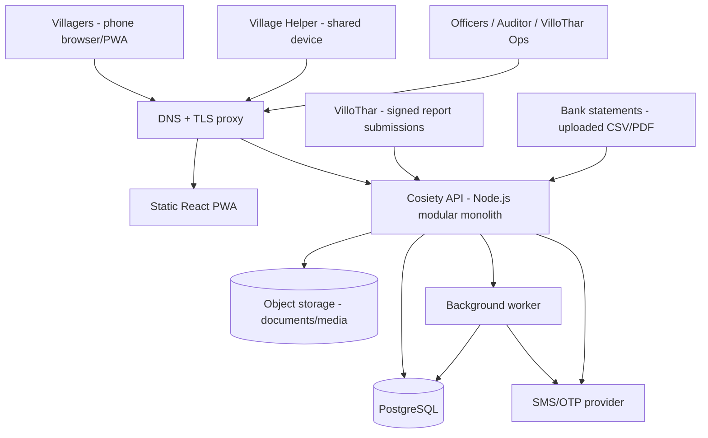

## 2.3 Component architecture
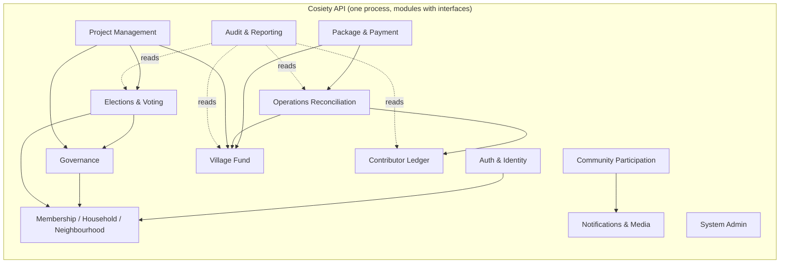
Rule: modules call each other only through exported service interfaces; no module reads another module's tables, **and VF, CL and OPS modules never import each other's data access code** (DD-02). Cross-stream matching happens only in the `recon` component (see §8).

## 2.4 Deployment architecture
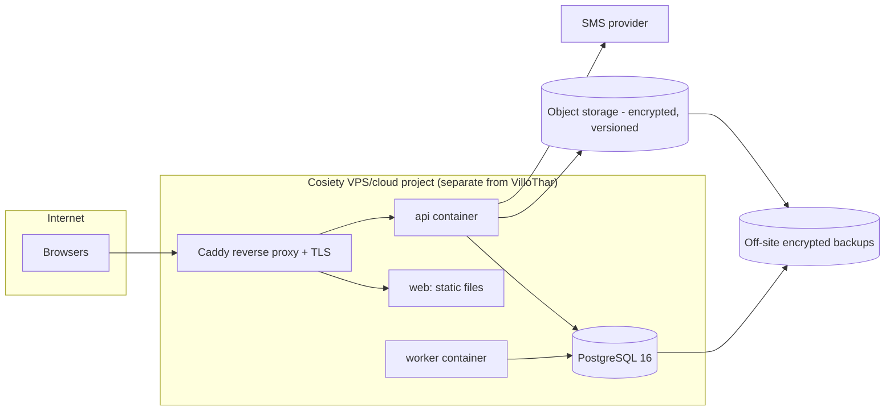

## 2.5 External system integration
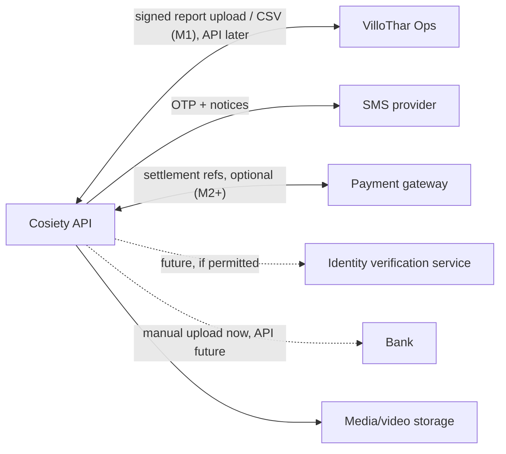
Each integration sits behind an adapter interface (`SmsPort`, `PaymentPort`, `IdentityPort`, `BankStatementPort`, `MediaPort`) so providers can be replaced; the status of each (required / optional / future / dependent) is in SRS §5.

---

# 3. Recommended Technology Stack

Principle: boring, widely taught, affordable, maintainable by a small local team. **[REC]** for all.

## 3.1 Frontend

| Concern | Choice | Why / alternatives |
|---|---|---|
| Framework | **React + TypeScript (Vite)** as a PWA | Large talent pool in Pakistan; alternatives (Vue, Svelte) are fine but no clear gain |
| UI | **Tailwind CSS** + own small component set, logical (RTL-safe) properties | Small bundles; no heavy UI kit; supports RTL via `dir` |
| State/API | **TanStack Query** for server data; React context for session/language | Avoids a global store |
| Forms | **react-hook-form + zod** (same schemas as the backend) | Shared validation |
| i18n/RTL | **i18next**, resource files for `sd`, `ur`, `en`; `dir="rtl"` for `sd`/`ur`; Noto Naskh Arabic / Sindhi-capable web font subset | NFR-LOC |
| Offline | Service worker (Workbox): cache shell + last-read public pages; draft forms in IndexedDB | NFR-CON |
| Voice | Pre-recorded audio per screen/ballot item (primary); browser speech synthesis only as fallback | Sindhi TTS quality unreliable [ASM]; recorded audio is dependable |

## 3.2 Backend

| Concern | Choice | Why |
|---|---|---|
| Runtime | **Node.js (LTS) + TypeScript** | Same language as frontend |
| Framework | **Express** (or Fastify) with a thin module structure; NestJS acceptable if the team prefers | Simple, well known |
| API style | REST/JSON, OpenAPI 3 documented | Testable, cacheable |
| DB access | **Kysely or knex + hand-written SQL migrations** (not an ORM that hides transactions/constraints) | Finance and voting need explicit SQL, transactions and constraints |
| Validation | zod | |
| Jobs | **pg-boss** (queue in PostgreSQL) | No Redis to run |
| Auth | Server-side sessions, Argon2id for PINs, OTP | §6 |

## 3.3 Database
**PostgreSQL 16 (DD-03).** Needed features: ACID transactions, `CHECK`/`EXCLUDE`/partial unique constraints, deferred constraint triggers (balanced entries), row-level security, schemas and roles per ledger domain, `pgcrypto`, mature backup tools.

| Alternative | Reason not chosen |
|---|---|
| MySQL/MariaDB | Weaker constraint/RLS support; workable but less suited |
| MongoDB | No enforced relational integrity; poor fit for ledgers |
| SQLite | No role/schema separation, weak concurrency for election peaks |

## 3.4 Infrastructure

| Item | Recommendation |
|---|---|
| Hosting | One VPS (2–4 vCPU, 4 GB RAM, ~80 GB SSD) from a reputable provider with a region near South Asia [ASM]; Docker Compose; OS-level firewall. Indicative cost on the order of tens of US dollars per month (to be verified) |
| Domain | Dedicated subdomain of the VilloThar domain, delegated or pointed by A/CNAME records only (see §12.4) |
| TLS | Automatic certificates (Let's Encrypt via Caddy) |
| File storage | S3-compatible object storage, private bucket, signed URLs, server-side encryption |
| Backups | Nightly `pg_dump` + WAL archive (pgBackRest or similar), encrypted, copied to a second provider |
| Logging/monitoring | Structured JSON logs; uptime checks; Sentry-style error reporting (self-hosted or free tier); alert by SMS/email |
| CI/CD | GitHub Actions: lint, tests, build, deploy to staging on merge, production by manual approval |

## 3.5 External integrations

| Integration | Recommendation | Status |
|---|---|---|
| OTP/SMS | A PTA-compliant local bulk-SMS aggregator with delivery reports; second provider as fallback | Required [DEP] |
| Payments | JazzCash/Easypaisa/bank/Raast-type options evaluated later; M1 records payments manually from VilloThar reports | Optional [DEP] |
| Video | Own object storage with 240p/360p MP4 + audio-only MP3; optionally an unlisted public video platform as a mirror | Required (M2) |
| Identity verification | Pluggable `IdentityPort`; manual provider in M1 | Future [DEP] |

---

# 4. Application Modules

| Module | Responsibility | Depends on | Key SRS |
|---|---|---|---|
| Auth & Identity | Registration, OTP, sessions, verification workflow, account suspension | Membership, Audit | AUTH |
| Membership / Household / Neighbourhood | Member, household, group registry and history | Auth | MEM, HH, NBG |
| Governance | Meetings, agendas, resolutions, quorum rules, committees/terms, petitions, conflict declarations | Membership | GB, EXC |
| Elections & Voting | Election config, nominations, snapshot, ballot casting, tally, certification | Governance, Membership | ELE |
| Village Fund (VF) | Levy config, ledger, project allocations | Governance (approval refs) | FIN, LED |
| Contributor Ledger (CL) | Contributors, agreements, capital, returns, distributions | Audit | CON |
| Operations Reconciliation (OPS) | VilloThar reports, levy-due computation, transfer matching | VF, CL via `recon` only | FIN-007/008, PAY |
| Package & Payment | Packages, price/levy split, purchase records, settlement refs | OPS | PAY |
| Project Management | Proposal lifecycle, budgets, expenses, reports | Governance, Elections, VF | PRJ |
| Community Participation | Issues, public questions | Notifications | ISS, AUD-004 |
| Notifications & Media | Notices, SMS, video library, translations | – | NTC |
| Audit & Reporting | Event log, hash chain, monthly reports, auditor exports | reads all | AUD |
| System Admin | Config, health, deployment support; **no business-data rights** | – | NFR-SEC |

Communication: synchronous in-process calls through module interfaces; asynchronous events via the `outbox` table (e.g. `ProposalApproved`, `TransferConfirmed`) consumed by the worker for notifications and report generation. A module never writes into another module's schema.

---

# 5. Database Design

## 5.1 Principles
1. **Schemas as boundaries.** `core` (people, roles, config), `gov`, `vote`, `vf` (Village Fund), `cl` (Contributor Ledger), `ops` (VilloThar reports), `recon` (matching), `prj`, `comm`, `audit`. Each financial schema has its own database role; the application connects with *different* roles per module, so VF code physically cannot write to `cl` tables (DD-02).
2. **No foreign keys between `vf`, `cl` and `ops`.** Only `recon` holds references to them (as `domain + entry_id`), and it has no power to post entries.
3. **`society_id` on every table**, with PostgreSQL row-level security (RLS) so one society cannot see another's rows (DD-05).
4. **Append-only where it matters:** ledger lines, ballots, audit events, published documents have no `UPDATE`/`DELETE` privilege (revoked) plus triggers that raise errors.
5. Primary keys are UUIDv7 (`uuid`), money in `numeric(14,2)` (PKR), timestamps `timestamptz` in UTC, `created_at/created_by` audit fields everywhere, `voided_at` instead of delete.

## 5.2 Entity relationship diagram – people, governance, elections
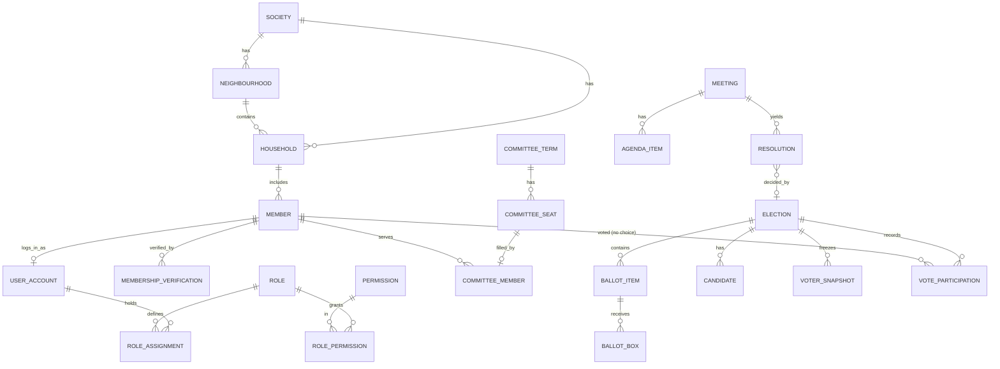

## 5.3 ERD – money (three separate schemas)
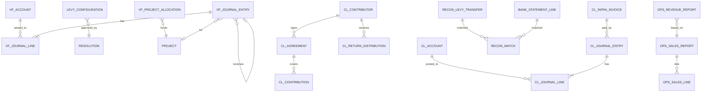
`RECON_MATCH` references `(domain, entry_id)` as plain values with a `CHECK (domain IN ('VF','CL'))`; there are no FKs from `vf`↔`cl`↔`ops`.

## 5.4 Data dictionary (core tables)
*PK = primary key, FK = foreign key, N = nullable. All tables also have `society_id uuid NOT NULL`, `created_at`, `created_by`.*

**core.member**

| Column | Type | Null | Notes |
|---|---|---|---|
| id | uuid PK | | |
| household_id | uuid FK | | → core.household |
| neighbourhood_id | uuid FK | | current group (history in `member_neighbourhood_history`) |
| full_name | text | | |
| gender | text | N | for quota calculations; CHECK in allowed list |
| date_of_birth | date | | from CNIC |
| mobile_e164 | text | | UNIQUE per society where status active |
| cnic_enc | bytea | | field-encrypted (AES-GCM), key in secrets store |
| cnic_hmac | bytea | | HMAC-SHA256(secret pepper, cnic); **UNIQUE** (partial: status not in ('deactivated')) – duplicate detection without revealing CNIC |
| status | text | | `applicant|active|suspended|deactivated|left` |
| identity_status | text | | `unverified|checked|approved|rejected` |
| voting_suspended_until | timestamptz | N | |

**core.membership_verification** – `id, member_id FK, step (otp_confirmed|identity_checked|approved|rejected), actor_user_id, at, note`; CHECK that `approved` actor ≠ `identity_checked` actor (enforced by trigger).

**core.role_assignment** – `id, user_id FK, role_id FK, scope_type (society|neighbourhood), scope_id N, valid_from, valid_to, source (term|appointment|system), term_id N`. Partial index on active assignments. CHECK `valid_to > valid_from`.

**gov.committee_seat** – `id, term_id FK, role_code, reserved_for (neighbourhood|women|general), reserved_ref N, cycle_no`. **gov.committee_member** – `seat_id UNIQUE, member_id FK, start, end, household_id snapshot`. EXCLUDE constraint prevents overlapping terms for the same seat; unique index on `(term_id, household_id)` enforces *one member per household* when rule on (configurable via `gov.rule`).

**gov.rule** – configuration rows: `key, value jsonb, version, approved_by_resolution_id, effective_from`. Keys include `committee.size_min/max`, `quota.women`, `term.length_months`, `term.max_consecutive`, `levy.cap`, `quorum.<decision_type>`, `threshold.<decision_type>`, `recall.petition_share`. Values start **empty**; elections and levy votes cannot open until required keys exist and are linked to an approving resolution.

**vote.election** – `id, type, title, state (draft|nomination|ready|open|closed|tallied|certified|void), ballot_mode (secret|open), opens_at, closes_at, config_json, config_hash, snapshot_hash, resolution_id N`. CHECK `closes_at > opens_at`.
**vote.voter_snapshot** – `election_id, member_id` PK(election_id, member_id); created when the election opens.
**vote.vote_participation** – `election_id, item_id, member_id, cast_at, channel (self|assisted_kiosk)` **PK(election_id, item_id, member_id)** → duplicate vote impossible. FK to snapshot required (voter must be in snapshot).
**vote.ballot_box** – `ballot_id uuid PK (random v4), election_id, item_id, choice_code`. **No member id, no timestamp, no sequence.** Insert-only.
**vote.open_vote** – used only if `ballot_mode='open'`: `election_id,item_id,member_id,choice_code`.

**vf.account** – `id, code, name, type (asset|income|expense|fund)`, project_id N.
**vf.journal_entry** – `id, ref_no UNIQUE, entry_date, category, description, source_type, source_id, idempotency_key UNIQUE, reverses_entry_id N, status (posted|reversed), approval_id N, project_id N, evidence_doc_id N`.
**vf.journal_line** – `entry_id FK, account_id FK, debit numeric(14,2) ≥0, credit numeric(14,2) ≥0`; CHECK `(debit=0) <> (credit=0)`. A **deferred constraint trigger** checks that for each entry sum(debit)=sum(credit) at commit.
**vf.levy_configuration** – `id, amount, cap_at_time, effective_from, resolution_id FK, status`; CHECK `amount <= cap_at_time` and trigger compares against current `levy.cap` rule.
**vf.project_allocation** – `project_id, amount, resolution_id, status`; trigger rejects allocation exceeding unallocated VF balance.

**cl.contributor** – `id, member_id N (if resident), display_name, contact (encrypted), payout_account_enc, status`. **There is no column or table link between `cl.*` and any role/permission/election table** – by construction contributors cannot gain privileges (BR-09).
**cl.agreement** – `id, contributor_id, version, document_id, accepted_at, terms_json (formula parameters, cap, term)`. **cl.contribution** – `id, agreement_id, amount, received_entry_id, bank_line_ref`. **cl.infra_invoice** – `id, vendor (VilloThar), invoice_no, amount, document_id, paid_entry_id N`. **cl.return_calculation** – `id, period, revenue_basis_ref, formula_version, status (draft|approved)`; **cl.return_distribution** – `id, calc_id, contributor_id, amount, status (calculated|approved|paid), paid_entry_id N`.
**cl.account / journal_entry / journal_line** – same pattern as VF.

**ops.sales_report** – `id, period_start, period_end, version, status (draft|submitted|superseded), submitted_by, submitted_at, file_hash`; **ops.sales_line** – `report_id, package_id, units, gross_amount, levy_amount, paid_count`; **ops.revenue_report** – `id, period, package_revenue_basis, version`. *Corrections create a new version; older versions stay.*

**pay.package** – `id, name, price, active_from`; **pay.purchase** – `id, member_id, package_id, price_amount, levy_amount, status (initiated|pending|paid|failed|refunded|reversed), external_ref, idempotency_key UNIQUE`.

**recon.levy_transfer** – `id, period_start, period_end, amount_expected, amount_declared, reference_no, state (announced|sent|confirmed|disputed|cancelled), declared_by, confirmed_by, confirmed_at`; trigger: `confirmed_by ≠ declared_by`.
**recon.bank_statement_line** – `id, bank_account_id, value_date, amount, narrative, bank_ref, imported_batch_id, UNIQUE(bank_account_id, bank_ref)`; **recon.bank_account** – `id, domain ('VF'|'CL'), masked_number, bank` (**one bank account per domain recommended, OD-10**). **recon.match** – `id, statement_line_id, domain, entry_id, transfer_id N, matched_by`.

**prj.proposal** – `id, member_id, neighbourhood_id, title, description, category, est_budget, impact_text, state (proposal|explainer|discussion|voting|approved|rejected|execution|reporting|closed)`; CHECK state order via transition table `prj.allowed_transition`. **prj.expense_request** – `id, project_id, amount, vendor, invoice_doc_id, requested_by, status`; trigger rejects when the requester also approves or approver has a conflict declaration.

**comm.issue**, **comm.question**, **comm.notice**, **comm.media_asset**, **comm.notice_version** (published versions immutable).

**audit.event_log** – `seq bigserial, society_id, at, actor_id, action, entity_type, entity_id, before jsonb, after jsonb, reason, ip_hash, prev_hash, hash` – insert-only; `hash = SHA256(prev_hash || canonical_json(row))`.

## 5.5 Important constraints (summary)

| # | Constraint | Purpose |
|---|---|---|
| K-1 | `UNIQUE(cnic_hmac)` partial | Duplicate identity prevention |
| K-2 | `PK(election_id,item_id,member_id)` on `vote_participation` | One vote per person per item |
| K-3 | Trigger: `vote.*` rows cannot be inserted unless `election.state='open'` and `now()` within window | Voting period |
| K-4 | Trigger: `election.config_json`, `closes_at`, snapshot immutable once `state≠draft/nomination` | Protect settings |
| K-5 | Deferred balance trigger per ledger entry | Balanced entries |
| K-6 | `REVOKE UPDATE, DELETE` on ledger lines/ballots/audit; reversal entries only | Immutability |
| K-7 | `vf.levy_configuration.amount ≤ levy.cap` + resolution link | Cap and approval |
| K-8 | No cross-schema FKs among `vf/cl/ops`; separate roles | Stream separation |
| K-9 | `UNIQUE(idempotency_key)` on purchases and journal entries | Duplicate transactions |
| K-10 | `committee_member` unique household per term (when rule active) | Household restriction |
| K-11 | Approver ≠ preparer triggers | Maker–checker |
| K-12 | RLS policy `society_id = current_setting('app.society_id')` | Multi-society isolation |

## 5.6 Indexing
`(society_id, status)` on member; `(society_id, mobile_e164)`; `(election_id)` on snapshot/participation/ballot; `(entry_date, id)` and `(account_id, entry_id)` on journal lines for ledger paging; `(state, society_id)` on proposals; `(period_start, period_end)` on reports; partial index for active role assignments; GIN on `audit.event_log (entity_type, entity_id)` as needed.

## 5.7 Ledger approach: double-entry or simple?
**DD-06: Use double-entry bookkeeping inside each stream; keep the three streams as three separate sets of books.**

* *Why double-entry:* every movement has a source and a destination, so a payment cannot "appear" without a matching change elsewhere; balances are derived from lines, not stored; reversals are natural; auditors recognise it.
* *Why not one shared ledger with a `type` column:* a coding mistake could mix streams. Separate schemas/roles prevent it.
* *Simplicity:* entries are mostly two lines, and chart of accounts per stream is short; the UI shows plain words ("Money received", "Money spent"), not debits and credits.
* *OPS is different:* Cosiety does not own VilloThar's books, so `ops` is a **controlled report register** (versioned reports), not a ledger. Only amounts that reach Cosiety's bank accounts become entries – in VF or CL.

**Starter charts of accounts [REC]** (names deliberately neutral; legal/accounting review needed):

| VF | CL |
|---|---|
| 1100 VF Bank · 1200 Levy due from VilloThar · 3000 Village Fund (unallocated) · 4000 Levy income · 5xxx Project spending (per project) | 1100 CL Bank · 1200 Contribution returns due from VilloThar · 1300 Infrastructure paid for · 2100 Contributor capital (sub-account per contributor) · 2200 Amounts due to contributors (sub-account per contributor) |

## 5.8 Example records
```text
core.member      (M-0412, "Ali Bheel", hh H-077, nbhd "Mohalla Ram Nagar", status active, identity_status approved)
vote.participation (E-2027-01, item 1, M-0412, 2027-02-14T08:41Z, channel self)      -- no choice stored
vote.ballot_box  (a9c3…e71, E-2027-01, item 1, "YES")                                   -- no member, no time
recon.levy_transfer (T-004, 2027-03-01..03-07, expected 12,350.00, declared 12,350.00, ref "IBFT-77231", state confirmed)
vf.journal_entry (VF-2027-0031, 2027-03-09, "Levy received wk 9", source T-004)
   Dr 1100 VF Bank 12,350.00      Cr 1200 Levy due from VilloThar 12,350.00
cl.journal_entry (CL-2027-0005, "Capital received – C-07, agreement v1")
   Dr 1100 CL Bank 100,000.00     Cr 2100 Contributor capital C-07 100,000.00
```
(Figures are illustrative.)

## 5.9 Financial transaction lifecycle
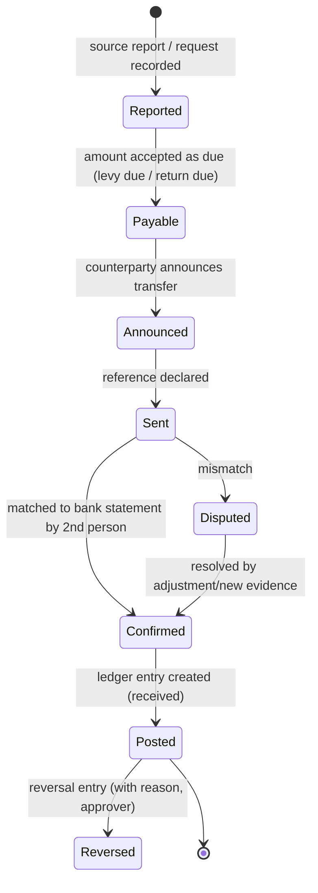
Only the **Posted** state changes a balance. *Reported / Payable / Announced / Sent* appear on the portal as "expected" or "on the way", never in the balance.

---

# 6. Authentication and Authorization Architecture

## 6.1 Registration and verification flow
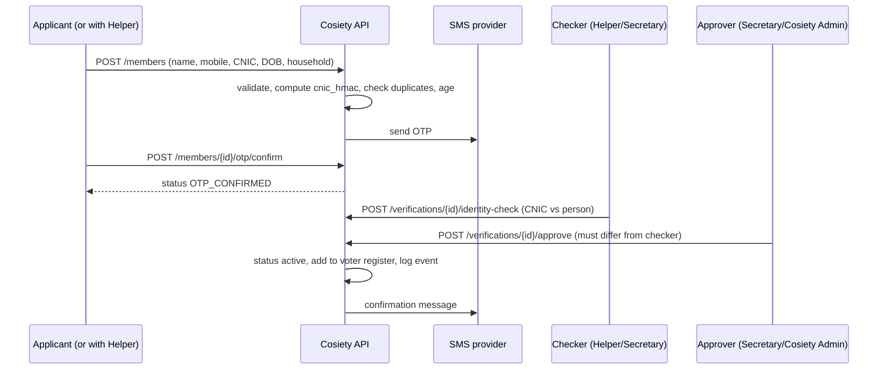
**DD-07:** *Identity verification* (a human, later maybe a provider, confirms who the person is) and *phone verification* (OTP) are separate statuses; *voting authorization* is a third, computed value: `Active ∧ identity approved ∧ age ≥ rule ∧ not voting-suspended`. None of them grants a role.

## 6.2 Login, sessions, recovery
* Login: mobile + OTP (default). Optional 4–6 digit PIN stored with Argon2id for faster return visits. Officers and admins: OTP **and** PIN (two factors); optional TOTP app.
* Sessions: opaque random token in `HttpOnly; Secure; SameSite=Lax` cookie, stored hashed in `core.session` (device label, IP hash, last seen); idle timeout 30 min (officers 10 min); revocable by user, admin or on suspension. CSRF double-submit token on state-changing requests.
* Recovery: lost phone → re-verification (OTP to new number + in-person check by two people); every recovery is logged and notified to the old number.
* Rate limits: per mobile and per IP on OTP send/verify; progressive back-off; SMS cost caps.

## 6.3 Authorization
* **RBAC with scoped, time-bound assignments** (`role_assignment`): permission = `(action, resource_type)` with scope `society | neighbourhood | own | masked`. Elected roles are created by the system from *certified election results* with `valid_to = term end`; they expire automatically (FR-EXC-002).
* One server-side policy function `authorize(user, action, resource)` is called by every route handler (middleware denies by default). A test enumerates every route and asserts a policy is declared.
* **Separation of duties** rules in a table (`sod_rule`): Treasurer ≠ expenditure approver; checker ≠ preparer; officer cannot act on a household-linked or conflict-declared item; one person cannot hold both Treasurer and President; VilloThar Ops Admin cannot confirm a transfer they declared.
* **Application administrators** (Cosiety Admin, VilloThar Ops Admin, System Admin) are distinct permission sets; none includes `approve` on money, `vote` on others' behalf, or `read` of ballots. System Admin has OS/database-operator access outside the app but no application credentials that decrypt business data.
* **Account suspension:** sets status, revokes sessions, removes voting authorization; reversible by two-person approval with reason.

## 6.4 Enforcing one-person-one-vote with secrecy
Identity is established in §6.1; at vote time the voter re-authenticates (OTP step-up). Eligibility is read from `vote.voter_snapshot`. The *primary key* of `vote_participation` prevents repeats. Secrecy comes from storing the *choice* in a different table with no member link (§7).

---

# 7. Voting System Architecture

## 7.1 Election lifecycle
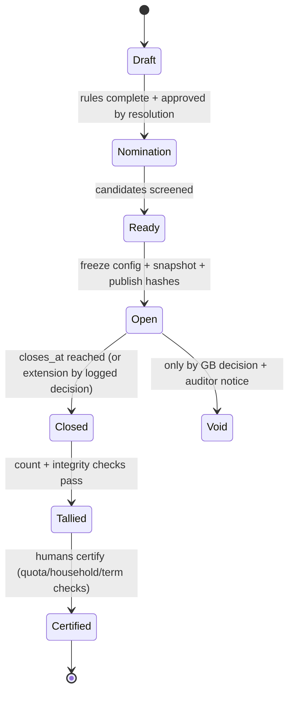

## 7.2 Components
1. **Election configuration** – rows from `gov.rule` copied into `config_json` at *Open*; `config_hash = SHA256(canonical_json)`. Elections cannot open unless the rule keys required for their type are present and linked to an approving resolution (this is how un-approved quotas/thresholds are prevented from being silently assumed).
2. **Voter eligibility snapshot** – at *Open*, `INSERT … SELECT` of eligible members; `snapshot_hash` = hash of sorted member IDs; both hashes are shown publicly (count and hash, not names, unless the society publishes the voter list).
3. **Quorum** – `required = ceil(snapshot_count × quorum_fraction[type])`; computed at close from participation count; never from ballots.
4. **Voting period enforcement** – DB trigger K-3 compares `now()` with the window; clock source is the database, not the client.
5. **Duplicate prevention** – PK on `(election, item, member)`; casting is one SQL transaction:
```sql
BEGIN;
  -- 1. eligibility and window checks (snapshot row exists, state = 'open')
  INSERT INTO vote.vote_participation (election_id,item_id,member_id,cast_at,channel) VALUES (...); -- fails if already voted
  INSERT INTO vote.ballot_box (ballot_id,election_id,item_id,choice_code) VALUES (gen_random_uuid(),...);
  INSERT INTO audit.event_log (...)  -- records "member voted", NOT the choice
COMMIT;
```
If either insert fails, both roll back. The API returns success only after `COMMIT` (AC-ELE-04).
6. **Secret ballot architecture [REC]** – `ballot_box` has no member, timestamp or serial. Row order on disk could still hint at sequence, so at close the worker **re-creates the box in randomised order** (`ballot_box_final`) and discards the original, before any count is shown. Phase-2 option: encrypt each choice with an *election public key* and decrypt only at close using a key split among custodians (e.g. two EC members + the auditor).
7. **Vote integrity** – at close, check `count(ballot_box) = count(vote_participation)` per item; mismatch blocks *Tallied* and raises an alert.
8. **Result calculation** – deterministic SQL/functions in a versioned module; result record stores the rule hash used; an independent script (provided to the auditor) recomputes the result from exported data.
9. **Result publication** – turnout, quorum status, totals and pass/fail; **no individual choices for secret ballots** (FR-ELE-007).
10. **Open ballot mode** – only if `ballot_mode='open'` is part of the approved rules; uses `open_vote`.
11. **Assisted voting** – Helper opens a *kiosk session* on a shared device; the voter authenticates with their own OTP; the helper's account is not authorized for `cast`; the screen shows voice and icon prompts; after submission the session is wiped. The log records `channel=assisted_kiosk` and the helper ID, never the choice.
12. **Executive seat allocation** – the tally produces ranked candidates; a rules engine applies reserved seats, quota, household and term constraints and outputs a *proposed* allocation with explanations; it becomes final only when certified by the authorised humans (SRS FR-ELE-011).

## 7.3 Preserving integrity against an administrator

| Threat | Defence |
|---|---|
| Admin edits election settings after opening | K-4 triggers block updates; `config_hash` published at open and re-verified by a scheduled job |
| Admin adds a voter | Snapshot is frozen; `snapshot_hash` public; participation requires snapshot membership |
| Admin inserts ballots | App role has no direct INSERT on `ballot_box` except through the cast procedure; count equality check at close |
| Admin deletes ballots/participation | `REVOKE DELETE`; audit chain; count equality; daily digest of counts sent to auditor |
| Admin rewrites audit log | Hash chain; daily head-hash published to public integrity page and emailed to auditor/EC |
| Database superuser (host operator) tampers | Cannot be fully prevented by software: *tamper-evident, not tamper-proof*. Mitigated by separate host credentials, digests held outside the server, observer-witnessed counting, and optional key custody. **Residual risk accepted and listed (RK-04, RK-10).** |
| Coercion / vote-selling | Receipt shows only "you voted"; no proof of choice; recommended in-person kiosk privacy; training |

---

# 8. Financial System Architecture

## 8.1 Structure
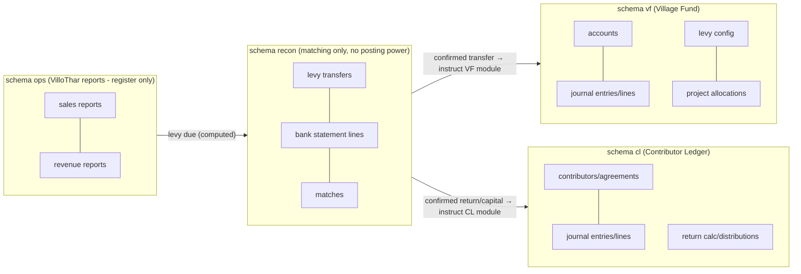
*The `recon` component never writes ledger rows itself; it calls the VF or CL module's `post()` interface, which validates and posts in that module's own schema.*

**DD-08 (idempotency and money rules):** every posting has an `idempotency_key` derived from the business event (e.g. `levy-transfer:T-004:confirmed`); retries return the same entry. Amounts in integer paisa at the API boundary. All postings in one DB transaction with the state change that caused them.

## 8.2 Workflow 1 – Package payment

| Aspect | Design |
|---|---|
| Actors | Member (or helper-assisted), VilloThar Ops Admin, payment channel [DEP] |
| Trigger | Member selects a package |
| Steps | Show price + levy + total → create `pay.purchase(initiated)` with idempotency key → payment via channel or recorded by VilloThar → status `paid` → purchase appears in VilloThar's sales report |
| DB changes | `pay.purchase` row & status transitions; later `ops.sales_line` rows (reported by VilloThar) |
| Validation | Package active; levy amount equals current approved `levy_configuration` at purchase date; one price for everyone; member active |
| Transaction boundary | Purchase creation and status change are each atomic; payment-gateway callback handled idempotently |
| Failure handling | `failed`/`pending` purchases do not count; a reconciliation job ages pending ones and alerts; gateway timeout → remains `pending` until confirmed |
| Audit | `purchase.created/paid/failed` |
| Notifications | SMS/portal receipt in Sindhi/Urdu |
| Note | The money is **VilloThar's collected money**; the levy part is recorded as **payable to Cosiety**, not as received (no VF entry yet). |

## 8.3 Workflow 2 – Village Fund transfer (levy)

| Aspect | Design |
|---|---|
| Actors | VilloThar Ops Admin (declare), Treasurer (confirm), President/EC (review on dispute) |
| Trigger | End of reporting period (schedule per OD-07) |
| Steps | 1 VilloThar submits sales/collection report (version n) → 2 system computes `levy_due = Σ paid_count × levy_at_purchase`, posts **Dr Levy due from VilloThar / Cr Levy income** in VF (money *payable*, not received) → 3 VilloThar declares transfer (reference, amount, date) → state `sent` → 4 Cosiety uploads bank statement; Treasurer matches line to transfer (second person confirms) → state `confirmed` → 5 posts **Dr VF Bank / Cr Levy due**; public ledger updates |
| DB changes | `ops.sales_report`, `recon.levy_transfer`, `recon.bank_statement_line`, `recon.match`, `vf.journal_entry/line` |
| Validation | Declared amount vs levy due; reference unique; bank line unique and unmatched; confirmer ≠ declarer |
| Transaction boundary | Step 5: match + state change + VF posting + outbox event in one transaction |
| Failure handling | Amount differs → `disputed`, difference shown as "unreconciled"; no bank line after N days → alert; wrong match → reversal entry |
| Audit | Each state change with actor and evidence |
| Notifications | Treasurer/PIO on overdue; public "levy transfer received" note |
| Rule | **A pending or initiated transfer is never counted as received (BR-22).** |

## 8.4 Workflow 3 – Infrastructure contribution

| Aspect | Design |
|---|---|
| Actors | Contributor, Treasurer, Cosiety Admin, VilloThar (invoice) |
| Trigger | Contributor wishes to contribute |
| Steps | Register contributor → create agreement (version, formula parameters, cap) and obtain acceptance record (document) → contributor pays to Cosiety **CL bank account** → bank line matched → `cl.contribution` + **Dr CL Bank / Cr Contributor capital (c)** → Cosiety pays VilloThar for equipment → **Dr Infrastructure paid for / Cr CL Bank** with `cl.infra_invoice` attached |
| Validation | Agreement exists and accepted before any payment is recorded; payment amount ≥ 0; invoice document hash stored; approver ≠ preparer; spending cannot exceed CL bank balance |
| Transaction boundary | One DB transaction per posting; document upload before posting (orphan files cleaned by worker) |
| Failure handling | Unmatched receipt stays in "unidentified receipts" (not credited to anyone) until resolved |
| Audit | Agreement acceptance, receipt, invoice, payment |
| Notifications | Contributor receives their own statement update; public aggregate changes only |

## 8.5 Workflow 4 – Contributor return distribution

| Aspect | Design |
|---|---|
| Actors | VilloThar Ops Admin (revenue basis), Treasurer (prepare), President (approve), Contributors |
| Trigger | Period end with revenue report available |
| Steps | `ops.revenue_report` submitted → return pool determined **according to the agreement formula parameters (OD-14)**, bounded by cap → per-contributor amounts computed proportional to contributions → approval → **Dr Returns due from VilloThar / Cr Amounts due to contributor (c_i)** → VilloThar transfers the return amount, bank match → **Dr CL Bank / Cr Returns due** → distribution to each contributor: **Dr Amounts due to (c_i) / Cr CL Bank**, reference recorded |
| Validation | Sum of individual amounts = pool; no amount above cap; contributor active; payout account present; formula version stored |
| Failure handling | Short payment → distribute only after resolving per agreement (rule parameter), or pro-rata if the agreement says so; failed payout → stays "due" |
| Audit | Calculation inputs, formula version, approvals |
| Notifications | Each contributor sees own statement; public sees only totals |
| Note | The software does **not** decide how returns are legally classified; labels are neutral ("contribution return"). |

## 8.6 Workflow 5 – Village project expenditure

| Aspect | Design |
|---|---|
| Actors | Member (proposer), Executive, General Body, Treasurer, President/EC (second approver) |
| Trigger | Project proposal |
| Steps | Proposal → explainer → discussion → **vote** (thresholds from `gov.rule`) → *Approved* → `vf.project_allocation` created (≤ unallocated balance) → expense request with invoice → conflict check → maker–checker approval → payment recorded (**Dr Project spending / Cr VF Bank**) → receipt attached → public ledger shows → final report |
| Validation | Project state `approved/execution`; amount ≤ remaining project budget; approver has no declared conflict; evidence required above a configurable amount |
| Transaction boundary | Approval, posting and project budget update in one transaction |
| Failure handling | Over-budget → rejected; payment returned → reversal entry and new request |
| Audit | Full approval chain per expense |
| Notifications | PIO publishes progress; members see updated project page |

## 8.7 Reconciliation
Weekly job and manual screen produce a **three-way comparison** for each period: (a) VilloThar-reported levy due, (b) declared transfers, (c) bank statement lines. Outcomes:

| Case | Treatment |
|---|---|
| a = b = c | Auto-ready for confirmation |
| b ≠ a | `disputed`; difference listed publicly as "being checked" |
| c missing | Stays `sent`; not in balance |
| c without b | "Unidentified receipt"; held outside both streams until classified by two people |
| Duplicate bank line | Rejected by unique key |
| Later correction by VilloThar | New report version; difference becomes an adjustment entry, never an overwrite |
The same logic applies to CL (capital receipts and return receipts) against the CL bank account. Monthly reports list unreconciled items.

## 8.8 Audit events (examples)
`purchase.paid`, `report.submitted`, `levy.due_posted`, `transfer.declared/confirmed/disputed`, `ledger.entry_posted/reversed`, `agreement.accepted`, `return.calculated/approved/paid`, `expense.requested/approved`, `rule.changed`, `election.opened/closed/certified`, `admin.break_glass_cnic_view`.

---

# 9. API Design

## 9.1 Conventions
* **Base:** `/api/v1` (URL versioning; breaking changes → `/v2`, old version kept ≥ 6 months). JSON, UTF-8, ISO-8601 UTC timestamps, money as integer **paisa** plus display string.
* **Auth:** cookie session + CSRF header `X-CSRF-Token`; officers also pass step-up check. Public read endpoints under `/api/v1/public/*` need no login and return only public-level data.
* **Idempotency:** all money/vote `POST`s require `Idempotency-Key` (UUID); same key = same result.
* **Pagination:** cursor style `?limit=25&cursor=...`; response `{ "data": [...], "next_cursor": "..." }`; max limit 100.
* **Filtering/sorting:** `?filter[status]=active&filter[from]=2027-01-01&sort=-date`.
* **Errors:** `application/problem+json`:
```json
{ "type": "https://cosiety.example/errors/already-voted", "title": "Already voted",
  "status": 409, "code": "ELE_ALREADY_VOTED", "detail": "A ballot has already been recorded for this item.", "request_id": "…" }
```
Standard codes: 400 validation, 401 not logged in, 403 not permitted, 404 not found (also used where existence must not leak), 409 conflict/duplicate/state, 422 rule violation, 429 rate limit, 503 maintenance.

## 9.2 Endpoint catalogue

| ID | Method & path | Purpose | Auth / permission | Request (key fields) | Success | Validation / errors |
|---|---|---|---|---|---|---|
| API-01 | `POST /members` | Register applicant | public (rate-limited) | name, mobile, cnic, dob, household/neighbourhood, consent | 201 `{member_id,status:"applicant"}` | CNIC format 13 digits; mobile E.164; dob ≤ today; duplicate → 202 *under review* (no leak) |
| API-02 | `POST /members/{id}/otp/confirm` | Confirm phone | public with `member_id` token | code | 200 `{status:"otp_confirmed"}` | 400 wrong code; 429 attempts |
| API-03 | `POST /verifications/{id}/identity-check` | Record human identity check | `identity.check` | evidence_note, id_seen:true | 200 | 409 already checked; 403 same person as applicant |
| API-04 | `POST /verifications/{id}/approve` | Activate member | `membership.approve` | note | 200 `{status:"active"}` | 409 approver = checker; 422 under-age→non-voting |
| API-05 | `GET /me` · `PATCH /me` | Own profile | login | limited fields (name, language, consent) | 200 | CNIC/DOB not editable |
| API-06 | `GET /members?filter…` | Member directory | `members.read` (masked) | – | page of masked records | 403 for ordinary members |
| API-07 | `POST /neighbourhoods`, `PATCH /neighbourhoods/{id}`, `POST /neighbourhoods/{id}/members` | Manage groups | `nbhd.manage` | name(sd,ur,en), type; member_ids | 201/200 | unique name per society |
| API-08 | `POST /elections` | Create election | `election.create` | type, title, ballot_mode, window, rule_refs | 201 `draft` | 422 missing/unapproved rule keys |
| API-09 | `POST /elections/{id}/nominations` | Nominate | member / convener | candidate_member_id, seat_type | 201 | 422 eligibility (household, term limit) |
| API-10 | `POST /elections/{id}/open` | Freeze & open | `election.open` (two-person) | – | 200 `{config_hash,snapshot_hash,count}` | 409 wrong state; 422 incomplete |
| API-11 | `GET /elections/{id}/ballot` | Ballot items (icons, audio) | voter in snapshot | – | items + audio URLs | 403 not eligible |
| API-12 | `POST /elections/{id}/votes` | Cast ballot | `vote.cast`, OTP step-up | `{item_id, choice_code}[]` | 201 `{status:"recorded"}` (no choice echoed in logs) | 409 already voted; 403 not in snapshot; 409 closed; 422 invalid choice |
| API-13 | `GET /elections/{id}/results` | Results & turnout | public after close | – | totals, quorum, pass/fail | 404 until `tallied` |
| API-14 | `POST /proposals`, `GET /proposals`, `POST /proposals/{id}/transition` | Proposal lifecycle | member / EC | title, description, category, est_budget_paisa, neighbourhood | 201 | state order enforced → 422 |
| API-15 | `POST /proposals/{id}/questions`, `POST /questions/{id}/answer` | Public Q&A | member / EC | text / answer | 201 | answer deadline stored |
| API-16 | `GET /public/ledger/vf?from&to&cursor` | Village Fund public ledger | none | – | `{opening, in, out, balance, entries[]}` | VF only; never other streams |
| API-17 | `GET /public/ledger/summary` | Three side-by-side stream summaries | none | – | `{vf:{…}, cl_aggregate:{…}, ops_reported:{…}}` | each block separate; no total |
| API-18 | `POST /ops/sales-reports` | VilloThar submits report | `ops.report.submit` | period, lines[], file_hash | 201 `version:n` | signature/hash; overlapping periods → new version |
| API-19 | `POST /packages/{id}/purchases` | Buy package | member | idempotency key | 201 `{price,levy,total,status}` | levy must equal current approved levy |
| API-20 | `POST /levy-transfers` · `POST /levy-transfers/{id}/confirm` | Declare / confirm transfer | `transfer.declare` / `transfer.confirm` | reference_no, amount_paisa, period / bank_line_id | 201 / 200 | confirmer ≠ declarer; amount mismatch → 409 `disputed` |
| API-21 | `POST /contributors`, `GET /me/contributor` | Contributor profile | `contributor.manage` / own | profile, agreement_id | 201 | agreement must exist |
| API-22 | `POST /contributors/{id}/contributions` | Record capital | `cl.post` (maker) | amount, bank_line_id, agreement_id | 201 | needs second approval to post |
| API-23 | `GET /me/contributor/payouts` | Own payouts | own only | – | list | 404 for others (no leak) |
| API-24 | `POST /return-calculations` · `/approve` | Calculate / approve returns | `cl.return.prepare` / `cl.return.approve` | period, revenue_report_id | 201 / 200 | approver ≠ preparer; cap enforced |
| API-25 | `POST /projects/{id}/expenses` · `/approve` | Request / approve expenditure | Treasurer / EC | amount, vendor, invoice_doc_id | 201 / 200 | within budget; no conflict; approver ≠ requester |
| API-26 | `GET /audit/export?scope=…` | Auditor export | `audit.export` | scope, period | signed zip/CSV | logs access; rate-limited |
| API-27 | `POST /issues`, `PATCH /issues/{id}` | Community issues | member / EC | category, nbhd, text, visibility | 201 | file ≤ 200 KB after compression |
| API-28 | `POST /notices`, `POST /notices/{id}/publish` | Notices | PIO | title(sd,ur), body, audio_id | 201 / 200 | published version immutable |
| API-29 | `GET /public/reports/monthly/{yyyy-mm}` | Monthly report | none | – | report + PDF link | 404 until published |

## 9.3 Example – Member registration
```http
POST /api/v1/members
Content-Type: application/json
{ "full_name": "Ali Bheel", "mobile": "+923001234567", "cnic": "4xxxx-xxxxxxx-x",
  "date_of_birth": "1990-05-04", "neighbourhood_id": "…", "household_id": null,
  "new_household_name": "Bheel household", "consent_version": "2027-01", "language": "sd" }
```
`201 Created` → `{ "member_id": "…", "status": "applicant", "next": "otp_confirm" }`. Errors: 400 `VALIDATION`, 429 `OTP_RATE_LIMIT`, 202 `UNDER_REVIEW` (duplicate, neutral message).

## 9.4 Example – Cast vote
```http
POST /api/v1/elections/9f2…/votes
Idempotency-Key: 7c1…
{ "items": [ { "item_id": "…", "choice_code": "YES" } ], "otp": "482913" }
```
`201 { "recorded": true, "message_key": "vote.recorded" }`. The response and logs contain **no** choice. `409 ELE_ALREADY_VOTED`, `403 ELE_NOT_ELIGIBLE`, `409 ELE_NOT_OPEN`.

## 9.5 Example – Declare and confirm levy transfer
```http
POST /api/v1/levy-transfers
{ "period_start":"2027-03-01","period_end":"2027-03-07","reference_no":"IBFT-77231","amount_paisa":1235000 }
→ 201 { "id":"T-004","state":"sent","expected_paisa":1235000,"difference_paisa":0 }

POST /api/v1/levy-transfers/T-004/confirm   { "bank_statement_line_id":"…" }
→ 200 { "state":"confirmed","ledger_ref":"VF-2027-0031" }
```

## 9.6 API security notes
Server-side authorization on every route; schema validation (zod) at the edge; response filtering by role (e.g. `members` never includes CNIC); `/public/*` served from read-only DB views with no personal columns; OpenAPI spec generated and contract-tested.

---

# 10. Frontend Design and User Experience

## 10.1 Design principles
Warm, village-oriented look (not an accounting dashboard): large cards, big icons, local imagery chosen by the community, plain Sindhi/Urdu words ("Money received", "Money spent", "Your vote"). One main task per screen. Every screen: **icon + short text + 🔊 listen button**. Colour is never the only signal. Minimum 48 px touch targets, 16–18 px text, high contrast. Financial summaries use simple bars/"coins" plus numbers. Light pages: target < 300 KB first load, lazy-loaded charts, optional "text only" mode.

## 10.2 Sitemap
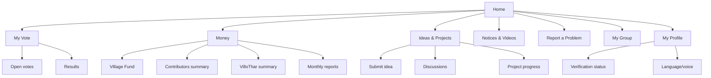
Role areas appear as an extra tab only for those with the role: **Committee**, **Treasurer**, **Information**, **Contributor**, **Helper**, **Auditor**, **Admin**.

## 10.3 Dashboards by role

| Role | Main contents |
|---|---|
| General Member | Open votes (big button), village money summary, my package & levy, notices, my issues/ideas |
| Executive Committee | Pending proposals, questions with deadlines, meeting calendar, approvals waiting, accountability scorecard |
| Treasurer | Reconciliation board (reported / sent / confirmed / disputed), VF entries to prepare, expense requests, month-end checklist |
| Public Information Officer | Notice composer (sd/ur), video upload, report publishing queue, public questions inbox |
| Infrastructure Contributor | Own capital, agreement, statements, payout history (confidential) + the ordinary member view |
| Village Helper | Assisted registration queue, kiosk mode, "who needs help" list (no vote access) |
| Independent Auditor | Read-only data browser, exports, integrity checks (hash chain, counts), findings upload |
| System Administrator | Health, backups, deployments, error logs; **no business data** |

## 10.4 Key screens
1. **Join / status** – 4-step progress with icons; OTP entry; "waiting for check" explanation; helper-assisted option.
2. **Home** – three large tiles (Vote, Money, Ideas) + notices ticker.
3. **Vote** – candidate/choice cards with photo/symbol, 🔊 per option, clear confirm screen, final "recorded" screen with no choice echoed.
4. **Money** – three separate coloured panels (Village Fund / Contributors (summary) / VilloThar (reported)) with a line "these are separate accounts"; tap for details; pending vs received shown in different styles.
5. **Package** – price, levy, total as three rows; link "why is there a levy?" opens explainer video.
6. **Proposal** – lifecycle strip (Idea → Explained → Talking → Vote → Approved → Doing → Report); video; question box.
7. **Treasurer reconciliation** – side-by-side columns; mismatch badges.
8. **Auditor integrity** – hash status, count checks, export.

## 10.5 User journeys (example)
*Vote:* SMS or helper reminder → open portal (PWA icon) → Vote tile → listen to question → choose icon → confirm → OTP → "Your vote was recorded." Offline: cannot cast; shows how to retry; draft not stored for ballots.
*Idea:* Ideas tile → record voice or type → pick group → submit → track on lifecycle strip.

---

# 11. Security Architecture

| Area | Design |
|---|---|
| Authentication | §6; OTP + PIN; Argon2id (memory-hard parameters tuned on target server); lock-out and back-off |
| Authorization | Central policy + SoD table + RLS; deny by default |
| Encryption | TLS 1.2+/HSTS; AES-256-GCM field encryption for CNIC, contributor contacts, payout accounts; keys in a secrets manager or sealed environment file held by two custodians; key rotation procedure; disk and backup encryption |
| API protection | Rate limits, request-size limits, CORS allow-list, security headers (CSP, X-Content-Type-Options, frame-ancestors), request IDs |
| Input validation | zod schemas at every route; parameterised queries only (no string-built SQL) |
| SQL injection | Query builder with bound parameters; DB role privileges minimal; lint rule against raw interpolation |
| XSS | React escaping; sanitise rich text (allow-list) in notices; CSP without `unsafe-inline` |
| CSRF | SameSite cookies + CSRF token |
| Audit logging | Hash-chained `audit.event_log` (§5.4); daily head-hash published; alerts on privileged actions |
| Backup security | Encrypted, access-restricted, restore drills; backups not accessible to VilloThar |
| Secrets | Not in Git; per-environment; rotated after staff change |
| Admin access | Named accounts, MFA, break-glass procedure (two people, logged, time-boxed) for CNIC viewing; production shell access limited to System Admin |
| CNIC | Never in logs/URLs/exports; shown masked (`4xxxx-xxxxxxx-1`); decrypt only via break-glass; purge schedule (OD-16) |
| Voting records | §7; no choice in logs; separate DB role for `vote` schema |
| Financial transactions | §8; append-only, maker–checker, idempotency |
| Contributor profiles | Field encryption; access only to owner, Treasurer (function-limited) and Auditor (masked) |
| Bank references | Stored as given; unique constraints; visible to officers/auditor, truncated on public view |
| Supply chain | Locked dependencies, `npm audit` in CI, minimal base images |
| Monitoring | Failed-login spikes, OTP abuse, unusual admin actions, hash-chain verification failures → alerts |

---

# 12. Deployment and Infrastructure Architecture

## 12.1 Environments

| Env | Purpose | Data |
|---|---|---|
| Development | Developer machines (Docker Compose) | Synthetic only |
| Staging | Same stack as production; UAT; mock SMS | Synthetic/anonymised; **never real CNIC or real ballots** |
| Production | Live | Real |

## 12.2 Hosting
Single VPS with Docker Compose (Caddy, api, worker, PostgreSQL) for the pilot; separate managed object storage; upgrade path: separate DB host, then read replica. Resource sizing validated by load test (§13).

## 12.3 CI/CD
GitHub Actions: lint → unit tests → integration tests with ephemeral PostgreSQL → build images → deploy staging → smoke tests → manual approval → deploy production with migration step (forward-only, reviewed). Rollback: previous image + migration down-script or restore point. No deployments during open elections (freeze calendar).

## 12.4 Domain and separation from VilloThar
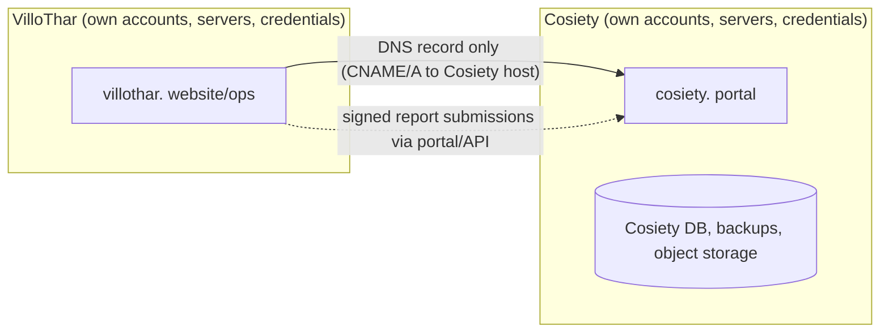
* The subdomain is **just a DNS pointer** (or delegated NS records) to Cosiety's host. VilloThar's DNS admin can *redirect* the name but cannot read Cosiety data; for continuity the society should register its own domain once registered (recommended roadmap item), and the MoU should say who controls the name.
* Separate: hosting account, SSL private keys, database credentials, Git organisation, CI secrets, backup storage, and admin users. No shared database; no VilloThar network access to Cosiety DB.
* Information flows: VilloThar → Cosiety (reports, transfer declarations) through authenticated submission; Cosiety → VilloThar only what VilloThar needs (levy due summary), nothing about members' identities or votes.
* Deployment permissions: only Cosiety-appointed System Admin(s); VilloThar staff receive a *VilloThar Ops Administrator* application role, nothing at server level.

## 12.5 Backups, monitoring, disaster recovery

| Item | Design |
|---|---|
| Backups | Nightly full + continuous WAL; retention 30 days daily / 12 months monthly *(proposed)*; off-site, encrypted, tested restore quarterly |
| Monitoring | Uptime probe, CPU/disk/memory, DB size, queue depth, certificate expiry, hash-chain verification |
| Error reporting | Central error tracker with PII scrubbing |
| DR | RPO ≤ 24 h, RTO ≤ 8 h *(proposed)*; documented rebuild from Git + backup on a new VPS; copy of runbook printed with officers |

---

# 13. Testing Strategy

| Level | Scope | Tools |
|---|---|---|
| Unit | Rule engines (quorum, thresholds, household/term), levy split, return formulas | Vitest/Jest |
| Integration & DB | Constraints, triggers, RLS, transactions, migrations, role privileges | Jest + ephemeral PostgreSQL; pgTAP optional |
| API | Contract tests from OpenAPI, permissions per route | Supertest/Schemathesis |
| Frontend | Components, RTL rendering, accessibility checks | Testing Library, Playwright, axe |
| Security | OWASP ASVS-based checks, dependency audit, authorization fuzzing | ZAP, npm audit |
| Voting integrity | See below | custom suite |
| Financial reconciliation | See below | custom suite |
| Performance | 200 concurrent voters; ledger paging; low-bandwidth profile (throttled 1 Mbps, 300 ms) | k6, Lighthouse |
| Usability | Sessions with villagers, women's groups, helpers; mock vote | Observation, task success rate |
| UAT | Treasurer month-end close; contributor statement; full mock election | Checklists |

**Special scenarios**

| ID | Scenario | Expected |
|---|---|---|
| TC-01 | Same voter submits twice concurrently from two devices | One succeeds; one gets `ELE_ALREADY_VOTED`; counts equal |
| TC-02 | Cast with network drop after server commit | Status reflects recorded; no second ballot |
| TC-03 | Admin tries SQL/API update of election window or snapshot after open | Rejected; attempt logged; hash check unchanged |
| TC-04 | Query joins `vote_participation` and `ballot_box` | No common key; no inference possible from columns (timestamp/serial absent); row order randomised |
| TC-05 | Edit/delete a ledger line (as app role, as DB owner role) | Blocked by revoked privileges/trigger; only reversal works |
| TC-06 | Post VF entry to CL account (direct and via crafted API) | Rejected; no FK path; separate roles |
| TC-07 | Sent-but-unconfirmed transfer | Not in balance; shown as "on the way" |
| TC-08 | Treasurer approves own entry | Blocked |
| TC-09 | Ordinary member/contributor/helper requests CNIC via API, export, log search | Not present anywhere; 403/404 |
| TC-10 | Contributor with large capital nominates / votes | Same as any member; no extra role created |
| TC-11 | Levy set above cap | Rejected |
| TC-12 | Duplicate payment callback | One purchase, one levy-due posting |
| TC-13 | Bank statement import re-uploaded | Duplicate lines rejected |
| TC-14 | Hash-chain tamper (modify an old audit row in a test DB) | Verification job fails and alerts |
| TC-15 | Executive election with two winners from one household | Certification blocked |
| TC-16 | Restore from backup into staging | Ledgers balanced; hash chain intact |

---

# 14. Maintenance and Future Scalability

| Phase | Architecture state |
|---|---|
| 1 One village | One `society` row (Pabohar); all code already uses `society_id` + RLS |
| 2 Governance/elections | Rule engine + election module in use |
| 3 Projects, levy, audit | VF/CL fully active; auditor role |
| 4 More villages + federation | New `society` rows; each with own members, rules, ledgers, bank accounts; `federation` schema added later (societies as members; one vote per society; no pooled money); shared learning content via a global library table |

Multi-society design: tenant isolation by RLS and per-society encryption key IDs; per-society configuration; reports and ledgers never aggregate across societies except in explicitly designed federation views. Each society's bank accounts and approvals are separate. **Federation is not required for the first release.**

Maintenance: semantic versioning; migrations reviewed; documented runbook; quarterly dependency updates; yearly restore drill; handover guide (NFR-MNT-004); module owners; keep dependencies few to reduce long-term cost.

---

# 15. Implementation Roadmap

Legend: **MVP** = minimum viable first release (Phase 1).

| Phase | Scope | Technical dependencies | DB | API | Deliverables | Testing | Deployment milestone | Institutional dependencies |
|---|---|---|---|---|---|---|---|---|
| **1 Internet pilot (MVP)** | Member register (OTP + manual verification), households/neighbourhoods, contributor profiles + agreements, public ledger (VF + CL aggregate + OPS reported), weekly sales/collection records, transfer declaration & confirmation, notices, audit log, monthly report | SMS provider; hosting; backup; staging | core, vf, cl, ops, recon, audit, comm.notice | API-01..07, 16..23, 28, 29 | Working portal in Sindhi/Urdu, handover guide | Unit + DB + permission tests; reconciliation suite; usability pilot | Production at pilot launch | Bank account (OD-10), VilloThar reporting format (AD-07), contributor agreements (AD-10), registration started (OD-09) |
| **2 Community participation** | Voting engine, agenda submission, issue reporting, video library, first election, committee terms, public Q&A | Media storage; audio recordings | gov, vote, comm.* | API-08..13, 15, 27 | First certified election | Voting integrity suite, load test 200 voters, mock election | Election-readiness checklist, freeze calendar | Rules approved: OD-01..04, 06, 15, 18 |
| **3 Financial governance** | Levy vote, VF expenditure, project lifecycle, return calculations, auditor access, recall/conflict declarations | Auditor onboarding | prj, vf allocations, cl returns | API-14, 24..26 | First project closed with public report; first audit | Financial workflow, SoD tests, audit export tests | Audit-ready release | OD-05, 07, 08, 11, 12, 14 |
| **4 Expansion** | Second village, multi-society hardening, federation module, events, competitions, shared learning | Per-society keys; ops capacity | society onboarding, `federation` | Society admin & federation APIs | Society #2 live | Tenant-isolation and migration tests | Staged rollout | Pabohar society stable; MoUs; new society rules |

**MVP vs enhancements:** MVP excludes voting, levy changes, expenditure, auditor tooling, automated payments, video library, federation. Anything marked optional in SRS §5 (gateway, ID verification, bank APIs) remains an enhancement until agreements exist.

---

# 16. Consistency Review

| Question | Answer |
|---|---|
| Every principle has a requirement? | Yes – SRS §11. |
| Every critical FR has a design? | Voting §7 (ELE), finance §8 (FIN/PAY/CON), DB constraints §5.5, auth §6, UX §10, security §11. |
| Streams genuinely separated? | Separate schemas/roles, no cross-FKs, separate bank accounts recommended, `recon` cannot post (§5, §8). |
| Every transaction traceable? | Journal refs, source ids, idempotency keys, hash-chained audit, bank match (§8.8). |
| One verified person → one vote? | PK + snapshot + step-up (§7.2). |
| Low literacy participation? | Icons, audio, helper kiosk, women's groups (§10, §7.2). |
| Low bandwidth? | PWA, light pages, audio-only/360p (§3, §10). |
| Independence from VilloThar? | §12.4. |
| First village without federation? | Yes (§14). |
| More villages without rebuild? | `society_id`, RLS, per-society config (§5.1, §14). |
| Honest limits | Software cannot prevent a host-level superuser from tampering; it makes tampering detectable (§7.3). Legal classification of returns is **not decided** here. |

---

# 17. Glossary and References

**Glossary:** see SRS §18. Additional: *RLS* – row-level security; *WAL* – write-ahead log; *PWA* – progressive web app; *Idempotency key* – unique ID that makes retries safe; *HMAC* – keyed hash; *Hash chain* – each log entry contains the hash of the previous, so edits are detectable; *Break-glass* – exceptional, logged, two-person access.

**References**
1. Cosiety Design Note, Draft v1, 16 Nov 2026. 2. Cosiety_SRS_v1.0. 3. PostgreSQL documentation (constraints, RLS, roles). 4. OWASP ASVS and Top 10. 5. WCAG 2.1. 6. Sindh Co-operative Societies Act, 2020 and Cooperative Department Sindh (cooperation.sindh.gov.pk) – legal matters in SRS §16 require professional review.
