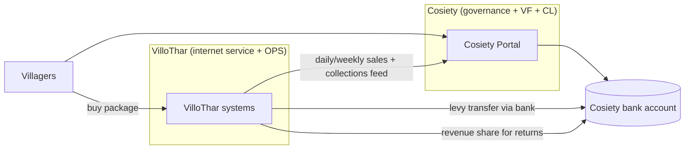

# Cosiety – Software Requirements Specification (SRS)

| | |
|---|---|
| **Project** | Cosiety – Digital Village Cooperative Society |
| **Document** | Cosiety_SRS_v1.0 |
| **Version** | 1.0 (Draft for stakeholder review) |
| **Prepared** | 16 November 2026 |
| **Status** | DRAFT – not approved. Contains proposals that are *not* adopted policy. |
| **Source** | "Cosiety: Village Cooperative Society – Design Note", Draft v1, 16 Nov 2026 |
| **Companion** | Cosiety_SDS_v1.0 (Software Design Specification) |
| **Standard** | Structure inspired by ISO/IEC/IEEE 29148 |

## Revision history

| Version | Date | Author | Change |
|---|---|---|---|
| 0.1 | 16 Nov 2026 | Draft team | Initial extraction from Design Note |
| 1.0 | 16 Nov 2026 | Draft team | First complete SRS for review |

## How to read this document

* **[DN]** = stated in the Design Note. **[REC]** = recommendation added by this draft, *not* approved. **[ASM]** = technical assumption. **[DEP]** = external dependency needing confirmation.
* Requirement priority: **M1–M4** = the build phase (Phase 1–4 of the Design Note, §11) in which it is first needed. **M1 is the MVP.**
* "Shall" = mandatory. "Should" = recommended. Numbers shown as *(proposed target)* need validation in the pilot.
* No governance number (committee size, quota, term, cap, threshold, quorum) is fixed here. Each is a **configurable parameter** (see §13, Open Decisions).

## Table of contents

1. Introduction
2. Overall Description
3. Stakeholders, Roles and Permissions
4. Functional Requirements (Modules A–N)
5. External Interface Requirements
6. Non-Functional Requirements
7. Use Case Specifications
8. Business Rules Catalogue
9. Data Requirements
10. Acceptance Criteria
11. Requirements Traceability Matrix
12. Executive Summary of Design Ambiguities
13. Open Decisions
14. Assumptions and Dependencies Register
15. Risk Register
16. Legal and Regulatory Considerations
17. Consistency Review
18. Glossary and References

---

# 1. Introduction

## 1.1 Purpose
This SRS states **what** the Cosiety platform must do, **who** uses it, and **under what conditions** it is acceptable. It converts the Design Note's institutional model (equal votes, a public village fund, rotating leadership, three separated money streams) into testable software requirements. Implementation choices are in the SDS.

## 1.2 Executive summary
Cosiety is a web portal that lets the verified adult residents of a village form and run a cooperative society on top of the VilloThar rural internet network. It provides: a member register, neighbourhood groups, a General Body that votes, an elected Executive Committee, an equal-voting election engine, three strictly separated money ledgers (Village Fund, Infrastructure Contributor Ledger, Operations reconciliation), a public ledger, a project lifecycle (proposal → explainer → discussion → vote → execution → report), issue reporting, notices and a Sindhi/Urdu video library. It must work for people with low literacy and low bandwidth, and it must keep going after outside support ends **[DN §1]**.

The first release serves **one village, Pabohar** **[DN §3]**. Federation of villages is a later phase and is **not** a dependency of the first release.

## 1.3 Scope
**In scope (first village):** modules A–N below.
**Out of scope for first release:** federation features (events, competitions, shared learning), second-village onboarding UI, direct NADRA integration, automated bank-transfer initiation, accounting-system integration. These are identified as Phase 4 or optional.
**Out of scope entirely:** VilloThar's internal billing, network operations and staff accounting; legal registration itself; deciding the legal classification of contributor returns.

## 1.4 Intended audience
Developers and testers; cooperative representatives; VilloThar management; an independent auditor; potential institutional partners and funders.

## 1.5 Document conventions
IDs: `FR-<MODULE>-nnn`, `NFR-<AREA>-nnn`, `UC-nn`, `BR-nn`, `OD-nn` (open decision), `AD-nn` (assumption/dependency), `RK-nn` (risk), `AC-<MODULE>-nn` (acceptance criterion).
Module codes: AUTH, MEM, HH, NBG, GB, EXC, ELE, FIN, PAY, LED, PRJ, ISS, NTC, CON, AUD.

## 1.6 Definitions (short; full glossary in §18)

| Term | Meaning |
|---|---|
| **Member** | An individual adult resident registered in the Cosiety member register. |
| **Verified Adult Voter** | A Member whose identity and adulthood are verified and who is *active* – the only kind of person who may vote. |
| **Household** | A group of members living together; used for restrictions (e.g. one committee seat per household). A household never votes; individuals do. |
| **Neighbourhood group** | A mohalla/hamlet-level group. |
| **General Body (GB)** | All verified adult voters of the village. |
| **Executive Committee (EC)** | The elected body that runs Cosiety day to day. |
| **Village Fund (VF)** | Stream 1: the per-individual levy. |
| **Contributor Ledger (CL)** | Stream 2: capital from infrastructure contributors and returns paid back. |
| **Operations Account (OPS)** | Stream 3: package revenue kept by VilloThar. Owned by VilloThar, not Cosiety. |
| **Levy** | Small equal amount added to each individual user's package, set by General Body vote and capped. |

## 1.7 Product overview and system boundary

**Boundary rule [DN §6, §8]:** Cosiety's application, database, credentials and administrators are separate from VilloThar's. Cosiety receives *reports and references* from VilloThar; it does not control VilloThar's accounting, and VilloThar does not control Cosiety's governance or ledgers. Sharing a domain name or a server does **not** imply shared ownership, governance or financial control, and this SRS makes no legal assumption about the future MoU.

---

# 2. Overall Description

## 2.1 Product perspective
Cosiety is a new standalone system. It exchanges data with VilloThar (sales/collection feed, levy transfer references, revenue-for-returns figures) and with third-party services (SMS/OTP, payments, media, possibly identity verification). Its design adapts the three-tier model of the Rural Support Programmes (neighbourhood group → village body → union-level body) but replaces NGO staff with software and an elected body **[DN §3]**.

## 2.2 Product objectives
1. Give every verified adult resident one equal vote. 2. Make all money visible. 3. Turn ideas into funded projects through a transparent lifecycle. 4. Rotate leadership and prevent household domination. 5. Include people who cannot read or own a smartphone. 6. Be sustainable without external NGO staff.

## 2.3 Major capabilities
Registration & verification · member/household registry · neighbourhood groups · General Body and Executive management · elections and referenda · three-stream finance · package/levy collection records · public ledger · participatory budgeting · issues · notices and video library · contributor management · audit and accountability.

## 2.4 First village vs federation

| Aspect | First village (Pabohar) – required | Later (Phase 4) – not required for release |
|---|---|---|
| Societies | One society | Many independent societies |
| Money | Own VF, CL, OPS reconciliation | Each society has its own; no pooled funds |
| Voting | Member votes | Federation votes use one vote per society |
| Data design | All records carry a `society_id` from day one **[REC]** | Federation module added on top |

## 2.5 User categories
See §3. Four broad groups: (a) villagers (members, voters, group members, contributors); (b) elected representatives (EC, President, Secretary, Treasurer, PIO); (c) support staff (Village Helper, Cosiety Administrator, VilloThar Operations Administrator); (d) oversight (Independent Auditor, System Administrator).

## 2.6 Operating environment
Mobile-first web app used mostly on low-cost Android phones over the VilloThar fixed-wireless network and mobile data, with occasional use on a shared device operated by a Village Helper **[ASM]**. Interface languages: Sindhi, Urdu (right-to-left), and English for administrators.

## 2.7 Design constraints
* **C-1** Three money streams shall be separated in data, accounts and reports **[DN §5]**.
* **C-2** Contributor capital never grants votes, seats or privileges **[DN §2.2]**.
* **C-3** Governance parameters are configurable, because the Design Note leaves them open **[DN §12]**.
* **C-4** Must run on low bandwidth and low-end devices.
* **C-5** Low cost: no infrastructure that a village society cannot sustain.
* **C-6** Identity checks use CNIC and one-time code **[DN §9]**; official NADRA verification is *not* assumed.

## 2.8 Assumptions and dependencies
See §14 (register). Key ones: CNIC verification route (AD-01/02), SMS provider (AD-03), bank account for Cosiety (AD-05), payment merchant arrangement (AD-06), VilloThar reporting feed (AD-07), cooperative registration (AD-09), contributor agreements (AD-10).

## 2.9 Limitations
Software cannot guarantee legal compliance, honest officials or voter freedom from social pressure. It can make misconduct harder to hide and easier to detect (immutable records, separation of duties, public data).

---

# 3. Stakeholders, Roles and Permissions

## 3.1 Stakeholder and role definitions

| # | Role | Nature | Responsibility in the system |
|---|---|---|---|
| 1 | General Society Member | Villager | Registered resident; reads public information; submits ideas, questions, issues. |
| 2 | Verified Adult Voter | Villager | Member with verified identity and adulthood; votes in elections/referenda. |
| 3 | Neighbourhood Group Member | Villager | Takes part in a mohalla group: agenda items, nominations, meetings. |
| 4 | Executive Committee Member | **Elected** | Runs Cosiety; answers public questions; proposes budgets; votes in committee. |
| 5 | President | **Elected** | Chairs EC; second approver of spending. |
| 6 | Secretary | **Elected** | Agendas, minutes, notices, membership approvals. |
| 7 | Treasurer | **Elected** | Prepares VF entries and reports; may not approve own entries. |
| 8 | Public Information Officer | **Elected** | Publishes notices, reports, explainers; handles public questions workflow. |
| 9 | Village Helper | Appointed, not on committee | Assists registration/voting; cannot vote on anyone's behalf. |
| 10 | Infrastructure Contributor | Villager/outsider | Sees own contribution/payout; no extra governance rights. |
| 11 | Cosiety Administrator | **Appointed**, non-elected | Operates the application on behalf of the society; no governance powers. |
| 12 | VilloThar Operations Administrator | VilloThar staff | Submits sales/collection and transfer records from the VilloThar side. |
| 13 | Independent Auditor | External | Read-only access for audit; publishes audit report. |
| 14 | System Administrator | Technical | Operates servers and deployment; no business-data privileges. |

Rules: **(R-1)** Application administrators (11, 12, 14) are not elected representatives and hold no vote beyond what they have as ordinary members. **(R-2)** No role is all-powerful; sensitive actions need two different people (maker–checker). **(R-3)** An elected role is a *time-bound assignment* that expires automatically at term end. **(R-4)** Being verified never makes someone an administrator.

## 3.2 Role-permission matrix
Legend: **V** view · **C** create · **U** update · **D** void/archive (no hard delete of financial or governance records) · **A** approve · **R** reject · **P** publish · **T** vote · **X** audit (read audit trail/export). Qualifiers: *(own)* own record only; *(agg)* aggregates only; *(mask)* masked, e.g. CNIC hidden; *(pub)* public-level only; *(maker)* may prepare but not approve own work; *(2nd)* second approver.

| Role | Financial data | Identity data | Governance records | Operational data |
|---|---|---|---|---|
| 1 General Member | V(pub) | V,U (own, limited fields) | V(pub), C (ideas, questions, issues) | V(pub summaries) |
| 2 Verified Voter | V(pub) | V,U(own) | V(pub), C, **T** | V(pub) |
| 3 Neighbourhood Group Member | V(pub) | V,U(own) | as 2 + C (group agenda, nominations) | V(pub) |
| 4 EC Member | V (all VF detail) | V(mask) | V, C, U(committee items), A/R (feasibility, committee decisions) | V |
| 5 President | V, A(2nd) on spending | V(mask) | V, A, P (with Secretary) | V |
| 6 Secretary | V | V(mask), A (membership approval) | C,U (agenda, minutes), P (notices) | V |
| 7 Treasurer | V, C,U(maker) VF entries, P (draft reports) | V(mask) | V | V (levy/transfer status) |
| 8 PIO | V, P (approved reports) | none | C,U,P (notices, explainers, Q&A) | V(pub) |
| 9 Village Helper | none | C (assisted registration), V(mask) for people assisted | assisted-voting session (no ballot choice access), V(pub) | none |
| 10 Contributor | V(own CL statement; agg CL) | V,U(own) | as member role | V(pub) |
| 11 Cosiety Administrator | V (no C/U/A) | V(mask), U (status ops, with reason) | U (rule-parameter changes via dual control; never approves resolutions) | C,U (config), V logs |
| 12 VilloThar Ops Administrator | C,U(maker) VilloThar-side collection/transfer records; V (levy payable, transfer status) | none | none (member rights only if resident) | C,U own feed |
| 13 Independent Auditor | V (all), **X**, P (audit report) | V(mask) | V, X | V, X |
| 14 System Administrator | none (cannot read decrypted data) | none | none | V,U (infrastructure only) |

Additional rules: Treasurer ≠ approver of own entries; President and Treasurer may not share a household **[DN §4]**; a member may not approve spending that benefits their family or business **[DN §8]** (BR-15). CNIC data is visible only to a narrow, logged "break-glass" path (see NFR-PRV-002).

---

# 4. Functional Requirements

Source tags: DN = Design Note section; REC = recommendation (not approved). Phase = first build phase (M1–M4).

## Module A – Member Registration and Identity Verification (AUTH)

| ID | Requirement | Ph | Source |
|---|---|---|---|
| FR-AUTH-001 | The system shall let a person start registration with name, mobile number, CNIC number, date of birth (as on CNIC), neighbourhood and household selection or creation. | M1 | DN §9 |
| FR-AUTH-002 | The system shall verify control of the mobile number by sending a one-time password (OTP) valid for a configurable time *(proposed 5 min)* and allowing a limited number of attempts *(proposed 5)*. | M1 | DN §9 |
| FR-AUTH-003 | The system shall compute adulthood from the CNIC date of birth against a configurable minimum voting age *(proposed default 18)* and mark under-age registrants as *non-voting*. | M1 | DN §1 |
| FR-AUTH-004 | The system shall prevent duplicate identities: one CNIC shall map to at most one active member, and a duplicate attempt shall be flagged for review without revealing whose CNIC it matches. | M1 | DN §9 |
| FR-AUTH-005 | The system shall support a *verification workflow*: Submitted → OTP-confirmed → Identity-checked (human check of CNIC against person, by Village Helper or Secretary) → Approved (second person) → Active. Each transition is logged with actor and time. | M1 | DN §9 / REC |
| FR-AUTH-006 | The system shall not treat OTP success alone as identity verification; identity status and phone status are tracked separately. | M1 | REC |
| FR-AUTH-007 | The system shall make verification-provider integration (e.g. an automated CNIC check) a replaceable component; the first release shall operate without it. NADRA access is a dependency requiring confirmation (AD-01). | M1 | DN §9 / DEP |
| FR-AUTH-008 | The system shall provide login by mobile number + OTP and, optionally, a PIN/password; and shall provide account recovery through re-verification (OTP + Village Helper assisted check where phone is lost). | M1 | REC |
| FR-AUTH-009 | The system shall support suspension and deactivation of a member with mandatory written reason, effective date, and appeal path; suspended members keep read access to public data but cannot vote. | M1 | REC |
| FR-AUTH-010 | The system shall show each applicant their verification status in Sindhi/Urdu with icons and plain language. | M1 | DN §9 |
| FR-AUTH-011 | CNIC numbers, CNIC images and credentials shall never appear in any public page, public API, public ledger, export or notification text. | M1 | DN §2.3 |

## Module B – Member and Household Management (MEM, HH)

| ID | Requirement | Ph | Source |
|---|---|---|---|
| FR-MEM-001 | The system shall maintain a member directory visible to authorised roles with masked identity data; ordinary members see only what the society's privacy policy allows *(proposed: name and neighbourhood only if member consents)*. | M1 | REC |
| FR-MEM-002 | The system shall record membership status (Applicant, Active, Suspended, Deactivated, Deceased/Left) with history. | M1 | REC |
| FR-MEM-003 | The system shall record voting eligibility separately from membership status, calculated from status + age + any voting-suspension. | M1 | DN §2.1 |
| FR-MEM-004 | The system shall keep a participation history (meetings attended, votes *participated in* but never choices, proposals submitted) for each member, visible only to that member and aggregated for others. | M2 | DN §3 |
| FR-MEM-005 | The system shall show member statistics (totals by neighbourhood, gender, verified voters, women's participation) without identifying individuals. | M1 | DN §9 |
| FR-HH-001 | The system shall record households with a household identifier, neighbourhood, and the members belonging to it. | M1 | DN §4 |
| FR-HH-002 | The system shall preserve the distinction that a household has no vote; only individual members vote. | M1 | DN §2.1 |
| FR-HH-003 | The system shall let a household's members be reassigned (e.g. marriage, split) with logged history, so household restrictions in elections use the household as it was at nomination time. | M2 | REC |
| FR-HH-004 | The system shall associate each member with exactly one neighbourhood at a time with history. | M1 | DN §3 |

## Module C – Neighbourhood Groups (NBG)

| ID | Requirement | Ph | Source |
|---|---|---|---|
| FR-NBG-001 | Cosiety Administrator or Secretary shall create neighbourhood groups (mohalla/hamlet), including women's groups where chosen. | M1 | DN §9 |
| FR-NBG-002 | Members shall be assigned to a group; reassignment is logged. | M1 | DN §3 |
| FR-NBG-003 | Each group shall have one or more representatives (convener) who may submit agenda items on its behalf. | M2 | DN §3 |
| FR-NBG-004 | Groups shall hold scheduled meetings with agenda, attendance and minutes recorded and published to group members (and publicly if the group chooses). | M2 | DN §3, §10 |
| FR-NBG-005 | Groups shall be able to nominate candidates for elections. | M2 | DN §3 |
| FR-NBG-006 | Groups shall be able to publish community notices to their members. | M2 | DN §3 |
| FR-NBG-007 | The system shall record group participation (attendance counts, submitted agenda items). | M2 | DN §10 |

## Module D – General Body Management (GB)

| ID | Requirement | Ph | Source |
|---|---|---|---|
| FR-GB-001 | The system shall maintain the verified voter register as an exact, queryable list of eligible voters at any date. | M1 | DN §3 |
| FR-GB-002 | The system shall publish General Body meeting notices with date, place, agenda and notice period (configurable). | M2 | REC |
| FR-GB-003 | The system shall record meeting agendas, attendance (physical and/or digital), decisions, and minutes. | M2 | REC |
| FR-GB-004 | The system shall calculate quorum as *eligible voters at snapshot × quorum fraction*; the fraction is configurable per decision type (OD-06). | M2 | DN §7, §12 |
| FR-GB-005 | The system shall manage resolutions: drafted, tabled, voted, passed/failed, published. | M2 | DN §7 |
| FR-GB-006 | The system shall publish every GB decision with its vote counts and date. | M2 | DN §2.3 |
| FR-GB-007 | The system shall offer a public question-and-answer session feature tied to a meeting or project. | M2 | DN §7 |

## Module E – Executive Committee Management (EXC)

| ID | Requirement | Ph | Source |
|---|---|---|---|
| FR-EXC-001 | The system shall hold committee configuration: size range *(proposed 9–11, to be approved)*, role list, reserved seats per neighbourhood/community, women's quota, term length, term limit, staggering plan. **All shall be parameters**, none hard-coded (OD-01..04). | M2 | DN §4, §12 |
| FR-EXC-002 | The system shall create committee terms with start/end dates; role permissions expire automatically at term end. | M2 | DN §4 |
| FR-EXC-003 | The system shall support the roles President, Secretary, Treasurer, Public Information Officer and members, assignable to elected persons. | M2 | DN §4 |
| FR-EXC-004 | The system shall enforce at nomination and at result certification: no two members from the same household; President and Treasurer not from the same household; term limits; reserved seats and quotas as configured. Violations block certification until resolved. | M2 | DN §4 |
| FR-EXC-005 | The system shall support staggered elections (e.g. seats expiring in different cycles) by assigning each seat a cycle. | M2 | DN §4 |
| FR-EXC-006 | The system shall accept recall petitions; a petition is valid when signatures from verified voters reach a configurable share (OD-11); on validity, a recall vote is scheduled automatically. | M3 | DN §4 |
| FR-EXC-007 | The system shall record conflict-of-interest declarations by committee members (family, business) and use them to block those members from approving related spending. | M3 | DN §8 |
| FR-EXC-008 | The system shall keep performance records per committee member: meetings attended, questions answered on time, proposals handled, decisions voted. | M3 | DN §8 |
| FR-EXC-009 | The system shall show a public committee page with names, roles, term dates, neighbourhood and attendance. | M2 | DN §2.3 |

## Module F – Election and Voting System (ELE)

| ID | Requirement | Ph | Source |
|---|---|---|---|
| FR-ELE-001 | The system shall let the authorised body create an election/referendum of a type: executive election, levy approval, budget approval, project approval, recall, or other resolution. | M2 | DN §4, §7 |
| FR-ELE-002 | Each election shall have configurable: nomination period, voting period, eligibility rules, thresholds, quorum, ballot type (secret/open), number of seats, reserved-seat rules. | M2 | DN §12 |
| FR-ELE-003 | The system shall accept candidate nominations (self-nomination and neighbourhood-group nomination) and check candidate eligibility automatically (verified, not suspended, household and term rules). | M2 | DN §3, §4 |
| FR-ELE-004 | On opening an election the system shall freeze the rules and the list of eligible voters (snapshot); later changes to membership shall not alter that election. | M2 | REC |
| FR-ELE-005 | The system shall allow each eligible voter to vote at most once per ballot item, and shall enforce this regardless of device or session. | M2 | DN §2.1 |
| FR-ELE-006 | Executive elections shall be secret ballots; levy, budget, project and recall votes shall be secret unless the General Body explicitly adopts open voting for a vote type (OD-15). Individual choices of secret ballots shall never be stored in a way linking them to a person. | M2 | REC |
| FR-ELE-007 | The system shall publish turnout, totals, quorum status and results; it shall not publish individual choices for secret ballots. | M2 | DN §2.3 |
| FR-ELE-008 | The system shall support voting by icon, symbol and voice prompts, and assisted voting at a Village Helper kiosk in which the voter personally authenticates and chooses. | M2 | DN §9 |
| FR-ELE-009 | The system shall evaluate results against the configured threshold and quorum and report *Passed / Failed / No quorum*. | M2 | DN §7 |
| FR-ELE-010 | The system shall produce an election audit log (config, snapshot digest, state changes, counts) that cannot be edited and can be exported. | M2 | DN §8 |
| FR-ELE-011 | The system shall run executive elections with reserved seats and quota rules, producing a seat allocation that a human must certify. | M2 | DN §4 |
| FR-ELE-012 | The system shall notify voters (SMS/portal/helper) about open elections. | M2 | DN §9 |

## Module G – Three Separate Financial Streams (FIN)

| ID | Requirement | Ph | Source |
|---|---|---|---|
| FR-FIN-001 | The system shall maintain three distinct ledger domains: **VF**, **CL**, **OPS-Reconciliation**. Every financial record shall belong to exactly one domain. | M1 | DN §5 |
| FR-FIN-002 | No transaction, report, export or API response shall combine balances of different domains into one balance. Cross-domain views may *list* the three side by side with clear labels. | M1 | DN §5 |
| FR-FIN-003 | **VF**: record levy configuration (amount, effective date, cap, approving vote reference, history). | M3 | DN §5 |
| FR-FIN-004 | **VF**: record collections *recorded as due*, transfers received, expenditures, allocations per approved project, and the running balance. | M1/M3 | DN §6 |
| FR-FIN-005 | **VF**: an expenditure shall only be recordable against an approved project/budget line, with approver(s) and evidence. | M3 | DN §5, §7 |
| FR-FIN-006 | **CL**: record contributors, agreements, payments in, infrastructure purchase invoices paid to VilloThar, returns received, and returns distributed. | M1 | DN §5, §6 |
| FR-FIN-007 | **OPS-Reconciliation**: record VilloThar's published package sales and collections (as reported), the levy portion, and revenue figures used for contributor returns. Cosiety does not hold VilloThar's operating books. | M1 | DN §6 |
| FR-FIN-008 | The system shall reconcile reported levy collected vs. levy transferred vs. levy received in the Cosiety bank statement, and expose unmatched items. | M1/M3 | DN §6 |
| FR-FIN-009 | The system shall distinguish **money received**, **money recorded as payable**, and **money transferred**, as separate states; a pending or initiated transfer shall never appear as received. | M1 | REC |
| FR-FIN-010 | Financial records shall be append-only; corrections shall be reversal or adjustment entries with reason and approver. | M1 | REC |
| FR-FIN-011 | Every financial entry shall carry a reference number, date, category, domain, actor, approver (if required) and supporting document link where applicable. | M1 | DN §6 |
| FR-FIN-012 | The levy shall be enforced against its approved cap; a change above the cap or without an approved vote reference shall be rejected. | M3 | DN §5 |
| FR-FIN-013 | The system shall guarantee that levy money is used only for approved projects (VF expenditure requires a project approval reference). | M3 | DN §5 |

## Module H – Package Purchase and Levy Collection (PAY)

| ID | Requirement | Ph | Source |
|---|---|---|---|
| FR-PAY-001 | The system shall display packages with a single price per package for all users (one price list). | M1 | DN §2.4 |
| FR-PAY-002 | Every package screen shall show the package price (to VilloThar) and the levy (to Village Fund) separately, and the total. | M1 | DN §5 |
| FR-PAY-003 | The levy shall be applied per individual subscriber/user, not per household. | M1 | DN §5 |
| FR-PAY-004 | The system shall record each purchase with a status: Initiated, Pending, Paid, Failed, Refunded, Reversed. Only Paid contributes to collection totals. | M1 | REC |
| FR-PAY-005 | VilloThar shall publish daily or weekly sales and collections (cadence configurable) to Cosiety; the system shall store each submission with preparer and time; later changes are corrections, not overwrites. | M1 | DN §6, §11 |
| FR-PAY-006 | The system shall compute levy due to Cosiety per reporting period = count of paid individual packages × levy at purchase date. | M1 | DN §6 |
| FR-PAY-007 | The system shall record each VilloThar→Cosiety levy transfer with transfer reference, amount, period covered, status (Announced, Sent, Received/Confirmed, Disputed), and reconcile it against periods. | M1/M3 | DN §6 |
| FR-PAY-008 | The system shall not assume that a payment gateway settles to Cosiety; settlement is tracked as a separate record (AD-06). | M1 | REC |
| FR-PAY-009 | The system shall provide payment history for each user and daily/weekly collection reports for authorised roles. | M1 | DN §11 |
| FR-PAY-010 | The system shall list failed/pending transactions with ageing and follow-up status. | M1 | REC |

## Module I – Public Financial Ledger (LED)

| ID | Requirement | Ph | Source |
|---|---|---|---|
| FR-LED-001 | The system shall publish for each domain-appropriate public view: opening balance, money received, money spent, current balance, by period. | M1 | DN §2.3, §6 |
| FR-LED-002 | Each public entry shall show date, category, amount, reference number, related approved project and, where appropriate, supporting document. | M1 | DN §6 |
| FR-LED-003 | The system shall publish monthly statements and keep historical records accessible. | M1 | DN §8 |
| FR-LED-004 | The public ledger shall show Infrastructure Contributor Ledger only in aggregate (total capital, total returns paid, balance) without individual identities or amounts unless the contributor consents. | M1 | DN §8, §2.3 |
| FR-LED-005 | The public ledger shall show project budget vs. spending per project. | M3 | DN §6 |
| FR-LED-006 | Ledger entries shall be immutable; the public view shall display reversals/adjustments explicitly. | M1 | REC |
| FR-LED-007 | Ledger pages shall remain readable on slow connections (summary first, details loaded on demand) and offer printable/simple-language summaries. | M1 | DN §9 |

## Module J – Project Proposal and Participatory Budgeting (PRJ)

| ID | Requirement | Ph | Source |
|---|---|---|---|
| FR-PRJ-001 | Any verified member shall submit a project idea via the portal or through a neighbourhood group (including through a Village Helper). | M3 | DN §7 |
| FR-PRJ-002 | A proposal shall have title, description, category, neighbourhood, estimated budget, expected social impact. | M3 | DN §7 |
| FR-PRJ-003 | The Executive shall do a feasibility review and publish a response with reasons. | M3 | DN §7 |
| FR-PRJ-004 | The Executive shall publish an explainer (short video in Sindhi with voice) stating idea, cost and effect on the levy before discussion opens. | M3 | DN §7 |
| FR-PRJ-005 | A discussion period with fixed deadline, public questions, and Executive public answers shall be provided. | M3 | DN §7 |
| FR-PRJ-006 | The General Body shall vote with thresholds and quorum configured by spending size and by whether the levy changes. | M3 | DN §7 |
| FR-PRJ-007 | An approved project shall receive a budget allocation from VF; allocation shall not exceed available VF balance. | M3 | REC |
| FR-PRJ-008 | The Executive shall post execution progress, receipts and evidence for each expense. | M3 | DN §7 |
| FR-PRJ-009 | A final public report and an optional question session shall close the project. | M3 | DN §7 |
| FR-PRJ-010 | The system shall support the lifecycle states: Proposal → Explainer → Discussion → Voting → Approved/Rejected → Execution → Reporting → Closed, with enforced ordering. | M3 | DN §7 |

## Module K – Issue Reporting and Community Participation (ISS)

| ID | Requirement | Ph | Source |
|---|---|---|---|
| FR-ISS-001 | Members (or Village Helpers on their behalf) shall report community issues with category (e.g. water), neighbourhood/location, description, optional photo/voice note. | M2 | DN §11 |
| FR-ISS-002 | Issues shall have status, assignee, executive response, resolution history. | M2 | DN §11 |
| FR-ISS-003 | Reporter may choose visibility: public, neighbourhood only, or Executive only. | M2 | REC |
| FR-ISS-004 | Attachments shall be compressed and limited in size to suit low bandwidth. | M2 | DN §9 |
| FR-ISS-005 | The system shall let an issue be converted into a project proposal. | M3 | REC |

## Module L – Notices, Announcements and Knowledge Library (NTC)

| ID | Requirement | Ph | Source |
|---|---|---|---|
| FR-NTC-001 | The PIO shall publish announcements, election and meeting notices, reports, society rules, project updates, event announcements. | M1 | DN §9 |
| FR-NTC-002 | Content shall be available in Sindhi and Urdu, with English where needed for administrators. | M1 | DN §9 |
| FR-NTC-003 | A video library shall hold explainers for decisions, rules, reports and major projects, each with audio-only option and text summary. | M2 | DN §9 |
| FR-NTC-004 | Notices shall be delivered via portal, SMS for critical ones, and read aloud for low-literacy users. | M1 | DN §9 |
| FR-NTC-005 | Published content shall have version history and shall not be silently replaced. | M1 | REC |

## Module M – Contributor Management (CON)

| ID | Requirement | Ph | Source |
|---|---|---|---|
| FR-CON-001 | The system shall register contributors and keep profiles in the backend. | M1 | DN §8 |
| FR-CON-002 | Each contribution shall be linked to a *contribution agreement* record (terms agreed before contributing), stored as a document with version and signature/acceptance evidence. | M1 | DN §5 |
| FR-CON-003 | The system shall record capital payments into the Cosiety account and match them to contributors. | M1 | DN §6 |
| FR-CON-004 | The system shall record infrastructure investments (purchase orders, invoices from or via VilloThar, payments by Cosiety to VilloThar) linked to the CL. | M1 | DN §6 |
| FR-CON-005 | The system shall calculate each contributor's return for a period as proportional to contribution *and* subject to the agreed contractual terms and cap, using a parameterised formula approved in the agreements (OD-14). | M3 | DN §6 |
| FR-CON-006 | The system shall record distributions to each contributor's account and generate statements. | M3 | DN §6 |
| FR-CON-007 | Each contributor shall see only own profile, contributions, statements and payouts; others see only aggregates. | M1 | DN §8 |
| FR-CON-008 | The system shall prevent any contributor attribute from affecting voting, candidacy, committee or permissions. | M1 | DN §2.2 |

## Module N – Audit and Accountability (AUD)

| ID | Requirement | Ph | Source |
|---|---|---|---|
| FR-AUD-001 | The system shall generate a monthly public report: money in, money out, balance (per stream), reviewed by Treasurer and approved by a second officer before publication. | M1 | DN §8 |
| FR-AUD-002 | The system shall give the Independent Auditor read-only access and full export of ledgers, approvals, logs, documents. | M3 | DN §8 |
| FR-AUD-003 | The system shall store and publish the annual audit report in full, with management responses. | M3 | DN §8 |
| FR-AUD-004 | A public question window shall record questions, assign them to Executive members, show response deadlines *(configurable)* and publish answers. | M2 | DN §8 |
| FR-AUD-005 | The system shall record administrative actions (who, what, when, from where, why) in a tamper-evident log. | M1 | REC |
| FR-AUD-006 | The system shall maintain approval history for every spending decision. | M3 | DN §8 |
| FR-AUD-007 | The system shall maintain conflict-of-interest declarations and show which approvals were blocked or recused. | M3 | DN §8 |

---

# 5. External Interface Requirements

| ID | Interface | Requirement | Status for first release |
|---|---|---|---|
| EI-01 | Web application | Responsive web app (PWA); latest two versions of Chrome/Android WebView; works on 360 px width screens. | **Required** |
| EI-02 | Mobile-responsive UI | Touch targets ≥ 48 px; usable on a 1–2 GB RAM Android phone *(proposed target)*. | **Required** |
| EI-03 | Database | Relational database accessed only by the application; no direct access by VilloThar. | **Required** |
| EI-04 | Authentication | Mobile OTP login; session tokens; rate limits. | **Required** |
| EI-05 | SMS/OTP provider | Third-party bulk-SMS API for OTP and critical notices; provider replaceable. | **Required** – **Dependent on third-party agreement** (AD-03) |
| EI-06 | VilloThar feed | Authenticated, signed submission (portal form + file upload, later API) of sales, collections, levy transfer references and revenue figures. | **Required** – dependent on VilloThar (AD-07) |
| EI-07 | Payment gateway | Wallet/bank payment services for packages. Settlement and merchant account are separate arrangements. | **Optional** at M1 (VilloThar may record payments manually); **Dependent on merchant onboarding** (AD-06) |
| EI-08 | Bank statements | Manual statement upload (CSV/PDF) for reconciliation. | **Required** |
| EI-09 | Banking APIs / automated transfers / accounting software | Automated import or initiation of transfers; accounting export. | **Future phase**; dependent on bank agreement |
| EI-10 | Media storage/video | Hosted videos with low-bitrate and audio-only variants. | **Required** (M2) |
| EI-11 | Identity verification service | Automated CNIC/biometric verification. | **Future/optional**, **dependent on legal permission** (AD-01, AD-02) |
| EI-12 | Email/WhatsApp notifications | Additional notification channels. | **Optional** |

---

# 6. Non-Functional Requirements

All numeric targets are **proposed targets requiring validation in the pilot** unless stated.

## 6.1 Security (NFR-SEC)

| ID | Requirement |
|---|---|
| NFR-SEC-001 | Authentication shall use OTP with expiry ≤ 5 min, ≤ 5 attempts per code, lock-out/back-off after repeated failures. |
| NFR-SEC-002 | Role-based access control shall be enforced on the server for every request; there shall be no endpoint that relies only on hidden UI elements. |
| NFR-SEC-003 | All traffic shall use TLS 1.2+; sensitive fields (CNIC, bank references, contributor data) shall be encrypted at rest at field level. |
| NFR-SEC-004 | Sessions shall expire after inactivity *(proposed 30 min; 10 min for admin/treasurer)* and be revocable. |
| NFR-SEC-005 | The API shall validate all input, resist injection, XSS and CSRF, and apply rate limiting per user and per IP. |
| NFR-SEC-006 | Every administrative, financial and governance-configuration action shall be logged with actor, time, before/after, and reason; logs shall be tamper-evident and retained ≥ 7 years *(proposed; confirm with legal advice)*. |
| NFR-SEC-007 | Privileged accounts (Treasurer, President, Cosiety Admin, System Admin, VilloThar Ops Admin) shall require a second factor beyond a password/PIN. |
| NFR-SEC-008 | A person shall not be able to approve their own financial entry. |

## 6.2 Privacy (NFR-PRV)

| ID | Requirement |
|---|---|
| NFR-PRV-001 | The system shall collect only data listed in §9 (data minimisation). |
| NFR-PRV-002 | CNIC numbers/images shall be viewable only through a logged justified-access action by Secretary + Cosiety Admin (two-person), and by the Auditor in masked form. |
| NFR-PRV-003 | Members shall see, correct and (subject to legal retention) request deletion of their own personal data; consent text shall be in Sindhi/Urdu and read-aloud. |
| NFR-PRV-004 | The society shall adopt a retention schedule (OD-16). Until then, identity images are kept only until verification is complete + a configurable period *(proposed 90 days)*. |
| NFR-PRV-005 | Public pages shall expose only aggregated or consented information about individuals. |

## 6.3 Performance (NFR-PERF) – *proposed targets*

| ID | Requirement |
|---|---|
| NFR-PERF-001 | First meaningful content for a ledger or notice page ≤ 4 s on a 1 Mbps link (p75); total initial payload ≤ 300 KB compressed. |
| NFR-PERF-002 | 95% of API calls ≤ 500 ms under 100 concurrent users; ledger summaries ≤ 1 s. |
| NFR-PERF-003 | Support ≥ 500 registered members and ≥ 200 concurrent voters per election in one village; scalable to 5,000 members/society by configuration. |
| NFR-PERF-004 | Casting a ballot shall complete (server confirmation) in ≤ 3 s (p95). |
| NFR-PERF-005 | Ledger of 100,000 entries shall remain paginated and load first page ≤ 1 s. |

## 6.4 Availability and reliability (NFR-REL)

| ID | Requirement |
|---|---|
| NFR-REL-001 | Availability ≥ 99% monthly *(proposed)*; planned maintenance announced in advance and avoided during open elections. |
| NFR-REL-002 | Daily database backups with off-site copy; restore tested at least quarterly. RPO ≤ 24 h, RTO ≤ 8 h *(proposed)*. |
| NFR-REL-003 | Every financial posting and every ballot shall be atomic: either fully recorded or not recorded. |
| NFR-REL-004 | Repeated submissions (retries, double-taps) shall not create duplicate payments, ledger entries or votes (idempotency). |
| NFR-REL-005 | If a voting window is interrupted by an outage, the election authority shall be able to extend the window with a logged, published decision. |

## 6.5 Usability and accessibility (NFR-USE)

| ID | Requirement |
|---|---|
| NFR-USE-001 | The 10 most frequent tasks shall each be completable in ≤ 5 taps from the home screen *(proposed)*. |
| NFR-USE-002 | Every important screen shall have icons plus text and a "listen" button that reads it in Sindhi/Urdu. |
| NFR-USE-003 | Body text ≥ 16 px; high contrast (WCAG 2.1 AA); no reliance on colour alone. |
| NFR-USE-004 | In usability tests ≥ 80% of sampled villagers with limited literacy, assisted by video/voice, shall complete a mock vote without help from a facilitator *(proposed; to be validated)*. |
| NFR-USE-005 | Helper-assisted mode shall allow a helper to support registration/voting on a shared device without gaining access to the voter's choice or account afterward. |

## 6.6 Localisation (NFR-LOC)

| ID | Requirement |
|---|---|
| NFR-LOC-001 | Full interface in Sindhi and Urdu (RTL), English for administrators; language switch persists. |
| NFR-LOC-002 | Dates (Gregorian with optional Islamic date), numerals (Latin or Arabic-Indic, user choice) and currency (PKR) formatted locally. |
| NFR-LOC-003 | Sindhi and Urdu fonts shall render correctly on Android without installing fonts. |

## 6.7 Connectivity (NFR-CON)

| ID | Requirement |
|---|---|
| NFR-CON-001 | Core read pages shall work from cache after first visit and fall back gracefully offline. |
| NFR-CON-002 | Images compressed on upload (≤ 200 KB); videos offered at ≤ 360p and audio-only. |
| NFR-CON-003 | Forms shall save drafts locally and resume after connection loss; ballot casting shall never show success unless the server confirmed. |

## 6.8 Maintainability and scalability (NFR-MNT)

| ID | Requirement |
|---|---|
| NFR-MNT-001 | Modular code with documented REST API (OpenAPI), automated tests, CI, structured logs, monitoring and alerting. |
| NFR-MNT-002 | Every table that holds society data carries `society_id`; multi-society operation requires configuration, not re-architecture. |
| NFR-MNT-003 | Unit + integration test coverage of ledger, voting and permission code ≥ 90% line coverage *(proposed)*. |
| NFR-MNT-004 | Operations shall be documented in a handover guide so that a new maintainer can run the system without the original developers. |

---

# 7. Use Case Specifications

Compact format: **Actors / Pre / Trigger / Main / Alt / Exc / Post / FR.**

**UC-01 Member registration** — *Actors:* applicant, Village Helper (optional). *Pre:* none. *Trigger:* person opens "Join". *Main:* 1 enter name, mobile, CNIC, DOB; 2 choose neighbourhood/household; 3 accept consent; 4 receive OTP and confirm; 5 submission recorded as *OTP-confirmed*. *Alt:* helper completes form with applicant present. *Exc:* duplicate CNIC → flagged for review, neutral message; OTP expired → resend; under-age → non-voting status. *Post:* applicant record awaits identity check. *FR:* AUTH-001..004, 010, 011.

**UC-02 Identity verification** — *Actors:* Village Helper/Secretary, Secretary/Cosiety Admin. *Pre:* UC-01 done. *Trigger:* application in queue. *Main:* 1 checker compares CNIC original with applicant; 2 marks *Identity-checked*; 3 second person approves; 4 member becomes *Active* and is added to voter register; 5 SMS confirms. *Alt:* automated provider (if later approved). *Exc:* mismatch → reject with reason; checker = approver → blocked. *Post:* verification trail stored. *FR:* AUTH-005..007, GB-001.

**UC-03 View public ledger** — *Actors:* any member. *Trigger:* opens "Money". *Main:* sees three separate streams' summary cards; opens Village Fund; sees balance, in/out list, monthly statements. *Alt:* listen/summary mode. *Exc:* offline → cached last version with "as of" date. *Post:* none. *FR:* LED-001..007.

**UC-04 Submit project proposal** — *Actors:* member, neighbourhood convener, helper. *Pre:* verified. *Main:* fill form; attach optional photo/voice; submit; Executive acknowledges. *Alt:* via neighbourhood meeting. *Exc:* missing fields. *Post:* proposal in *Proposal* state. *FR:* PRJ-001,002.

**UC-05 Discuss a proposal** — *Actors:* members, Executive, PIO. *Pre:* explainer published, discussion open. *Main:* members watch explainer, post questions; Executive answers publicly before deadline; PIO moderates. *Exc:* unanswered by deadline → flagged on accountability page. *Post:* discussion record. *FR:* PRJ-004,005; AUD-004.

**UC-06 Vote on a proposal** — *Actors:* verified voter, helper (assist only). *Pre:* voting open; voter in snapshot. *Main:* open ballot; hear/see proposal; choose Yes/No/Abstain; confirm; OTP step-up; ballot recorded; receipt shown ("you have voted"). *Alt:* assisted kiosk. *Exc:* already voted → blocked; not eligible → explain; network drop → no success shown until confirmed. *Post:* participation recorded; choice stored without voter link. *FR:* ELE-004..009.

**UC-07 Conduct executive election** — *Actors:* election authority (Secretary + Cosiety Admin acting under GB-approved rules), candidates, voters, auditor (observer). *Main:* configure; publish notice; nominations; eligibility check; freeze snapshot; voting; close; tally; quota/household checks; human certification; publish results; start terms. *Exc:* rule violation → certification blocked; low turnout → quorum fail. *Post:* committee terms created. *FR:* EXC-001..005, ELE-001..012.

**UC-08 Record a package payment** — *Actors:* user, VilloThar Ops Admin. *Main:* user selects package; sees price + levy; pays; record Paid; VilloThar submits sales/collection feed; system splits price and levy. *Exc:* failed/pending → listed, no levy due; duplicate → idempotency rejects. *Post:* levy receivable created for the period. *FR:* PAY-001..006,009,010.

**UC-09 Record a levy transfer** — *Actors:* VilloThar Ops Admin, Treasurer. *Pre:* levy due for period. *Main:* VilloThar enters transfer (reference, amount, date) → state *Sent*; Treasurer matches to bank statement → *Confirmed*; VF ledger posts receipt; public ledger updates. *Exc:* amount mismatch → *Disputed*; not on statement → stays pending. *FR:* PAY-007, FIN-008,009.

**UC-10 Record a contributor investment** — *Actors:* contributor, Treasurer, Cosiety Admin. *Pre:* signed agreement. *Main:* register contributor; attach agreement; record payment; match bank statement; post to CL. *Exc:* no agreement → blocked. *Post:* contributor's capital recorded; no governance change. *FR:* CON-001..003,008.

**UC-11 Calculate contributor returns** — *Actors:* Treasurer (prepare), President (approve), VilloThar Ops Admin (revenue figure). *Pre:* revenue for period reported; return received (or recorded as payable). *Main:* system applies approved formula/caps; shows each contributor's amount; approver reviews; distribution recorded when paid. *Exc:* revenue below minimum → formula-defined result; amounts exceed cap → capped. *FR:* CON-005,006.

**UC-12 Approve project expenditure** — *Actors:* Treasurer (maker), President or another EC member (checker), conflict check. *Pre:* project approved with budget. *Main:* Treasurer posts request with invoice; system checks budget line and conflict declarations; checker approves; payment recorded; receipt attached; public ledger updates. *Exc:* conflicted approver → blocked; over budget → rejected. *FR:* FIN-005,013; AUD-006,007.

**UC-13 Publish monthly financial report** — *Actors:* Treasurer, PIO, President. *Main:* system drafts report from ledgers; Treasurer reviews; second officer approves; PIO publishes with explainer. *Exc:* unreconciled items → report must list them. *FR:* AUD-001.

**UC-14 Submit a public question** — *Actors:* member, Executive, PIO. *Main:* question posted; assigned; deadline set; answered publicly. *Exc:* deadline missed → escalated in public status. *FR:* AUD-004, GB-007.

**UC-15 File a community issue** — *Actors:* member/helper, Executive. *Main:* describe, choose category/location; submit; track status; response; resolution. *FR:* ISS-001..004.

**UC-16 Conduct an independent audit** — *Actors:* Independent Auditor, Treasurer, PIO. *Main:* auditor gets read-only access; exports ledgers/logs; checks reconciliation and approvals; uploads report; society publishes in full. *Exc:* missing evidence → listed as audit finding. *FR:* AUD-002,003,005.

---

# 8. Business Rules Catalogue

| ID | Rule | Rationale | Module |
|---|---|---|---|
| BR-01 | Each verified adult voter has exactly one vote per ballot item. | Principle 1 [DN §2] | ELE |
| BR-02 | Only Active, identity-verified members at or above the voting age (parameter, default 18) may vote. | Each person's vote is their own [DN §9] | AUTH, ELE |
| BR-03 | All users pay the same package price; no discount or premium tied to person or status. | Nobody left out [DN §2] | PAY |
| BR-04 | The levy is charged per individual user, not per household. | Each person is a citizen [DN §5] | PAY |
| BR-05 | The levy amount is set only by an approved General Body vote and displayed on every package screen. | Open decision [DN §5] | FIN |
| BR-06 | A levy cap applies; no levy above cap can be configured. | Prevent quiet growth [DN §5] (OD-05) | FIN |
| BR-07 | Levy money is used only for approved projects. | [DN §5] | FIN, PRJ |
| BR-08 | VF, CL and OPS-Reconciliation records are never mixed in accounts, entries, balances or reports. | [DN §5] | FIN |
| BR-09 | Contributor capital grants no extra vote, seat, nomination right or permission. | Money never buys power [DN §2] | CON, EXC |
| BR-10 | Contributors are repaid per agreed contractual terms; returns vary with revenue and are limited by the agreed cap. | [DN §6] | CON |
| BR-11 | Committee terms are fixed and limited by consecutive-term rule (parameters OD-03). | Rotation [DN §4] | EXC |
| BR-12 | No two committee members from the same household; President and Treasurer not from the same household. | [DN §4] | EXC |
| BR-13 | Women's reserved seats/quota and at least one senior role as set by the General Body. | [DN §4] (OD-02) | EXC |
| BR-14 | Seats are reserved so every neighbourhood and community is represented (rule set by General Body). | [DN §4] | EXC |
| BR-15 | A committee member may not approve spending that benefits their family or business. | [DN §8] | AUD, FIN |
| BR-16 | Quorum and approval threshold apply to each decision type; larger spending or levy changes require higher thresholds (parameters OD-06). | [DN §7] | GB, ELE |
| BR-17 | General Body may recall a committee member when a configured share of users petition. | [DN §4] (OD-11) | EXC |
| BR-18 | A monthly public report (in, out, balance) is published. | [DN §8] | AUD |
| BR-19 | An independent audit is performed annually and published in full. | [DN §8] | AUD |
| BR-20 | The Executive must answer public questions within a set time. | [DN §8] | AUD |
| BR-21 | Staggered elections: never replace the whole committee at once. | Keep knowledge [DN §4] | EXC |
| BR-22 | A transfer is "received" only when confirmed against the Cosiety bank statement. | Financial integrity [REC] | PAY, FIN |
| BR-23 | Financial entries are never edited or deleted; corrections are reversals/adjustments. | Audit integrity [REC] | FIN |
| BR-24 | Village Helpers and administrators cannot cast or view a voter's choice. | Ballot secrecy [REC] | ELE |
| BR-25 | Personal identity data is never public. | Privacy [DN §2.3 implied] | AUTH |

---

# 9. Data Requirements

| Data group | Main items | Public? | Notes |
|---|---|---|---|
| Member | member ID, name, mobile, CNIC (encrypted + HMAC hash for duplicate check), DOB, gender (for quota), neighbourhood, status, verification trail, consent record | No (name + neighbourhood only with consent) | CNIC and images never public |
| Household | household ID, neighbourhood, member links, history | No | Used for restriction checks only |
| Neighbourhood | name (Sindhi/Urdu/English), type (mohalla/hamlet/women's), convener | Yes | |
| Committee | term, seats, roles, assignments, cycle, declarations of interest | Yes (names, roles, dates); declarations summary yes | |
| Election | type, config, snapshot digest, candidates, state, results | Yes (config, counts, results) | |
| Voting | participation record (who voted, not what); anonymous ballot records | Turnout only | No link between person and choice for secret ballots |
| Financial | domain, accounts, entries, references, approvals, documents | Per-domain public view | Append-only |
| Contributor | profile, agreements, contributions, returns, payout accounts | Aggregate only | Bank details encrypted |
| Package & payment | packages, price, levy at purchase, purchase status, settlement/transfer records | Aggregated totals | |
| Project | proposal, review, explainer, discussion, vote result, budget, expenses, receipts, report | Yes | |
| Audit | action log, approval chain, audit reports | Reports yes; logs to auditor | |
| Issue | category, location, status, responses, attachments | Depends on reporter's visibility choice | |
| Media/announcement | notices, translations, videos, versions | Yes | |

---

# 10. Acceptance Criteria (Given–When–Then)

| ID | Module | Scenario |
|---|---|---|
| AC-AUTH-01 | A | **Given** an applicant with a CNIC already linked to an active member, **when** they register, **then** the record is held for review and the response does not disclose the existing member's identity. |
| AC-AUTH-02 | A | **Given** an OTP older than the validity window, **when** entered, **then** it is rejected; after 5 wrong attempts the code is invalidated. |
| AC-AUTH-03 | A | **Given** the same person is both identity-checker and approver, **when** they try to approve, **then** the system blocks it. |
| AC-AUTH-04 | A | **Given** any public page or API, **when** inspected, **then** no CNIC, DOB or phone number appears. |
| AC-MEM-01 | B | **Given** a household with two adults, **when** both are Active, **then** each can vote once and the household count never exceeds 1 in household-restriction checks. |
| AC-GB-01 | D | **Given** 400 eligible voters at snapshot and quorum 30%, **when** 119 vote, **then** result shows *No quorum*; at 120 it shows quorum met. (Numbers illustrative.) |
| AC-EXC-01 | E | **Given** two nominees from one household, **when** both win seats, **then** certification is blocked until one seat is reallocated per rule. |
| AC-EXC-02 | E | **Given** a term end date, **when** it passes, **then** the officer's elevated permissions are removed automatically. |
| AC-ELE-01 | F | **Given** a voter who already voted, **when** they try again from another device, **then** the second ballot is rejected. |
| AC-ELE-02 | F | **Given** a secret ballot, **when** a database administrator queries ballots, **then** no stored field links a ballot to a member. |
| AC-ELE-03 | F | **Given** an open election, **when** an admin tries to change eligibility or thresholds, **then** the change is refused and attempt logged. |
| AC-ELE-04 | F | **Given** the network drops after pressing "Vote", **when** connectivity returns, **then** the voter sees their true status (voted or not) and cannot double vote. |
| AC-FIN-01 | G | **Given** a VF entry, **when** a user attempts to post it to a CL account, **then** the system rejects it. |
| AC-FIN-02 | G | **Given** a posted ledger entry, **when** a user tries to edit or delete it, **then** the action is refused; a reversal entry is the only correction. |
| AC-FIN-03 | G | **Given** a levy proposal above the cap, **when** saved, **then** it is rejected. |
| AC-FIN-04 | G | **Given** a transfer in *Sent* state, **when** the VF balance is displayed, **then** the amount is not included. |
| AC-PAY-01 | H | **Given** a Rs. 1,000 package with Rs. 50 levy *(illustrative)*, **when** the user views it, **then** price, levy and total are shown separately. |
| AC-PAY-02 | H | **Given** a failed payment, **when** collection totals are computed, **then** it is excluded and listed under failed items. |
| AC-LED-01 | I | **Given** an adjustment, **when** the public ledger is opened, **then** the original and the reversal both appear. |
| AC-PRJ-01 | J | **Given** a proposal not yet in *Discussion* state, **when** a vote is scheduled, **then** the system refuses. |
| AC-PRJ-02 | J | **Given** a project of Rs. X, **when** VF balance < X, **then** allocation is refused. |
| AC-ISS-01 | K | **Given** an issue marked "Executive only", **when** another member searches, **then** it is not visible. |
| AC-NTC-01 | L | **Given** a notice, **when** viewed in Sindhi, **then** layout is RTL and "listen" plays audio. |
| AC-CON-01 | M | **Given** contributor A, **when** A views the portal, **then** B's amounts are not visible; only aggregates. |
| AC-CON-02 | M | **Given** a contributor of any size, **when** they stand for election or vote, **then** rules apply as for any member (no extra seat, vote or privilege). |
| AC-AUD-01 | N | **Given** the Auditor role, **when** accessing the system, **then** all data is readable but no create/update/approve action is possible. |
| AC-AUD-02 | N | **Given** a public question unanswered past the deadline, **when** the deadline passes, **then** it is shown as overdue publicly. |

---

# 11. Requirements Traceability Matrix

Chain: Design Note principle → Business rule → Stakeholder → Functional requirement → Use case → Acceptance test.

| DN principle / source | Business rule | Stakeholder | Functional requirements | Use case | Acceptance |
|---|---|---|---|---|---|
| P1 One person, one vote (§2.1) | BR-01, 02, 24 | Voter, Election authority | AUTH-003/005, ELE-004..009 | UC-02, 06, 07 | AC-AUTH-03, AC-ELE-01/02/04 |
| P2 Money never buys power (§2.2) | BR-09 | Contributor, EC | CON-008, EXC-004 | UC-10 | AC-CON-02 |
| P3 Everything public (§2.3) | BR-18, 25 | All members, PIO | LED-001..007, GB-006, AUD-001 | UC-03, 13 | AC-LED-01, AC-AUTH-04 |
| P4 Nobody left out (§2.4) | BR-03 | Member, Helper | PAY-001, NFR-USE, NFR-CON | UC-06, 08 | AC-PAY-01, NFR tests |
| P5 Rotation (§2.5, §4) | BR-11..14, 17, 21 | EC, Voters | EXC-001..006 | UC-07 | AC-EXC-01/02 |
| P6 Slow, steady (§2.6, §11) | Phased roadmap | EC, VilloThar | All phased by Ph tag | – | Phase acceptance (SDS §14) |
| Three money streams (§5) | BR-04..08, 22, 23 | Treasurer, VilloThar Ops, Contributor | FIN-001..013, PAY-001..010 | UC-08, 09, 11, 12 | AC-FIN-01..04, AC-PAY-01/02 |
| Money flow (§6) | BR-10, 22 | Treasurer, Contributor | PAY-005..007, CON-003..006 | UC-09, 10, 11 | AC-FIN-04, AC-CON-01 |
| Decision process (§7) | BR-16 | Member, EC | PRJ-001..010, GB-004..007 | UC-04, 05, 06, 12 | AC-PRJ-01/02, AC-GB-01 |
| Accountability (§8) | BR-15, 18, 19, 20 | Auditor, PIO, EC | AUD-001..007, EXC-007/008 | UC-13, 14, 16 | AC-AUD-01/02 |
| Inclusion (§9) | BR-24 | Helper, Member | AUTH-005, ELE-008, NTC-002/003, NBG | UC-01, 06 | AC-NTC-01, NFR-USE-004 |
| Identity separation REC | BR-02, 25 | Admins | AUTH-006, NFR-PRV-002 | UC-02 | AC-AUTH-04 |
| Federation later (§3, §11) | – | Federation | multi-society design (NFR-MNT-002) | – | Phase 4 tests |

All **[REC]** items are marked in §4 and require stakeholder confirmation.

---

# 12. Design Ambiguities Identified in the Design Note

These are points where the note is silent or could be read more than one way. The documents handle each as shown; none is settled.

| # | Ambiguity | How this draft treats it |
|---|---|---|
| AMB-1 | "Every verified adult **user**" – does a person need their own package to be a member? Households may buy one connection. | Members = verified adult residents; levy attaches to individual package subscriptions. New open decision **OD-13**. |
| AMB-2 | Who is merchant of record for package payments and where does settlement go before VilloThar transfers the levy? | Treated as VilloThar-collected money with levy *payable* until transferred (PAY-008, OD-17). |
| AMB-3 | Contributor return: "limited, as designed" – formula and cap unstated. | Parameterised, from the agreement (OD-14). No formula assumed. |
| AMB-4 | Contributors' payments go to the Cosiety account – is Cosiety the legal counterparty to contributors? | Not assumed; flagged for legal advice (§16). |
| AMB-5 | Reporting cadence: "day's sales" (§6) vs "weekly sales" (§11). | Configurable; default weekly for pilot. |
| AMB-6 | "Everything is public" vs contributor confidentiality. | Contributor data aggregate-public, personal view private (DN §8 supports this). |
| AMB-7 | Ballot secrecy for each vote type not stated. | Secret by default; open only if General Body decides (OD-15). |
| AMB-8 | Who runs elections before a first Executive exists? | Interim, time-limited arrangement proposed in OD-18. |
| AMB-9 | "Start-up support period" from VilloThar (§10) not defined. | Tracked as OD-19. |
| AMB-10 | Village name spelled "Pabohar" in this note. | Used as written; configurable name. |

---

# 13. Open Decisions

All remain **configurable**; statuses are **Pending** unless stated. Recommended defaults are **proposals, not approved policy**.

| ID | Decision (DN §12 unless new) | Why it matters | Technical implication | Recommended default (REC) | Blocks? | Responsible | Status |
|---|---|---|---|---|---|---|---|
| OD-01 | Executive Committee size | Seat structure, reserved seats | `committee_config.min/max_seats` | Range 9–11 (from note) | Blocks first election only | General Body (interim group) | Proposed (by note) |
| OD-02 | Women's quota (incl. a senior role) | Representation | Rule table `seat_rule` | Keep a numeric field; no default value | Blocks first election | General Body | Pending |
| OD-03 | Term length and consecutive-term limit | Rotation | Term parameters; eligibility check | e.g. staggered terms; value left empty | Blocks first election | General Body | Pending |
| OD-04 | Reserved neighbourhood/community seats | Coverage | Seat-to-neighbourhood mapping | One seat per neighbourhood where count allows | Blocks first election | General Body | Pending |
| OD-05 | Levy cap | Prevent growth | `levy_config.cap` hard constraint | Cap as % of package price; value left empty | Blocks levy vote (M3) | General Body | Pending |
| OD-06 | Voting thresholds & quorum per decision type | Validity of decisions | `decision_rule` table per type | Simple majority for ordinary; higher for levy/large spend; values left empty | Blocks first binding vote | General Body | Pending |
| OD-07 | VilloThar→Cosiety transfer schedule | Reconciliation, cash flow | Period definition; due dates | Weekly during pilot | Blocks M3 transfers | VilloThar + Treasurer | Pending |
| OD-08 | Independent auditor | Credibility | Auditor account | Choose before first levy transfer | Blocks M3 audit | General Body / Cooperative Dept | Pending |
| OD-09 | Cooperative Department registration | Legal standing | Registration number field | Start registration in M1 | Does not block software build | Founders | Pending |
| OD-10 | Cosiety bank account arrangements | Where money lands | Bank account record, statement import | Dual-signatory account | Blocks live money (M1 money) | Founders/EC | Pending |
| OD-11 | Recall rules (petition share, vote threshold) | Accountability | Petition engine params | Value left empty | Blocks recall feature (M3) | General Body | Pending |
| OD-12 | Conflict-of-interest rules (scope of "family", "business") | Fair spending | Declaration categories | Declare household + close kin + business interests | Blocks M3 spending approvals | General Body | Pending |
| OD-13 | *New*: membership eligibility (every adult resident vs. package holders) | Who votes | `eligibility_rule` | Every verified adult resident | Blocks voter register | Founders/General Body | Pending |
| OD-14 | *New*: contributor return formula, cap, minimum | Contract clarity | `return_formula` parameters | From agreements only | Blocks returns calculation | Contributors + legal adviser | Pending |
| OD-15 | *New*: ballot secrecy per vote type | Freedom from pressure | `ballot_mode` | Secret for all | Blocks first vote | General Body | Pending |
| OD-16 | *New*: data retention schedule | Privacy | Retention jobs | See NFR-PRV-004 | Does not block | Executive + legal | Pending |
| OD-17 | *New*: payment channel / merchant of record | Money handling | Payment records, settlement | Manual recording at M1 | Blocks online payment only | VilloThar | Pending |
| OD-18 | *New*: interim arrangement for first election | Legitimacy | Interim role with expiry | Time-limited interim committee chosen by open meeting | Blocks first election | Founders/neighbourhood groups | Pending |
| OD-19 | *New*: VilloThar start-up support period | Sustainability | Support-end date field | Fixed period set in MoU | Does not block | VilloThar + EC | Pending |

---

# 14. Assumptions and Dependencies Register

Type: **F** fact from Design Note · **A** technical assumption · **I** proposed improvement · **Q** needs stakeholder confirmation · **E** external dependency.

| ID | Type | Item | Impact if wrong |
|---|---|---|---|
| AD-01 | E | CNIC verification route: manual check at first; automatic check needs a lawful provider. NADRA access, if pursued, requires permission. | Verification stays manual |
| AD-02 | Q | Legal permission to collect/store CNIC data under Pakistani rules. | May need to change storage |
| AD-03 | E | SMS/OTP provider contract and sender ID registration. | No OTP, no login |
| AD-04 | A | Most users have a phone number (own or family). Shared numbers must be handled. | Registration blocked |
| AD-05 | E | Cosiety bank account opening (OD-10). | No live finance |
| AD-06 | E | Payment gateway: merchant account, settlement time, fees; no automatic inter-entity settlement. | Online payments delayed |
| AD-07 | E | VilloThar provides sales/collection reports in agreed format and cadence. | Reconciliation fails |
| AD-08 | E | Hosting/domain arrangement (subdomain under VilloThar domain, separate admin). | Mixed administration risk |
| AD-09 | E | Registration with Cooperative Department (Sindh). | Legal standing |
| AD-10 | E | Contributor agreements exist before money is accepted. | CL cannot start |
| AD-11 | F | One village (Pabohar) first; federation later [DN §3]. | – |
| AD-12 | F | Three streams separate; contributors get no extra power [DN §2,§5]. | – |
| AD-13 | I | `society_id` on all records from day one. | Rework in Phase 4 |
| AD-14 | I | Maker–checker approvals for money. | – |
| AD-15 | A | Pilot scale: hundreds, not tens of thousands, of members. | Resize |
| AD-16 | Q | VilloThar's reporting visibility limited to levy and contributor-return basis (not full books). | Scope creep |

---

# 15. Risk Register

L = Likelihood, I = Impact (Low/Med/High).

| ID | Risk | L | I | Mitigation | Owner |
|---|---|---|---|---|---|
| RK-01 | Financial mismanagement | M | H | Append-only ledger, maker–checker, monthly public report, annual audit | EC / Auditor |
| RK-02 | Unauthorised transactions | M | H | Dual approval, MFA for officers, alerts on large entries | Treasurer / Cosiety Admin |
| RK-03 | Family/group domination | H | H | Household limits, rotation, quotas, open agenda, public records | General Body |
| RK-04 | Election manipulation (incl. pressure at kiosks) | M | H | Frozen config + snapshot, hash-chained log, no helper access to choices, auditor observer | Election authority |
| RK-05 | Identity fraud | M | H | Human verification + two-person approval, duplicate check | Secretary |
| RK-06 | Duplicate memberships | M | M | CNIC hash uniqueness, review queue | Cosiety Admin |
| RK-07 | Digital exclusion | H | H | Helper, voice/icon UI, assisted mode, women's groups | EC / Helper |
| RK-08 | Low digital literacy | H | M | Video explainers, training, simple screens | PIO |
| RK-09 | Connectivity failures | H | M | Offline-capable PWA, window extension rule | Cosiety Admin |
| RK-10 | Administrative misuse (admin sees/changes data) | M | H | No admin financial rights, logged break-glass, separate credentials | System Admin |
| RK-11 | Conflicts of interest | M | H | Declarations, recusal blocking | EC |
| RK-12 | Data breach (CNIC leak) | M | H | Field encryption, minimal retention, access logs | System Admin |
| RK-13 | Over-dependence on VilloThar | H | M | Separate accounts, data export, handover guide, MoU | EC |
| RK-14 | Institutional sustainability after support ends | M | H | Sustainable low-cost design, training, routine meetings | EC |
| RK-15 | Multi-village expansion complexity | M | M | `society_id` architecture, phase gating | Project lead |
| RK-16 | Legal non-compliance (registration, returns classification) | M | H | Professional legal/accounting review before live money | Founders |
| RK-17 | Reconciliation gaps between VilloThar reports and bank | H | M | Weekly reconciliation, disputed state, escalation | Treasurer |

---

# 16. Legal and Regulatory Considerations

This section is **not legal advice**. The architecture does not guarantee compliance. Items below are flagged for professional legal and accounting review.

**Verified (official sources consulted):**
* The Sindh Co-operative Societies Act, 2020 (Sindh Act XXVIII of 2020) consolidates cooperative law in Sindh. The Cooperative Department, Government of Sindh, supervises cooperative societies and handles registration, inspection and audit under the Cooperative Societies Act 2020 and Rules 2020 (department website, cooperation.sindh.gov.pk).
* The Act sets minimum membership for registration (the text found refers to a minimum of thirty persons, with higher for some society types); the exact eligibility of a "digital village society" type must be confirmed with the Registrar.

**Not yet verified / to be confirmed by a lawyer or the Registrar:**
* Whether Cosiety's activities (collecting a levy through VilloThar, accepting capital from contributors, paying returns) fit a registrable society type and its by-laws.
* **Classification of contributor returns** (profit share, loan repayment, rent, other) and any regulatory or tax treatment – **this draft does not decide it** (OD-14).
* Whether holding contributor funds and distributing returns triggers financial-services or investment rules.
* Personal data handling for CNIC and voting; electronic records and signatures validity (e.g. under Pakistan's electronic transactions legislation); Pakistan's data protection law status. These must be checked against current text before launch.
* Digital payment rules for wallet/bank gateways and merchant onboarding.
* Audit requirements for cooperative societies versus the "independent auditor" in the design note.

Where the system stores agreements, reports and approvals it can *support* evidence for these matters; it does not replace them.

---

# 17. Consistency Review (SRS)

| Question | Answer |
|---|---|
| Every principle → requirement? | Yes, §11. |
| Three streams separated? | Yes: FIN-001/002, BR-08, AC-FIN-01 – enforced structurally in SDS §4/§7. |
| One verified person, one eligible vote? | Yes: BR-01, FR-ELE-005, AC-ELE-01. |
| Participation without advanced digital literacy? | Yes: NFR-USE, ELE-008, helper. Needs pilot testing. |
| Works on low bandwidth? | Yes: NFR-CON, PERF targets (proposed). |
| Independence from VilloThar? | Yes: boundary rule §1.7, FIN-007, AD-08. |
| First village without federation? | Yes: §2.4. |
| Adding villages without rebuild? | `society_id` (NFR-MNT-002). |

---

# 18. Glossary and References

**Glossary additional:** *Mohalla* – neighbourhood; *Hamlet* – small settlement; *Maker–checker* – two-person control; *Snapshot* – frozen list of eligible voters at election opening; *Reversal* – new entry that cancels a previous entry; *Idempotency* – repeat of a request has no extra effect; *Reconciliation* – matching records against bank statements and partner reports; *PWA* – installable website that works partly offline; *RPO/RTO* – recovery point/time objectives; *MoU* – memorandum of understanding.

**References**
1. Cosiety: Village Cooperative Society – Design Note, Draft v1, 16 Nov 2026.
2. ISO/IEC/IEEE 29148 (requirements engineering – structure used as guidance).
3. Sindh Co-operative Societies Act, 2020 (Sindh Act XXVIII of 2020), Government of Sindh.
4. Cooperative Department, Government of Sindh – cooperation.sindh.gov.pk.
5. WCAG 2.1 (W3C) for accessibility.
