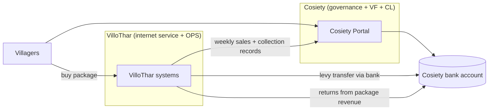

# Cosiety – Software Requirements Specification (SRS)

| | |
|---|---|
| **Project** | Cosiety – Village Cooperative Society Portal |
| **Document** | Cosiety_SRS (file `Cosiety_SRS_v1.0.md`, content version 1.1) |
| **Version** | 1.1 (Draft for stakeholder review) |
| **Prepared** | 17 November 2026 |
| **Status** | DRAFT – not approved. Proposed rules are not adopted policy. |
| **Source of truth** | "Cosiety: Village Cooperative Society – Design Note", Draft v1, 16 Nov 2026 (7-page revised version) |
| **Companion** | Cosiety SDS (content version 1.1) |
| **Standard** | Structure inspired by ISO/IEC/IEEE 29148 |

## Revision history

| Version | Date | Change |
|---|---|---|
| 0.1 | 16 Nov 2026 | Initial extraction from the first 6-page design note |
| 1.0 | 16 Nov 2026 | First complete SRS |
| 1.1 | 17 Nov 2026 | Re-based on the revised design note (7 pages): co-presidents, vote-points trial, gender-specific contests, no neighbourhood groups, candidate qualification and training; requirement classification added |

## What changed from v1.0 (summary)

| Area | v1.0 (earlier note) | v1.1 (revised note) |
|---|---|---|
| Voting power | One person, one equal vote | Every adult is a member; **vote weight follows a points system (one-year trial)** for co-president elections |
| Leadership | 9–11 member Executive Committee, President/Secretary/Treasurer/PIO, reserved neighbourhood and women's seats | **Two co-presidents (one woman, one man), one-year terms**; each forms a team; only co-presidents are elected |
| Elections | One shared election, quotas, staggered terms | **Gender-specific contests**; winner = highest total vote points; candidate qualification and training |
| Structure | Neighbourhood groups | **No neighbourhood or caste-based groups**; everyone belongs to the whole village |
| Membership | Verified adult residents | Everyone 18+ with a CNIC; education, work and exposure documents checked once for points |
| Money flow | VilloThar publishes daily sales (step) | That step is no longer in the money-flow list; weekly sales and collection records remain in Phase 1 |

## How to read this document
**Source classification** (every requirement and rule carries one):
* **C – Confirmed:** stated in the design note as a principle or fixed arrangement.
* **P – Proposed:** in the note as a *proposed starting rule* awaiting the first General Body.
* **O – Open Decision:** listed by the note as unresolved (or found unresolved in this analysis; see §13).
* **D – Derived:** a software requirement logically needed by a documented process.
* **R – Recommended Enhancement:** this team's suggestion; requires stakeholder approval.

**Priority:** M = Must Have, S = Should Have, C = Could Have, W = Won't Have in the current release. **Ph** = build phase 1–4 from the note (§11). Numbers marked *(proposed target)* need validation. **No governance value is hard-coded**; each is a configurable parameter linked to an approving resolution (§13).

**Level of detail:** FR tables give ID, requirement, role, priority/phase, source class and dependencies. Preconditions, main/alternative/exception flows and inputs/outputs are in the use cases (§7) and data tables (§9); validation is stated in the requirement text; acceptance tests are in §10.

## Table of contents
1 Introduction · 2 Overall Description · 3 Stakeholders, Roles and Permissions · 4 Functional Requirements · 5 External Interfaces · 6 Non-Functional Requirements · 7 Use Cases · 8 Business Rules · 9 Data Requirements · 10 Acceptance Criteria · 11 Traceability Matrix · 12 Ambiguities Found · 13 Open Decisions and Clarification Register · 14 Assumptions and Dependencies · 15 Risk Register · 16 Legal and Regulatory · 17 Consistency Review · 18 Glossary and References

---

# 1. Introduction

## 1.1 Purpose
This SRS states **what** the Cosiety portal must do, **for whom**, **under what conditions**, and **how success is verified**. It does not prescribe implementation (see SDS).

## 1.2 Executive summary
Cosiety is a community-centred digital governance platform for a village cooperative society, starting in **Pabohar**, running alongside the **VilloThar** internet network. Earlier Tharparkar village committees depended on NGO staff and manual collection and ended when support ended; Cosiety replaces that manual work with a **portal, a public ledger and an elected body** **[C – DN §1]**.

Key features: a verified member register of every adult (18+, CNIC) · a **vote-points** engine (one-year trial) · elections of **two co-presidents** (one woman, one man) in gender-specific contests · teams, recall and conflict-of-interest handling · **three strictly separate money streams** (Village Fund, Infrastructure Contributor Ledger, VilloThar Operations) · public ledger · participatory project lifecycle (proposal → video explainer → discussion → vote → execution → report) · issue reporting, notices and Sindhi/Urdu video library · Village Helper assistance · audit and accountability.

It is **not** an ordinary business system: equality, participation, transparency, inclusion and accountability are design drivers.

## 1.3 Scope
**In scope (first village):** modules AUTH, MEM, PTS, GB, EXC, ELE, FIN, PAY, LED, PRJ, ISS, NTC, CON, AUD, HLP, ADM (§4).
**Prepared architecturally but not activated now:** multiple societies, federation (events, competitions, shared learning; equal say per society) **[C – DN §3, §11]**.
**Out of scope:** VilloThar's internal billing/network/staff accounting; the legal registration itself; deciding the legal classification of contributor returns; direct NADRA integration (dependency to be confirmed).

## 1.4 Product vision and business objectives
Vision: a village can run its own institution through technology rather than depend on external intermediaries. Objectives: (1) verified digital membership register of all adult villagers; (2) transparent elections and decisions; (3) transparent money in three separate streams; (4) project proposals through to reports; (5) contributors see own records; (6) inclusion through Sindhi/Urdu, video, voice and icons; (7) reduced NGO dependence; (8) readiness for more villages and a federation.

## 1.5 Audience
Founders, cooperative representatives, business analysts, developers, designers, database architects, testers, project managers, auditors and future support staff.

## 1.6 Document conventions
IDs: `FR-<MOD>-nnn`, `NFR-<AREA>-nnn`, `UC-nn`, `BR-nn`, `OD-nn`, `AD-nn`, `RK-nn`, `AC-<MOD>-nn`, `EI-nn`. SDS components: `DC-xxx`.

## 1.7 Definitions (full glossary §18)

| Term | Meaning |
|---|---|
| **Member / General Body member** | Verified person aged 18+ with a CNIC **[C]** |
| **Vote points** | Weight of a member's vote in co-president elections: education + age + work + exposure **[P]** |
| **Contest** | One co-president election: *woman co-president* (women compete and vote) or *man co-president* (men compete and vote) **[P]** |
| **Co-presidents** | One woman and one man, each elected for a proposed one-year term **[P]** |
| **Team** | People named by a co-president to run Cosiety day to day **[P]** |
| **Executive** | Co-presidents and their teams |
| **Village Fund (VF)** | Stream 1 – equal levy per individual user |
| **Contributor Ledger (CL)** | Stream 2 – contributors' capital and repayments |
| **Operations Account (OPS)** | Stream 3 – package revenue kept by VilloThar (owned by VilloThar) |
| **Village Helper** | Non-committee person who assists with portal and voting, never impersonates or decides **[C]** |

## 1.8 System boundary

Cosiety receives *reports and references* from VilloThar; it does not control VilloThar's accounting, and VilloThar does not control Cosiety's governance or ledgers. A shared domain/host does **not** imply shared ownership, governance or financial control. A future MoU is anticipated; this SRS makes no legal assumption about it.

---

# 2. Overall Description

## 2.1 Existing and proposed environment
*Existing:* village committees run through NGO staff, manual collections and paper records; they lapse when support ends **[C – DN §1]**. *Proposed:* portal + public ledger + elected body, with a fixed start-up support period from VilloThar and a separation of roles **[C – DN §10]**.

## 2.2 Product perspective
New standalone system exchanging data with VilloThar (sales/collection records, levy-transfer references, revenue figures for returns) and third-party services (SMS/OTP, storage/video, possibly payments and identity verification). The note adapts the Rural Support Programmes' village-to-union-council model without NGO staff, **and with no neighbourhood or caste-based groups: every member belongs to the whole village** **[C – DN §3]**.

## 2.3 Major capabilities
Registration and verification · vote-points calculation · General Body, meetings and agenda · co-president elections · team, recall and conflict-of-interest management · three-stream finance and reconciliation · public ledger · project lifecycle · issues and questions · notices/videos · contributor views · audit.

## 2.4 First village vs future

| Aspect | First village (Pabohar) | Later (Phase 4; prepared, not activated) |
|---|---|---|
| Societies | One | Many independent societies |
| Money | Own VF, CL, OPS reconciliation | Each society separate; no pooled funds |
| Federation | None | One representative body; equal say per society **[C]** |
| Data design | `society_id` on every record from day one **[R]** | Federation module added later |

## 2.5 User classes
See §3: villagers (visitors, members, candidates, contributors); elected leaders (co-presidents, team, treasurers); support (Village Helper, Verification Officer, Election Administrator, Portal Administrator, VilloThar Operations User); oversight (Independent Auditor, System Administrator); future (Federation Administrator).

## 2.6 Operating environment
Mobile-first web app on low-cost Android phones over the VilloThar network and mobile data, plus shared devices used with a Village Helper **[A]**. Languages: Sindhi, Urdu (RTL), English for administrators.

## 2.7 Constraints
* **C-1** Three money streams separated in data, accounts and reports **[C]**.
* **C-2** Contributor capital grants no extra vote or seat **[C]**.
* **C-3** All unapproved rules (points table, quotas, thresholds, caps, terms) are configuration, not code **[D]**.
* **C-4** Identity: CNIC + one-time code **[C]**; NADRA access not assumed.
* **C-5** Low bandwidth, low-end devices, low operating cost.
* **C-6** No collection of caste, race, ethnicity or religion **[D – data minimisation, supports DN §2.1]**.
* **C-7** Vote-point formula applies only to co-president elections unless the General Body decides otherwise (OD-02).

## 2.8 Assumptions and dependencies
See §14.

## 2.9 Limits of software
Software cannot guarantee legal compliance, honest officials or freedom from social pressure. It can make misconduct harder to hide and easier to detect.

---

# 3. Stakeholders, Roles and Permissions

## 3.1 Stakeholder analysis

| # | Stakeholder / role | Nature | Objectives and responsibilities | Information needs |
|---|---|---|---|---|
| 1 | Public Visitor | Anyone | See what Cosiety is; read public ledger, notices, decisions | Public data only |
| 2 | Registered Member | Applicant | Register and complete verification | Own status |
| 3 | Verified Member (General Body) | Villager (18+, CNIC) | Vote on co-presidents, levy, major projects; propose ideas; ask questions | Public data; own profile and points |
| 4 | Women members / Men members | Contest group, **attribute not a role** | Women elect the woman co-president; men elect the man co-president **[P]** | Own contest |
| 5 | Candidate | Member | Apply, meet qualification, complete training | Own application status |
| 6 | Co-President (Woman) | **Elected [P]** | Lead with co-president (Man); form and manage team; approve in line with SoD | Executive and financial detail |
| 7 | Co-President (Man) | **Elected [P]** | As above | As above |
| 8 | Team Member | **Named by co-president [P]** | Run Cosiety daily, prepare budgets, answer public questions | Team work items |
| 9 | Treasurer | Team member | Prepare financial entries/reports for their co-president's team | Village Fund detail |
| 10 | Village Helper | Appointed, not on committee **[C]** | Assist registration, portal use, voting; never decide or impersonate | Only the session being assisted |
| 11 | Infrastructure Contributor | Villager or other | See own contributions and payouts | Own CL statement |
| 12 | Verification Officer | Authority **TBD** (OD-05, OD-06) | Check documents, points and candidate qualifications | Documents under logged access |
| 13 | Election Administrator | Neutral officer **[D]**, authority TBD | Configure/run election mechanics, certify and publish results; may not be a candidate | Voter lists (masked), turnout |
| 14 | VilloThar Operations User | VilloThar staff | Submit weekly sales/collections and transfer records | Levy due status |
| 15 | Independent Auditor | External **[C]** | Review financial records and publish audit | Read-only everything (masked) |
| 16 | Portal Administrator | Appointed, non-elected **[D]** | Operate the application for the society | Config, logs |
| 17 | System Administrator | Technical | Servers, backups, deployment | Infrastructure only |
| 18 | Federation Administrator | Future | Federation functions | None in current release |

## 3.2 Role rules
* **R-1** Application administrators (14, 16, 17) and the Election Administrator are **not elected representatives** and hold no extra vote.
* **R-2** No role has unrestricted access. Sensitive actions need two different people (maker–checker).
* **R-3** Elected/named roles are **time-bound assignments** that expire automatically at term end (one year proposed).
* **R-4** Verification never creates an administrator.
* **R-5** The Village Helper has no ballot, approval or impersonation rights **[C]**.
* **R-6** A Candidate cannot act as Verification Officer or Election Administrator for the same contest.

## 3.3 Role-permission matrix
Legend: **V** view · **C** create · **U** update · **D** void/archive (no hard delete of financial or governance records) · **A** approve · **R** reject · **P** publish · **T** vote · **X** audit. Qualifiers: *(own)*, *(agg)* aggregates, *(mask)* masked, *(pub)* public-level, *(maker)* prepares only, *(2nd)* second approver, *(log)* logged access.

| Role | Financial data | Identity & points data | Governance records | Operational data |
|---|---|---|---|---|
| 1 Public Visitor | V(pub) | – | V(pub) | V(pub) |
| 2 Registered Member | V(pub) | C,V,U (own application) | V(pub) | V(pub) |
| 3 Verified Member | V(pub) | V,U(own limited); V own points | V(pub); C (proposals, agenda, questions, issues); **T** | V(pub) |
| 5 Candidate | V(pub) | as 3 | as 3 + C (candidacy, training) | V(pub) |
| 6/7 Co-Presidents | V (all VF detail); A (expenditure; checker on the *other* team's entries) | V(mask) | V, U (own team), A (team appointments), A/R (proposal feasibility), P (with PIO-type function), A (COI recusal) | V |
| 8 Team Member | V | V(mask) | C,U (assigned items); answer public questions | V |
| 9 Treasurer | V; C,U (maker) VF entries; P (draft reports) | – | V | V (levy/transfer status) |
| 10 Village Helper | – | C (assisted registration); V(mask) for assisted person | assisted session only (no ballot-choice access); C (submit on behalf, member present) | – |
| 11 Contributor | V(own CL statement; agg CL) | V,U(own) | as 3 | V(pub) |
| 12 Verification Officer | – | V(log), C,A,R (documents, points, qualification) | A/R (candidate qualification) | – |
| 13 Election Administrator | – | V(mask) voter lists | C,U (until opened), A (certify, 2nd person), P (results) | V |
| 14 VilloThar Ops User | C,U(maker) VilloThar-side records; V (levy due, transfer status) | – | – (member rights only if resident) | C,U own feed |
| 15 Independent Auditor | V (all), **X**, P (audit report) | V(mask) | V, X | V, X |
| 16 Portal Administrator | V (no C/U/A) | V(mask); U (status ops, with reason) | U (rule parameters, only against an approved resolution, dual control) | C,U config; V logs |
| 17 System Administrator | – | – | – | V,U (infrastructure only) |
| 18 Federation Admin | – (none now) | – | – | – |

Further rules: a treasurer may not approve their own entry; **a co-president's treasurer is not from their household [P]**; a person may not approve spending that benefits their family or business **[C – DN §8]**; full CNIC and documents are visible only through logged, justified access (NFR-PRV-002).

---

# 4. Functional Requirements

Columns: **Role** = main actor · **Pri/Ph** = priority and phase · **Cl** = source class (C/P/O/D/R). "Dep" shows key dependencies.

## Module AUTH – Registration, Authentication and Identity Verification

| ID | Title and requirement | Role | Pri/Ph | Cl |
|---|---|---|---|---|
| FR-AUTH-001 | **Registration.** The system shall let a person aged 18+ start registration with full name, mobile number, CNIC number, date of birth and gender as on CNIC, and household. Fields are validated (CNIC 13 digits; mobile in E.164; DOB not in future). | Applicant, Helper | M/1 | C (DN §2.1, §9) |
| FR-AUTH-002 | **One-time code.** The system shall send an OTP to the mobile number, valid for a configurable time *(proposed 5 min)* with limited attempts *(proposed 5)*, to prove control of the phone. | Applicant | M/1 | C |
| FR-AUTH-003 | **Adult eligibility.** The system shall compute age from the verified DOB against the configured minimum age *(18, from note)* and mark under-age applicants *not eligible*. | System | M/1 | C |
| FR-AUTH-004 | **Duplicate prevention.** One CNIC shall map to at most one active member; a duplicate attempt is held for review without revealing the existing member. | System | M/1 | D |
| FR-AUTH-005 | **Verification workflow.** Status path: Submitted → OTP-confirmed → Documents-checked (Verification Officer) → Approved (second person) → Active. Every step logs actor and time; checker and approver must differ. | Verification Officer | M/1 | D (note: authority OD-06) |
| FR-AUTH-006 | **Separate statuses.** Phone verification, identity verification and points verification are tracked separately; OTP success never equals identity verification. | System | M/1 | D |
| FR-AUTH-007 | **Replaceable verification provider.** Identity checking shall sit behind a replaceable interface; the first release operates with manual document checking. NADRA/other provider access is a dependency (AD-01). | System | S/1 | D |
| FR-AUTH-008 | **Login and recovery.** Login by mobile + OTP (optional PIN); recovery by re-verification with in-person check; officers need two factors. | Member | M/1 | D |
| FR-AUTH-009 | **Suspension/deactivation.** Administrative action requires written reason and effective date; suspended members read public data but cannot vote; appeal path recorded. | Portal Admin + 2nd | M/1 | D |
| FR-AUTH-010 | **Status feedback.** Applicants see verification status in Sindhi/Urdu with icons and plain wording. | Applicant | M/1 | C (DN §9) |
| FR-AUTH-011 | **No public identity data.** CNIC numbers, images, documents and credentials shall never appear in public pages, APIs, ledgers, exports or notifications. | System | M/1 | C (DN §2.3 principle) / D |

## Module MEM – Member Profile, Directory and Household

| ID | Title and requirement | Role | Pri/Ph | Cl |
|---|---|---|---|---|
| FR-MEM-001 | **Membership register.** The system shall hold the verified register of all members (General Body) with statuses Applicant, Active, Suspended, Deactivated, Left, and history. | Portal Admin | M/1 | C |
| FR-MEM-002 | **Profile.** A member can view and update limited own fields (name spelling request, language, contact consent); CNIC, DOB and gender are changed only by re-verification. | Member | M/1 | D |
| FR-MEM-003 | **Directory.** Authorised roles see a masked member directory; ordinary members see only what they consent to be shown *(proposed: name only)*. | Member | S/1 | R |
| FR-MEM-004 | **Household record.** The system shall record households and link members; a household has no vote — only individuals vote. Household is used only for restriction checks (teams, treasurers, conflict of interest). | System | M/1 | P (DN §4) / D |
| FR-MEM-005 | **No groups.** The system shall not model neighbourhood, caste, tribe or community groups; every member belongs to the whole village. | System | M/1 | C (DN §3) |
| FR-MEM-006 | **Data minimisation.** The system shall not collect race, caste, ethnicity or religion. | System | M/1 | D |
| FR-MEM-007 | **Participation history.** The system records which meetings/elections a member took part in (never choices), visible to the member and in aggregate. | Member | S/2 | R |
| FR-MEM-008 | **Statistics.** Membership statistics (totals, verified, by gender) without identifying individuals. | Public | S/1 | D |
| FR-MEM-009 | **Contributor flag.** A contributor profile may link to a member record, but no contributor attribute shall alter member rights. | System | M/1 | C (DN §2.2) |

## Module PTS – Voting Points (one-year trial)

| ID | Title and requirement | Role | Pri/Ph | Cl |
|---|---|---|---|---|
| FR-PTS-001 | **Configurable formula.** The system shall store the points table (education, age, work, exposure) as a versioned, configuration — not code — linked to the approving General Body resolution. The proposed table (max 22) is loaded as a *draft proposal*, not as approved. | Portal Admin (dual control) | M/2 | P (DN §4) |
| FR-PTS-002 | **Profile inputs.** The system shall record education level, work category and exposure category for each member with supporting documents. | Applicant, Helper | M/1 | P |
| FR-PTS-003 | **Document check.** A Verification Officer approves or rejects each factor against documents; points are calculated **only from approved factors**. Documents are checked once, at registration; later changes need a logged re-verification. | Verification Officer | M/1 | P (authority O) |
| FR-PTS-004 | **Calculation.** Points = sum of the four factor values under the active formula version; the version used is stored with each result. | System | M/2 | P |
| FR-PTS-005 | **Undecided categories.** Members with no schooling or no outside exposure have *no configured value* until the General Body decides (OD-03, OD-04). The system shall block election opening if any eligible voter has an undecided factor, rather than silently using zero. | System | M/2 | O |
| FR-PTS-006 | **Age basis.** The age factor shall use one configured basis: *age at registration* or *age at election snapshot* (OD-18). Default is not assumed. | System | M/2 | O |
| FR-PTS-007 | **Public formula.** The formula (table and version) shall be published; an individual's points are visible only to that member and to authorised verifiers/auditor. | Public, Member | M/2 | P (DN §4: "formula is public") |
| FR-PTS-008 | **Scope.** Points weight co-president elections only; levy and project votes use equal weight until the General Body decides otherwise (OD-02). | System | M/2 | O |
| FR-PTS-009 | **Trial review.** The system shall support a trial-review record (period, data, decision) before the next election, and keep the previous formula version for old elections. | Election Admin | S/3 | P |
| FR-PTS-010 | **Maximum check.** Total points shall never exceed the sum of the highest values in the active formula; a validation alert is raised otherwise. | System | S/2 | D |

## Module GB – General Body, Meetings and Agenda

| ID | Title and requirement | Role | Pri/Ph | Cl |
|---|---|---|---|---|
| FR-GB-001 | **Voter register.** The system shall list, at any date, all Active verified members eligible to vote. | Election Admin | M/1 | C |
| FR-GB-002 | **Agenda submission.** Any verified member can submit an agenda item through the portal or a Village Helper; items are published for the General Body. | Member | M/2 | C (DN §11 Phase 2) |
| FR-GB-003 | **Meeting notices and records.** Notices (date, place, agenda, configurable notice period), attendance, decisions and minutes. | Team Member | S/2 | D |
| FR-GB-004 | **Quorum.** Quorum = eligible voters at snapshot × quorum fraction per decision type (OD-11); never hard-coded. | System | M/2 | O |
| FR-GB-005 | **Resolutions.** Draft → tabled → voted → passed/failed → published, each with its vote result. | Executive | M/2 | D |
| FR-GB-006 | **Public decisions.** Every decision and outcome is published. | Public | M/2 | C (DN §2.3) |
| FR-GB-007 | **Public Q&A.** Question sessions tied to a meeting or project. | Member | S/3 | C (DN §7) |

## Module EXC – Co-Presidents, Teams and Governance

| ID | Title and requirement | Role | Pri/Ph | Cl |
|---|---|---|---|---|
| FR-EXC-001 | **Co-president structure.** The system shall support exactly two co-president seats per society term: one woman, one man; configuration records the term length *(proposed 1 year)* and consecutive-term limit (OD-08). | Election Admin | M/2 | P |
| FR-EXC-002 | **Candidate qualification.** An application records qualification evidence: bachelor degree, **or** intermediate with strong exposure, experience and knowledge. The assessment process and authority are TBD (OD-05); the system records outcome and reasons. | Candidate, Verification Officer | M/2 | P/O |
| FR-EXC-003 | **Candidate training.** The system shall record study of the *Cosiety Presidency Book* (rights, equality regardless of race, gender, caste, religion and ethnicity, basic law) and a short test (result, date); a co-president-elect cannot take office until recorded as passed. Pass mark and retake rule are TBD (OD-30). | Candidate | M/2 | P |
| FR-EXC-004 | **Team formation.** Each co-president names a team; women and men share the work; names, roles and dates are recorded and published. Team size is TBD (OD-07). | Co-President | M/2 | P/O |
| FR-EXC-005 | **Household restrictions.** No two team members from the same household; a co-president's treasurer must not be from that co-president's household. Scope across teams/co-presidents is configurable (OD-22, OD-23). Violations block appointment. | System | M/2 | P |
| FR-EXC-006 | **Terms and rotation.** Roles expire automatically at term end; consecutive-term limits are checked when nominating. | System | M/2 | P/O |
| FR-EXC-007 | **Allowance and reimbursement.** The system records any allowance and **real expense reimbursements** (transport, phone) with receipts; all are published. Funding source is TBD (OD-24). | Treasurer | S/3 | P/O |
| FR-EXC-008 | **Recall.** The General Body may remove a co-president or team member by petition and vote; petition share and thresholds are TBD (OD-16). A valid petition automatically schedules a recall vote. | Member | S/3 | P/O |
| FR-EXC-009 | **Conflict of interest.** Members declare family and business interests; the system blocks them from approving related spending and records recusals (rules TBD, OD-17). | Co-President, Team | M/3 | C/O |
| FR-EXC-010 | **Accountability record.** Per leader: attendance, questions answered on time, decisions taken, expenses claimed. | Public | S/3 | D |
| FR-EXC-011 | **Public leadership page.** Names, roles, term dates, team lists. | Public | M/2 | C (DN §2.3) |

## Module ELE – Elections and Voting

| ID | Title and requirement | Role | Pri/Ph | Cl |
|---|---|---|---|---|
| FR-ELE-001 | **Election setup.** The Election Administrator creates an election with two contests (woman co-president, man co-president) or another configured ballot (levy, budget, project, recall), with dates, thresholds, quorum, minimum turnout. | Election Admin | M/2 | P/D |
| FR-ELE-002 | **Gender-specific contests.** Women candidates compete only against women and men against men; women vote only in the woman co-president contest and men only in the man contest, so a woman and a man always lead together. | System | M/2 | P |
| FR-ELE-003 | **Gender basis.** Contest eligibility is derived from the verified gender field; handling of members whose CNIC records another category is TBD (OD-20) and shall be configurable. | System | M/2 | O |
| FR-ELE-004 | **Candidate eligibility.** A candidate must be an Active verified member, in the correct contest, qualified (FR-EXC-002), trained (FR-EXC-003), within term limits, and cleared by the Verification Officer. | System | M/2 | P |
| FR-ELE-005 | **Snapshot freeze.** At opening, the system freezes rules, formula version, voter list per contest, and each voter's points; later changes do not affect the election. | System | M/2 | D |
| FR-ELE-006 | **One ballot per voter per contest.** Enforced regardless of device, session or Village Helper. | System | M/2 | D |
| FR-ELE-007 | **Secret ballot.** Individual choices of secret ballots are never stored in a way that links them to a person; ordinary administrators and the public cannot associate a ballot with a member. | System | M/2 | D (DN §9 "each vote is their own"), O (OD-32) |
| FR-ELE-008 | **Weighted counting.** A candidate's score = sum of points of members who voted for them; the winner is the highest total points, **not** the highest number of voters. | System | M/2 | P |
| FR-ELE-009 | **Minimum turnout and quorum.** The result counts only if configured minimum turnout (OD-01) and quorum are met; otherwise the outcome is *No valid result* with the rule applied shown. | System | M/2 | O |
| FR-ELE-010 | **Ties.** A configured tie rule (OD-19) is applied; if none is configured the system reports *Tie – decision required* and does not pick a winner. | System | M/2 | O |
| FR-ELE-011 | **Anonymity safeguard.** Before publication the system checks whether point-weighting could single out voters (e.g. very few voters with a given point value in a contest) and warns the Election Administrator; published results contain totals only, not per-points breakdowns, unless the policy says otherwise (OD-32). | System | S/2 | R |
| FR-ELE-012 | **Certification and publication.** Results are certified by two authorised people, then published with turnout, scores, quorum status and formula version; individual choices are never published. | Election Admin | M/2 | D |
| FR-ELE-013 | **Other ballots.** Levy, budget, project and recall votes follow configured thresholds and quorum; equal weight unless OD-02 decides otherwise. | System | M/3 | O |
| FR-ELE-014 | **Voice/icon voting.** Ballots offer symbols, photos, audio per option; assisted voting follows FR-HLP rules. | Voter | M/2 | C (DN §9) |
| FR-ELE-015 | **Audit log and records.** Immutable election log: configuration, snapshots, state changes, counts, certification; exportable to the auditor. | Auditor | M/2 | D |
| FR-ELE-016 | **Disputes and recounts.** The system records disputes and a recount request; the procedure is subject to approved policy (OD-36). | Election Admin | S/3 | O |
| FR-ELE-017 | **Voter reminders.** SMS/portal/helper reminders during voting. | System | S/2 | D |

## Module FIN – Three Separate Money Streams

| ID | Title and requirement | Role | Pri/Ph | Cl |
|---|---|---|---|---|
| FR-FIN-001 | **Three ledgers.** VF, CL and OPS-Reconciliation are kept as separate accounts and ledgers; every financial record belongs to exactly one. | System | M/1 | C |
| FR-FIN-002 | **No mixing.** No transaction, balance, export or API response combines streams into one balance; a screen may list them side by side, clearly labelled. | System | M/1 | C |
| FR-FIN-003 | **VF levy configuration.** Levy amount, effective date, cap, approving vote reference and history. Any change needs an approved General Body vote; amounts above the cap are rejected. | Treasurer | M/3 | C (cap value O) |
| FR-FIN-004 | **VF records.** Levy due, transfers received, expenditures, project allocations, balance. | Treasurer | M/1 | C |
| FR-FIN-005 | **VF spending rule.** Levy funds approved projects only: an expenditure needs an approved project or an approved budget line, evidence and maker–checker approval. | Treasurer | M/3 | C |
| FR-FIN-006 | **CL records.** Contributors, agreements, individual capital, payments in, invoices paid to VilloThar, returns received, returns distributed. | Treasurer | M/1 | C |
| FR-FIN-007 | **OPS records.** VilloThar's reported package sales, collections and revenue figures used for contributor returns; Cosiety does not hold VilloThar's operating books. | VilloThar Ops | M/1 | C/D |
| FR-FIN-008 | **Reconciliation.** Reported levy due vs declared transfers vs bank-statement lines, with unmatched items listed. | Treasurer | M/1 | D |
| FR-FIN-009 | **Money states.** Received, payable and transferred are separate states; a pending or initiated transfer is never counted as received. | System | M/1 | D |
| FR-FIN-010 | **Append-only.** Entries are never edited or deleted; corrections are reversal/adjustment entries with reason and approver. | System | M/1 | D |
| FR-FIN-011 | **Traceability.** Every entry shows stream, category, project, source, recipient, date, reference number and supporting document where applicable. | System | M/1 | C (master prompt) / D |
| FR-FIN-012 | **Maker–checker.** The preparer cannot approve; checker is from the *other* co-president's team where possible. | System | M/3 | R |
| FR-FIN-013 | **Unauthorised transfer prevention.** No endpoint shall move value between streams; transfers exist only as recorded external bank movements matched to records. | System | M/1 | D |

## Module PAY – Package Purchase and Levy Collection

| ID | Title and requirement | Role | Pri/Ph | Cl |
|---|---|---|---|---|
| FR-PAY-001 | **One price.** One package price list for everybody. | Member | M/1 | C (DN §2.4) |
| FR-PAY-002 | **Split display.** Every package screen shows package price (VilloThar), levy (Village Fund) and total separately. | Member | M/1 | C |
| FR-PAY-003 | **Per individual.** The levy applies per individual user, not per household. | System | M/1 | C |
| FR-PAY-004 | **Purchase states.** Initiated, Pending, Paid, Failed, Refunded, Reversed; only Paid counts toward collections. | System | M/1 | D |
| FR-PAY-005 | **Weekly sales and collections.** VilloThar submits sales and collection records (weekly in the pilot; cadence configurable); each submission is versioned, corrections never overwrite. | VilloThar Ops | M/1 | C (DN §11) |
| FR-PAY-006 | **Levy due.** Levy due per period = paid individual packages × levy applicable on purchase date. | System | M/1 | D |
| FR-PAY-007 | **Levy transfer record.** Each VilloThar→Cosiety transfer records reference, amount, period, status (Announced, Sent, Confirmed, Disputed) and appears on the portal. | VilloThar Ops, Treasurer | M/1 | C (DN §6) |
| FR-PAY-008 | **Manual/assisted recording.** No payment gateway, banking API or VilloThar integration is assumed; an auditable manual recording path (form + file upload + bank-statement import) shall exist. | Treasurer | M/1 | D |
| FR-PAY-009 | **History and reports.** Payment history per user; collection reports for authorised roles. | Member | S/1 | D |
| FR-PAY-010 | **Failed/pending.** Listed with ageing and follow-up. | Treasurer | S/1 | D |

## Module LED – Public Ledger and Dashboards

| ID | Title and requirement | Role | Pri/Ph | Cl |
|---|---|---|---|---|
| FR-LED-001 | **Public Village Fund view.** Opening balance, money received, money spent, current balance, by period. | Public | M/1 | C (DN §6.5) |
| FR-LED-002 | **Entry detail.** Date, category, amount, reference, approved project, supporting document where appropriate. | Public | M/1 | C |
| FR-LED-003 | **Monthly statements and history.** | Public | M/1 | C |
| FR-LED-004 | **Contributor aggregate only.** The public sees CL totals (capital, returns, balance), not personal or contractual details. | Public | M/1 | C / D |
| FR-LED-005 | **Project budgets.** Per project budget vs spending. | Public | M/3 | C |
| FR-LED-006 | **Reversals visible.** Reversal/adjustment entries appear next to the original. | Public | M/1 | D |
| FR-LED-007 | **Light pages.** Summary first; details on demand; printable plain-language summary. | Public | M/1 | C (DN §9) |
| FR-LED-008 | **Report audiences.** Each report carries an audience: public, member-only, contributor-only, executive-only or auditor-only (see SDS reports table). | System | M/1 | D |

## Module PRJ – Project Proposals and Participatory Budgeting

| ID | Title and requirement | Role | Pri/Ph | Cl |
|---|---|---|---|---|
| FR-PRJ-001 | **Submit.** Any member submits an idea through the portal or a Village Helper; a unique reference number is issued. The note also mentions submission "through a neighbourhood group" although the note states there are no groups — channel TBD (OD-28). | Member | M/3 | C/O |
| FR-PRJ-002 | **Content.** Title, description, category, estimated budget, expected effect, and effect on the levy. | Member | M/3 | C |
| FR-PRJ-003 | **Review and publish.** The Executive reviews feasibility and publishes the proposal with a reasoned response. | Team | M/3 | D |
| FR-PRJ-004 | **Explainer video.** A short video (Sindhi, with voice) explains idea, cost and effect on the levy; discussion cannot open without it. | Team | M/3 | C |
| FR-PRJ-005 | **Discussion.** Fixed-length period; public questions; the Executive answers publicly within the configured time. | Member, Team | M/3 | C |
| FR-PRJ-006 | **Vote.** General Body vote with quorum and thresholds by spending size and by whether the levy changes. | Voter | M/3 | C/O |
| FR-PRJ-007 | **Allocation.** Approved projects receive a VF allocation not exceeding the unallocated balance. | Treasurer | M/3 | D |
| FR-PRJ-008 | **Execution tracking.** Progress, expenditure, invoices, receipts published. | Team | M/3 | C |
| FR-PRJ-009 | **Final report and Q&A.** A final public report and a question session on request. | Team | M/3 | C |
| FR-PRJ-010 | **Ordered lifecycle.** Proposal → Reviewed → Explainer → Discussion → Voting → Approved/Rejected → Execution → Reporting → Closed; steps cannot be skipped. | System | M/3 | C |

## Module ISS – Issues and Community Participation

| ID | Title and requirement | Role | Pri/Ph | Cl |
|---|---|---|---|---|
| FR-ISS-001 | **Report issue.** Category (e.g. water), place (free text), description, optional photo/voice note; Village Helper may file with the member present. | Member | M/2 | C (DN §11) |
| FR-ISS-002 | **Tracking.** Status, assignee, Executive response, resolution history. | Team | M/2 | D |
| FR-ISS-003 | **Visibility.** Reporter chooses public or Executive-only. | Member | S/2 | R |
| FR-ISS-004 | **Compressed attachments.** Size-limited for low bandwidth. | System | S/2 | D |
| FR-ISS-005 | **Convert to proposal.** An issue can become a project proposal. | Team | C/3 | R |

## Module NTC – Notices, Announcements, Knowledge Library

| ID | Title and requirement | Role | Pri/Ph | Cl |
|---|---|---|---|---|
| FR-NTC-001 | **Notices.** Announcements, election and meeting notices, rules, reports, project updates, events. | Team | M/1 | C |
| FR-NTC-002 | **Sindhi and Urdu.** Content available in both; English for administrators. | System | M/1 | C |
| FR-NTC-003 | **Video library.** Explainers for every decision, rules and reports; text summary and audio-only version. | Team | M/2 | C (DN §9) |
| FR-NTC-004 | **Delivery.** Portal, SMS for critical notices, read-aloud option. | System | M/1 | D |
| FR-NTC-005 | **Versioning.** Published content cannot be silently replaced. | System | M/1 | D |
| FR-NTC-006 | **Multilingual content management.** Each item has sd/ur/en versions with translation status. | Team | S/2 | D |

## Module CON – Contributor Management

| ID | Title and requirement | Role | Pri/Ph | Cl |
|---|---|---|---|---|
| FR-CON-001 | **Profiles** kept in the backend. | Treasurer | M/1 | C (DN §8) |
| FR-CON-002 | **Agreements.** Contract terms agreed before contributing, stored as versioned documents with acceptance evidence. | Treasurer | M/1 | C |
| FR-CON-003 | **Capital records.** Individual amounts; payments into the Cosiety account matched to contributors. | Treasurer | M/1 | C |
| FR-CON-004 | **Infrastructure purchases.** Cosiety pays VilloThar to buy, install and maintain equipment; invoices recorded. | Treasurer | M/1 | C |
| FR-CON-005 | **Returns.** Returns from package revenue distributed proportionally to contributions, subject to agreed terms and limits, using a parameterised formula taken from agreements (OD-25). | Treasurer | M/3 | C/O |
| FR-CON-006 | **Distributions and statements** per contributor. | Treasurer | M/3 | C |
| FR-CON-007 | **Own view only.** A contributor sees their own profile, contributions and payouts; others see aggregates. | Contributor | M/1 | C |
| FR-CON-008 | **No governance effect.** Contributor data never influences votes, candidacy, seats or permissions. | System | M/1 | C |

## Module AUD – Audit and Accountability

| ID | Title and requirement | Role | Pri/Ph | Cl |
|---|---|---|---|---|
| FR-AUD-001 | **Monthly public report:** money in, money out, balance per stream; reviewed by a treasurer and approved by a second officer before publication. | Treasurer | M/1 | C |
| FR-AUD-002 | **Auditor access.** Read-only access and full export. | Auditor | M/3 | C |
| FR-AUD-003 | **Annual audit** uploaded and published in full, with Executive response. | Auditor | M/3 | C |
| FR-AUD-004 | **Public question window.** Questions, assignment, answer deadline *(configurable)*, publication; overdue status public. | Member | M/2 | C |
| FR-AUD-005 | **Administrative log.** Who, what, when, why, tamper-evident. | Auditor | M/1 | D |
| FR-AUD-006 | **Approval history** for every spending decision. | Auditor | M/3 | D |
| FR-AUD-007 | **COI records** visible, showing recusals and blocked approvals. | Public | M/3 | C |

## Module HLP – Village Helper and Accessibility

| ID | Title and requirement | Role | Pri/Ph | Cl |
|---|---|---|---|---|
| FR-HLP-001 | **Helper role.** The Village Helper is not a committee member and has no ballot access. | System | M/1 | C |
| FR-HLP-002 | **Assisted registration.** Helper completes forms with the applicant present; the applicant confirms by OTP on their own phone. | Helper | M/1 | C/D |
| FR-HLP-003 | **Assisted voting.** The voter authenticates personally and makes the choice; the helper never sees or enters the choice on the voter's behalf, cannot impersonate the voter, and the session is logged as assisted (rules in OD-27). | Helper, Voter | M/2 | C/O |
| FR-HLP-004 | **Voice and icons.** Every key screen has icon + text + "listen"; ballots use symbols/audio. | Voter | M/1 | C |
| FR-HLP-005 | **Clear feedback.** Every important action ends with a clear confirmation in the member's language. | Voter | M/1 | C (master prompt) |

## Module ADM – Administration, Configuration and Multi-Society Readiness

| ID | Title and requirement | Role | Pri/Ph | Cl |
|---|---|---|---|---|
| FR-ADM-001 | **Rule configuration.** Governance and financial parameters are changed only against an approved resolution reference with dual approval and full history. | Portal Admin | M/1 | D |
| FR-ADM-002 | **Roles and assignments** with start and end dates. | Portal Admin | M/1 | D |
| FR-ADM-003 | **Multi-society readiness.** All records carry a society identifier; no logic assumes a single village. | System | S/1 | R |
| FR-ADM-004 | **Federation placeholder.** No federation features active; data structures prepared. | System | W/1 (prepared) | C |
| FR-ADM-005 | **Reports and exports** for auditors and the society. | Auditor | S/3 | D |

---

# 5. External Interface Requirements

| ID | Interface | Requirement | Classification / status |
|---|---|---|---|
| EI-01 | Web browsers | Responsive web app (PWA); latest two versions of Chrome and Android WebView; usable at 360 px width | Proposed – **required** |
| EI-02 | Mobile devices | Touch targets ≥ 48 px; usable on 1–2 GB RAM Android phones *(proposed target)* | Proposed – **required** |
| EI-03 | SMS/OTP provider | Third-party SMS API for OTP and critical notices; replaceable | Proposed – **required**; **dependent on third-party agreement** (AD-03) |
| EI-04 | VilloThar records | Authenticated, versioned submission (portal form + file upload; API later) of weekly sales, collections, levy-transfer references and revenue figures. **No VilloThar software integration is assumed.** | **Required**, dependent on VilloThar (AD-07) |
| EI-05 | Bank statements | Manual upload (CSV/PDF) for reconciliation; **no banking API assumed** | **Required** (manual) / future (API) |
| EI-06 | Payment systems | Wallet/bank payment gateway for packages | **Optional** – only if selected; settlement and merchant account are separate arrangements (AD-06) |
| EI-07 | Video hosting/storage | Hosted videos with low-bitrate and audio-only options | **Required** (Phase 2) |
| EI-08 | Identity verification services | Automated CNIC check | **Future/optional**, dependent on legal permission (AD-01, AD-02) |
| EI-09 | Email/other notifications | Additional channels | **Optional** |
| EI-10 | Database/authentication internals | Accessed only by the application; no direct VilloThar access | Required |

---

# 6. Non-Functional Requirements

All numeric targets are **recommendations requiring stakeholder approval** unless stated in the note.

## 6.1 Security (NFR-SEC)

| ID | Requirement |
|---|---|
| NFR-SEC-001 | OTP expiry ≤ 5 min, ≤ 5 attempts per code, back-off after repeated failure. |
| NFR-SEC-002 | Role-based access enforced on the server for every request; none relies only on hidden UI elements. |
| NFR-SEC-003 | TLS 1.2+ in transit; sensitive fields (CNIC, documents, bank references, contributor data) encrypted at rest. |
| NFR-SEC-004 | Session idle timeout 30 min (10 min for officers/admins); sessions revocable. |
| NFR-SEC-005 | Input validation, protection against injection, XSS, CSRF; rate limits per user and IP. |
| NFR-SEC-006 | Every administrative, financial, governance-configuration and verification action logged with actor, time, before/after and reason; logs tamper-evident, retained ≥ 7 years *(confirm with legal advice)*. |
| NFR-SEC-007 | Privileged roles (co-presidents, treasurers, Verification Officer, Election Administrator, admins) use two factors. |
| NFR-SEC-008 | No one can approve their own financial entry. |

## 6.2 Privacy (NFR-PRV)

| ID | Requirement |
|---|---|
| NFR-PRV-001 | Collect only data listed in §9; do not collect race, caste, ethnicity or religion. |
| NFR-PRV-002 | CNIC numbers, education/work/exposure documents viewable only by the Verification Officer role through logged, justified access; Auditor sees masked data. |
| NFR-PRV-003 | Members can view and request correction of their data; consent text in Sindhi/Urdu with read-aloud. |
| NFR-PRV-004 | Document images are kept only as long as needed for verification plus a configurable period *(proposed 90 days)*; retention schedule is OD-31. |
| NFR-PRV-005 | Public pages show only aggregated or consented personal information; individual vote points are not public. |

## 6.3 Performance, scalability (NFR-PERF)

| ID | Requirement |
|---|---|
| NFR-PERF-001 | First meaningful content of a ledger/notice page ≤ 4 s on a 1 Mbps link (p75); initial payload ≤ 300 KB compressed. |
| NFR-PERF-002 | 95% of API calls ≤ 500 ms with 100 concurrent users. |
| NFR-PERF-003 | ≥ 1,000 registered members and ≥ 300 concurrent voters per election in one village; scalable by configuration to 10,000 per society. |
| NFR-PERF-004 | Casting a ballot confirmed ≤ 3 s (p95). |
| NFR-PERF-005 | Ledger of 100,000 entries stays paginated; first page ≤ 1 s. |

## 6.4 Availability, reliability, data integrity, backup (NFR-REL)

| ID | Requirement |
|---|---|
| NFR-REL-001 | Availability ≥ 99% monthly; no planned maintenance during open elections. |
| NFR-REL-002 | Daily backups with off-site copy; restore tested quarterly; RPO ≤ 24 h, RTO ≤ 8 h. |
| NFR-REL-003 | Every financial posting and every ballot is atomic: fully recorded or not at all. |
| NFR-REL-004 | Retries and double-taps never create duplicate payments, entries or votes (idempotency). |
| NFR-REL-005 | If an outage interrupts voting, the Election Administrator may extend the window by a logged, published decision (with second approver). |
| NFR-REL-006 | During temporary network loss the application never shows a vote or payment as completed until the server has confirmed it, and on reconnection shows the true status. |

## 6.5 Usability and accessibility (NFR-USE)

| ID | Requirement |
|---|---|
| NFR-USE-001 | The ten most frequent tasks are completable in ≤ 5 taps from the home screen. |
| NFR-USE-002 | Every key screen has icon + text + "listen" button in Sindhi/Urdu. |
| NFR-USE-003 | Body text ≥ 16 px; WCAG 2.1 AA contrast; no reliance on colour alone. |
| NFR-USE-004 | In usability tests ≥ 80% of sampled villagers with limited literacy complete a mock vote with voice/icon support and no facilitator help *(to be validated)*. |
| NFR-USE-005 | Helper-assisted mode lets a helper support registration/voting on a shared device without access to the voter's choice or account afterward. |

## 6.6 Multilingual and mobile (NFR-LOC)

| ID | Requirement |
|---|---|
| NFR-LOC-001 | Full interface in Sindhi and Urdu (RTL), English for administrators; language switch persists. |
| NFR-LOC-002 | Dates, numerals and PKR currency formatted locally; Sindhi/Urdu fonts render on Android without installing fonts. |
| NFR-LOC-003 | All screens mobile responsive from 360 px. |

## 6.7 Low bandwidth and connectivity (NFR-CON)

| ID | Requirement |
|---|---|
| NFR-CON-001 | Core read pages work from cache after first visit and fall back gracefully offline. |
| NFR-CON-002 | Uploaded images compressed to ≤ 200 KB; videos offered at ≤ 360p and audio-only. |
| NFR-CON-003 | Forms save drafts locally and resume; ballots and payments are never queued offline. |

## 6.8 Maintainability, interoperability, auditability, monitoring (NFR-MNT)

| ID | Requirement |
|---|---|
| NFR-MNT-001 | Modular code, documented REST API (OpenAPI), automated tests and CI. |
| NFR-MNT-002 | Society identifier on every record; adding a society requires configuration, not re-architecture. |
| NFR-MNT-003 | ≥ 90% line coverage on ledger, voting, points and permission code *(proposed)*. |
| NFR-MNT-004 | Handover guide so a new maintainer can operate the system. |
| NFR-MNT-005 | Standard formats for interoperability: JSON APIs, CSV/PDF exports, open formats for reports. |
| NFR-MNT-006 | Structured logs, uptime and error monitoring with alerts on failed logins, OTP abuse, unusual admin actions and audit-chain failures. |
| NFR-MNT-007 | Browser compatibility: current and previous major versions of Chrome, Edge, Firefox, Safari; Android WebView. |

---

# 7. Use Case Specifications

Compact format. FR = related functional requirements. *Alt* = alternative flows, *Exc* = exceptions.

**UC-01 New villager registers** — *Actors:* applicant, Village Helper (optional). *Pre:* aged 18+, CNIC, mobile. *Trigger:* "Join". *Main:* enter name, mobile, CNIC, DOB, gender, household; enter education, work, exposure and upload documents; accept consent; OTP confirmation; status *OTP-confirmed*. *Alt:* helper completes forms with applicant present. *Exc:* duplicate CNIC → held neutrally; under 18 → not eligible; OTP expired → resend. *Post:* application awaits document check. *FR:* AUTH-001..004, 010; PTS-002; HLP-002.

**UC-02 Member completes identity verification** — *Actors:* Verification Officer, second approver, member. *Main:* officer compares CNIC and documents with the person; approves/rejects each points factor; second person approves; member becomes Active; points calculated; SMS sent. *Exc:* mismatch → rejected with reason; checker = approver → blocked; missing document → *Pending*. *Post:* verification trail stored. *FR:* AUTH-005,006; PTS-003,004; GB-001.

**UC-03 Member checks profile and voting points** — *Actors:* member. *Main:* opens profile; sees status, four factors, formula version, total points; can request a correction. *Exc:* factor undecided (OD-03/04) → shown as "waiting for General Body decision". *FR:* MEM-002; PTS-004,005,007.

**UC-04 Candidate applies for a co-president election** — *Actors:* candidate, Verification Officer. *Pre:* election in nomination state; member of the matching gender contest. *Main:* applies; submits qualification evidence; completes Presidency Book study and test; officer approves eligibility. *Exc:* not qualified → rejected with reasons; term limit exceeded → blocked; test not passed → cannot take office. *FR:* EXC-002,003; ELE-004.

**UC-05 Verified member casts a vote** — *Actors:* voter, helper (assist only). *Pre:* election open; voter in the contest snapshot. *Main:* open ballot; hear/see candidates; choose; confirm; OTP step-up; ballot recorded; "your vote was recorded" shown. *Alt:* assisted kiosk — voter authenticates personally. *Exc:* already voted; wrong contest; network drop → status shown truthfully after reconnect; election closed. *Post:* participation recorded; choice not linked to person. *FR:* ELE-005..008,014; HLP-003.

**UC-06 Election Administrator publishes results** — *Actors:* Election Administrator, second certifier, Auditor (observer). *Main:* close; integrity checks (counts equal); compute points-weighted scores per contest; check minimum turnout and quorum; apply tie rule; certify; publish totals and rule versions. *Exc:* turnout below minimum → *No valid result*; tie without rule → *Decision required*; integrity mismatch → blocked. *FR:* ELE-008..012,015.

**UC-07 Member checks Village Fund transactions** — *Actors:* any member/visitor. *Main:* open "Money"; see three separate stream cards; open Village Fund; see balance, in/out list, monthly statements. *Exc:* offline → cached "as of" version. *FR:* LED-001..007.

**UC-08 Contributor views own records** — *Actors:* contributor. *Main:* log in; open "My contribution"; see agreement, capital, statements, payouts. *Exc:* another contributor's data requested → not found. *FR:* CON-007; FIN-006.

**UC-09 Member proposes a project** — *Actors:* member, Village Helper. *Main:* describe idea, estimated cost, effect; submit; receive reference number; Executive acknowledges. *Exc:* missing fields. *FR:* PRJ-001,002.

**UC-10 General Body votes on a project** — *Actors:* verified members. *Pre:* explainer published; discussion closed. *Main:* ballot shown with cost and levy effect; vote; result vs quorum/threshold; published. *Alt:* levy change → higher threshold. *Exc:* no quorum → not valid. *FR:* PRJ-006; ELE-013; GB-004.

**UC-11 Executive publishes expenditure records** — *Actors:* treasurer (maker), co-president or other-team approver (checker). *Main:* post expense with invoice; conflict check; second approval; payment recorded; receipt attached; public ledger updates. *Exc:* over budget; conflicted approver; same person both roles → blocked. *FR:* FIN-005,012; PRJ-008; AUD-006,007.

**UC-12 Auditor reviews transactions** — *Actors:* Independent Auditor. *Main:* read-only access; export ledgers, approvals, logs; check reconciliation and hash chain; upload report; society publishes in full. *FR:* AUD-002,003,005.

**UC-13 Village Helper assists a member** — *Actors:* helper, member. *Main:* member present; helper opens assisted session; member authenticates via own OTP; helper guides; member decides; session closed and wiped; log records assisted channel only. *Exc:* member absent → helper cannot act. *FR:* HLP-001..003.

**UC-14 Administrator publishes a Sindhi video explainer** — *Actors:* team member / portal administrator. *Main:* upload video; add audio-only and text summary; link to decision; publish; version recorded. *FR:* NTC-003,005,006; PRJ-004.

**UC-15 Record a package payment and levy due** — *Actors:* member, VilloThar Ops User. *Main:* member sees price + levy + total; pays; purchase recorded Paid; VilloThar submits weekly record; levy due computed. *Exc:* failed/pending excluded. *FR:* PAY-001..006.

**UC-16 Record and confirm a levy transfer** — *Actors:* VilloThar Ops User, treasurer. *Main:* VilloThar declares transfer (reference, amount, period) → *Sent*; treasurer matches to bank statement; second person confirms → *Confirmed*; VF entry posted. *Exc:* amount mismatch → *Disputed*; no bank line → stays *Sent*. *FR:* PAY-007; FIN-008,009.

**UC-17 Record contributor investment** — *Actors:* contributor, treasurer. *Pre:* accepted agreement. *Main:* record capital payment into Cosiety account; match to bank line; CL entry. *Exc:* no agreement → blocked. *FR:* CON-002,003.

**UC-18 Calculate contributor returns** — *Actors:* treasurer, approver, VilloThar Ops User. *Main:* revenue figure reported; formula and limits from agreements applied; per-contributor amounts shown; approved; distribution recorded when paid. *FR:* CON-005,006.

**UC-19 Publish monthly report** — *Actors:* treasurer, approver. *Main:* draft from ledgers; unreconciled items listed; second officer approves; published with explainer. *FR:* AUD-001.

**UC-20 Submit a public question** — *Actors:* member, Executive. *Main:* post; assign; deadline; public answer. *Exc:* overdue → public flag. *FR:* AUD-004.

**UC-21 Appoint a team** — *Actors:* co-president, system. *Main:* co-president names members and treasurer; system checks household rules and term limits; publishes team. *Exc:* household conflict → blocked. *FR:* EXC-004,005.

**UC-22 Recall petition** — *Actors:* members, Election Administrator. *Main:* members sign; when threshold reached the vote is scheduled; outcome ends or continues the term. *FR:* EXC-008.

---

# 8. Business Rules Catalogue

| ID | Rule | Class | Rationale | Module |
|---|---|---|---|---|
| BR-01 | Every person aged 18+ with a CNIC can join, vote and is equal as a human being regardless of race, caste, gender, religion or ethnicity. | C | DN §2.1 | AUTH, MEM |
| BR-02 | The system does not record caste, race, ethnicity or religion. | D | Supports BR-01 | MEM |
| BR-03 | There are no neighbourhood or caste-based groups; every member belongs to the whole village. | C | DN §3 | MEM |
| BR-04 | Each member casts at most one ballot per contest/ballot item. | D | Integrity | ELE |
| BR-05 | In co-president elections the weight of a vote follows vote points (one-year trial). | P | DN §4 | PTS, ELE |
| BR-06 | Points = education + age + work + exposure from the active formula version; proposed maximum 22; formula is public and configurable. | P | DN §4 | PTS |
| BR-07 | Points are checked from documents once, at registration; changes require logged re-verification. | P | DN §4 | PTS |
| BR-08 | Members with no schooling or no outside exposure have undecided points until the General Body decides. | O | DN §12 | PTS |
| BR-09 | Vote points apply only to co-president elections unless the General Body decides to extend them; otherwise equal weight. | O | DN §12 | PTS, ELE |
| BR-10 | There are two co-presidents, one woman and one man, each elected for one year (limit on consecutive terms). | P | DN §4 | EXC |
| BR-11 | Women compete and vote only in the woman contest; men only in the man contest. | P | DN §4 | ELE |
| BR-12 | The winner is the candidate with the highest total vote points, not the most voters; minimum turnout applies. | P/O | DN §4, §12 | ELE |
| BR-13 | A candidate holds a bachelor degree, or intermediate with strong exposure, experience and knowledge. | P | DN §4 | EXC |
| BR-14 | Every candidate studies the Presidency Book and passes a short test before taking office. | P | DN §4 | EXC |
| BR-15 | Co-presidents receive no pay or a very small allowance; real expenses are reimbursed and published. | P | DN §4 | EXC |
| BR-16 | Each co-president names a team; women and men share the work. | P | DN §4 | EXC |
| BR-17 | No two team members from the same household; a co-president's treasurer is not from their household. | P | DN §4 | EXC |
| BR-18 | The General Body can remove a co-president or team member by petition and vote. | P | DN §4 | EXC |
| BR-19 | Members cannot approve spending that benefits their family or business. | C | DN §8 | EXC, FIN |
| BR-20 | Money never buys power: contributors get no extra vote or seat. | C | DN §2.2 | CON |
| BR-21 | Everybody pays the same package price. | C | DN §2.4 | PAY |
| BR-22 | The levy is charged per individual user, set by an open General Body vote, shown on every package screen, capped, and changed only by vote. | C | DN §5 | FIN, PAY |
| BR-23 | The levy funds approved projects only. | C | DN §5 | FIN, PRJ |
| BR-24 | Village Fund, Contributor Ledger and Operations are tracked in separate accounts and ledgers and never mixed. | C | DN §5 | FIN |
| BR-25 | Contributors are repaid from package revenue in proportion to their contribution, subject to agreed terms and limits. | C | DN §6 | CON |
| BR-26 | A contributor sees only their own profile and payouts. | C | DN §8 | CON |
| BR-27 | A project passes: proposal → explainer video → discussion → vote → execution → report; larger spending or levy changes need a higher threshold and quorum (values open). | C/O | DN §7 | PRJ |
| BR-28 | A monthly public report and an annual independent audit published in full are required. | C | DN §8 | AUD |
| BR-29 | The Executive answers public questions within a set time. | C | DN §8 | AUD |
| BR-30 | Each person's vote is their own: individual verification and Village Helper limits apply. | C | DN §9 | AUTH, HLP |
| BR-31 | A transfer counts as received only when confirmed against the Cosiety bank statement. | D | Integrity | PAY |
| BR-32 | Financial entries are never edited or deleted; corrections are reversals/adjustments. | D | Audit | FIN |
| BR-33 | Personal identity and document data are never public. | D | Privacy | AUTH |
| BR-34 | In a federation (later) each society has an equal say. | C | DN §3 | ADM |

---

# 9. Data Requirements

Owner = who is accountable for the data. Conf. = confidentiality (Pub public · Mem members · Own owner only · Rst restricted roles). Ret. = retention consideration (OD-31).

| Entity | Main attributes | Relations | Owner | Conf. | Validation / retention |
|---|---|---|---|---|---|
| Member | id, name, mobile, CNIC (encrypted + keyed hash), DOB, gender, status | Household; Verification; Points | Society | Rst | CNIC 13 digits; unique hash; retain while member + legal period |
| Household | id, member links | Members | Society | Rst | Used only for restrictions |
| Identity verification | steps, actors, times, notes | Member | Society | Rst | Checker ≠ approver |
| Membership record | status history, effective dates | Member | Society | Mem(agg) | Append-only history |
| Education record | level, document ref, verified by | Member | Member | Own/Rst | Level from allowed list; undecided levels flagged |
| Work category | category, document ref, verified | Member | Member | Own/Rst | List per formula version |
| Exposure category | category, document ref, verified | Member | Member | Own/Rst | List per formula version |
| Voting points | factor values, total, formula version, verified date | Member; Formula | Society | Own/Rst | Total ≤ maximum |
| Points formula | version, tables, resolution ref, status | Resolution | Society | Pub | Versioned; old versions kept |
| Election | type, contests, dates, rules, state, hashes | Contests; Candidates | Society | Pub | Rules frozen at opening |
| Candidate | member, contest, qualification evidence, training status, eligibility decision | Election | Member | Pub(name, status) | Documents Rst |
| Ballot | anonymous choice (and weight as required by design) | Election contest | Society | Rst | No link to member; insert-only |
| Participation record | election, contest, member, time, channel | Election | Society | Rst | Records *that* a member voted, never the choice |
| Election result | totals, turnout, rule versions, certification | Election | Society | Pub | Immutable after certification |
| Co-president | member, contest, term dates | Election; Team | Society | Pub | One-year term (proposed) |
| Team | co-president, members, roles, treasurer | Co-president | Society | Pub | Household rule checked |
| Role and permission | role, assignment, valid dates | User | Society | Rst | Time-bound |
| Contributor | profile, contact, payout account | Agreements | Contributor | Own/Rst | Encrypted; aggregate only public |
| Contribution / Contract | amount, agreement version, acceptance | Contributor | Contributor | Own/Rst | Agreement exists before payment |
| Financial account | stream, code, bank account ref | Ledger | Society/VilloThar | Rst | One stream per account |
| Financial transaction | stream, category, project, source, recipient, date, reference, documents, approvals | Account | Society | Pub (VF), Own/agg (CL) | Append-only; ≥ 7 years *(confirm)* |
| Package, Levy | name, price; amount, cap, resolution ref | Purchase | VilloThar / Society | Pub | One price list; levy ≤ cap |
| Transfer | period, reference, amount, status | Bank line | Society/VilloThar | Pub(summary) | Confirmed only by matching |
| Project proposal / Discussion | reference, content, budget, state, questions/answers | Member | Member | Pub | Ordered lifecycle |
| Vote (non-election ballots) | as Ballot | Resolution | Society | Rst | Equal weight by default |
| Project / Expenditure / Invoice | budget, expenses, invoices, receipts, reports | Proposal | Society | Pub | Evidence required above threshold |
| Notice / Video resource | sd/ur/en versions, media, version | – | Society | Pub | Published versions immutable |
| Audit report | file, date, auditor, response | – | Society | Pub | Published in full |
| Complaint / Issue | category, place, text, visibility, status | Member | Member | per visibility | |
| Audit log | actor, action, entity, before/after, reason, hash chain | All | Society | Auditor | Insert-only; ≥ 7 years *(confirm)* |

---

# 10. Acceptance Criteria (Given–When–Then)

| ID | Module | Scenario |
|---|---|---|
| AC-AUTH-01 | AUTH | **Given** a CNIC already linked to an active member, **when** someone registers with it, **then** the record is held for review and the message does not reveal the existing member. |
| AC-AUTH-02 | AUTH | **Given** an OTP older than the validity window, **when** entered, **then** it is rejected; after 5 wrong attempts the code is invalid. |
| AC-AUTH-03 | AUTH | **Given** one person is both document-checker and approver, **when** they try to approve, **then** the system blocks it. |
| AC-AUTH-04 | AUTH | **Given** any public page or API, **when** inspected, **then** no CNIC, DOB, gender, documents or phone number is present. |
| AC-AUTH-05 | AUTH | **Given** an applicant aged 17 on the CNIC date, **when** submitted, **then** the application is marked not eligible. |
| AC-PTS-01 | PTS | **Given** the proposed table and a member with Bachelor (10), age 28 (2), government job (3), big city (2), **when** points are calculated, **then** the total is 17 and the formula version is stored. |
| AC-PTS-02 | PTS | **Given** the highest value in every factor, **when** calculated, **then** the total is 22 (proposed table). |
| AC-PTS-03 | PTS | **Given** a voter with "no schooling" and no approved value, **when** an election is opened, **then** opening is blocked and the voter is listed. |
| AC-PTS-04 | PTS | **Given** a points factor not approved by a Verification Officer, **when** points are calculated, **then** that factor contributes nothing and the member is shown as "points pending". |
| AC-PTS-05 | PTS | **Given** a levy vote, **when** votes are counted, **then** each vote has equal weight unless a General Body decision to apply points is recorded. |
| AC-EXC-01 | EXC | **Given** a co-president-elect who has not passed the Presidency test, **when** the term starts, **then** office permissions are not granted. |
| AC-EXC-02 | EXC | **Given** two team nominees from one household, **when** both are appointed, **then** the second appointment is blocked. |
| AC-EXC-03 | EXC | **Given** a co-president, **when** they name as treasurer a member of their household, **then** the system rejects it. |
| AC-EXC-04 | EXC | **Given** the term end date, **when** it passes, **then** the officer's permissions are removed automatically. |
| AC-ELE-01 | ELE | **Given** a woman member, **when** the man co-president ballot is requested, **then** access is denied; she sees only the woman contest. |
| AC-ELE-02 | ELE | **Given** candidate A with 40 voters (total 150 points) and B with 25 voters (total 160 points), **when** results are computed, **then** B wins. |
| AC-ELE-03 | ELE | **Given** turnout below the configured minimum, **when** results are computed, **then** the outcome is *No valid result*. |
| AC-ELE-04 | ELE | **Given** equal top scores and no tie rule, **when** results are computed, **then** the system shows *Tie – decision required*. |
| AC-ELE-05 | ELE | **Given** a voter who has voted, **when** they vote again from another device, **then** the second ballot is rejected. |
| AC-ELE-06 | ELE | **Given** a secret ballot, **when** an administrator inspects stored data, **then** no stored field links a ballot to a member. |
| AC-ELE-07 | ELE | **Given** an open election, **when** an administrator tries to change rules or voter list, **then** the change is refused and logged. |
| AC-ELE-08 | ELE | **Given** a network drop after "Vote", **when** connectivity returns, **then** the voter sees whether the vote was recorded and cannot vote twice. |
| AC-ELE-09 | ELE | **Given** a Village Helper account, **when** it requests ballot choices, **then** access is denied. |
| AC-FIN-01 | FIN | **Given** a Village Fund entry, **when** someone attempts to post it to a Contributor Ledger account, **then** it is rejected. |
| AC-FIN-02 | FIN | **Given** a posted entry, **when** edit or delete is attempted, **then** it is refused; a reversal is the only correction. |
| AC-FIN-03 | FIN | **Given** a levy above the cap or without an approving vote reference, **when** saved, **then** it is rejected. |
| AC-FIN-04 | FIN | **Given** a transfer in *Sent* state, **when** the balance is shown, **then** it is not included. |
| AC-FIN-05 | FIN | **Given** an expenditure with no approved project, **when** submitted, **then** it is rejected. |
| AC-PAY-01 | PAY | **Given** a package priced Rs. 1,000 with a levy of Rs. 50 *(illustrative)*, **when** viewed, **then** price, levy and total are shown separately. |
| AC-PAY-02 | PAY | **Given** a failed payment, **when** collections are totalled, **then** it is excluded and listed under failed items. |
| AC-LED-01 | LED | **Given** an adjustment, **when** the public ledger is opened, **then** the original and the reversal both appear. |
| AC-PRJ-01 | PRJ | **Given** a proposal without a published explainer, **when** discussion is opened, **then** the system refuses. |
| AC-PRJ-02 | PRJ | **Given** an allocation larger than the unallocated Village Fund balance, **when** requested, **then** it is refused. |
| AC-CON-01 | CON | **Given** contributor A, **when** A views the portal, **then** B's amounts are not visible; only aggregates. |
| AC-CON-02 | CON | **Given** a contributor of any size, **when** they vote or stand, **then** rules apply as for any member. |
| AC-HLP-01 | HLP | **Given** an assisted voting session, **when** it ends, **then** nothing about the choice is kept on the shared device or visible to the helper. |
| AC-AUD-01 | AUD | **Given** the Auditor role, **when** accessing the system, **then** all data is readable and no create/update/approve action is possible. |
| AC-AUD-02 | AUD | **Given** a public question unanswered past its deadline, **when** the deadline passes, **then** it shows as overdue publicly. |
| AC-NTC-01 | NTC | **Given** a notice viewed in Sindhi, **then** layout is right-to-left and a "listen" control plays audio. |

---

# 11. Requirements Traceability Matrix

Chain: design-note provision → business rule → requirement → use case → SDS component → acceptance test. SDS component IDs are defined in SDS §4.

| Design note provision | Business rule | Functional / non-functional requirement | Use case | SDS component | Acceptance |
|---|---|---|---|---|---|
| §2.1 Every adult is a member | BR-01..03 | AUTH-001..006, MEM-001/005/006 | UC-01, 02 | DC-AUTH, DC-MEM | AC-AUTH-01..05 |
| §4 Vote weight – points (trial) | BR-05..09 | PTS-001..010, ELE-008 | UC-02, 03, 06 | DC-PTS, DC-ELE | AC-PTS-01..05, AC-ELE-02 |
| §4 Co-presidents, gender contests | BR-10..12 | EXC-001, ELE-001..004,008..010 | UC-05, 06 | DC-GOV, DC-ELE | AC-ELE-01..04 |
| §4 Qualification and training | BR-13, 14 | EXC-002, 003, ELE-004 | UC-04 | DC-GOV | AC-EXC-01 |
| §4 Pay, expenses | BR-15 | EXC-007 | – | DC-GOV, DC-VF | (to define when OD-24 decided) |
| §4 Teams, household rule | BR-16, 17 | EXC-004..006 | UC-21 | DC-GOV | AC-EXC-02..04 |
| §4 Recall | BR-18 | EXC-008 | UC-22 | DC-GOV, DC-ELE | recall tests (SDS) |
| §2.2 Money never buys power | BR-20 | CON-008, FIN | UC-17 | DC-CL | AC-CON-02 |
| §2.3 Everything public | BR-28, 33 | LED-001..008, GB-006, FIN-011 | UC-07, 19 | DC-VF, DC-AUD | AC-LED-01, AC-AUTH-04 |
| §2.4 Nobody left out | BR-21 | PAY-001, NFR-USE, NFR-CON, HLP | UC-05, 13, 15 | DC-PAY, DC-UI | AC-PAY-01, NFR tests |
| §2.5 Rotation | BR-10, 17 | EXC-001, 006 | UC-21 | DC-GOV | AC-EXC-04 |
| §2.6 Slow, steady | roadmap | ADM-003/004, phases | – | SDS §15 | Phase exits |
| §5 Levy | BR-22, 23 | FIN-003..005, PAY-002/003 | UC-15 | DC-VF, DC-PAY | AC-FIN-03/05, AC-PAY-01 |
| §5–6 Three streams, money flow | BR-24, 25, 31, 32 | FIN-001..013, PAY-005..008, CON | UC-15..18 | DC-VF, DC-CL, DC-OPS, DC-REC | AC-FIN-01..04, AC-PAY-02 |
| §7 Decision process | BR-27 | PRJ-001..010, GB-004, ELE-013 | UC-09, 10 | DC-PRJ, DC-ELE | AC-PRJ-01/02 |
| §8 Accountability | BR-19, 28, 29 | AUD-001..007, EXC-009 | UC-11, 12, 19, 20 | DC-AUD | AC-AUD-01/02 |
| §9 Inclusion | BR-30 | HLP-001..005, ELE-014, NTC-002/003 | UC-13, 14 | DC-UI, DC-NOT | AC-HLP-01, AC-NTC-01 |
| §3, §11 Federation later | BR-34 | ADM-003/004 | – | DC-ADM | Phase 4 tests |

---

# 12. Ambiguities Found in the Design Note

None is resolved here; each is carried to the register (§13).

| # | Ambiguity | Treatment |
|---|---|---|
| AMB-1 | The note says there are no neighbourhood groups (§3), yet a proposal may be submitted "through a neighbourhood group" (§7). | No group entity; channel TBD (OD-28). |
| AMB-2 | Points are "checked once at registration" but the age factor changes every year. | Configurable basis; default not assumed (OD-18). |
| AMB-3 | Gender-based contests use gender, but CNICs may record other categories. | OD-20. |
| AMB-4 | Ties, self-voting and candidate voting are not addressed. | OD-19, OD-21. |
| AMB-5 | Two co-presidents may be from one household (e.g. a married couple); the note restricts only teams. | OD-22. |
| AMB-6 | "No two members from the same household" – within one team or across the Executive? | OD-23. |
| AMB-7 | Allowance/reimbursements are published, but levy funds approved projects only. | Source of funds OD-24. |
| AMB-8 | Contributor return formula and cap: "limited, as designed". | OD-25. |
| AMB-9 | Who receives package payments before transfer is not stated. | OD-26. |
| AMB-10 | Does a member have to live in Pabohar? | OD-29. |
| AMB-11 | Point-weighted votes may reveal who voted for whom when few voters share a point value. | OD-32; FR-ELE-011. |
| AMB-12 | Who administers the first election before any Executive exists? | OD-34. |
| AMB-13 | The earlier note step "VilloThar publishes the day's sales" is gone; Phase 1 still lists weekly records. | Cadence configurable (OD-12). |

---

# 13. Open Decisions and Requirements Clarification Register

Status for all: **Pending** unless noted. "Recommended" entries are **recommendations, not approved policy**. Decider "GB" = first General Body.

| ID | Issue and why it matters | Business and technical implications | Decider | Options / Recommended approach | Blocks | 
|---|---|---|---|---|---|
| OD-01 | Minimum turnout per contest for a result to count | Validity of co-president elections; `min_turnout` parameter per contest | GB | Options: % of eligible voters; % of points; count. Rec: configurable % per contest with *No valid result* outcome | First election |
| OD-02 | Do vote points apply to levy/project votes or only co-president elections | Decides weights in every ballot | GB | Rec: equal weight until decided (system default, not policy) | Levy/project votes (Ph 3) |
| OD-03 | Points for members with no schooling | Eligible voters have undefined education points | GB | Rec: decide before registration closes; system blocks election opening until set | First election |
| OD-04 | Points for members with no outside exposure | Same | GB | Same | First election |
| OD-05 | Who checks candidate qualifications | Verification Officer role, assessment evidence | GB / Cooperative Dept | Rec: panel not including candidates; criteria published | First election |
| OD-06 | Who verifies member points | Same, for all members | GB | Rec: two-person check with an independent person | Registration (Ph 1) |
| OD-07 | Team size | Appointment limits | GB | Rec: minimum/maximum parameters | First team |
| OD-08 | Consecutive term limit | Candidate eligibility | GB | Rec: numeric parameter | First re-election |
| OD-09 | Levy cap | Hard limit on levy | GB | Rec: cap as amount or % of package price | Levy vote |
| OD-10 | Voting thresholds per decision | Pass/fail logic | GB | Rec: threshold table per decision type | Binding votes |
| OD-11 | Quorum per decision | Validity | GB | Rec: quorum fraction per decision type | Binding votes |
| OD-12 | VilloThar→Cosiety transfer schedule | Period boundaries, due dates, reminders | VilloThar + Treasurer | Rec: weekly during pilot | Live transfers |
| OD-13 | Independent auditor | Auditor account and report workflow | GB / Cooperative Dept | Rec: appoint before first levy transfer | Audit (Ph 3) |
| OD-14 | Cooperative Department registration | Legal standing; registration fields | Founders | Rec: start in Phase 1 | Does not block build |
| OD-15 | Opening and operating the Cosiety bank account | Where money lands; signatories | Founders | Rec: separate accounts per stream if the bank allows | Live money |
| OD-16 | Recall rules (petition share, vote threshold) | Recall engine parameters | GB | Rec: parameters per office | Recall feature |
| OD-17 | Conflict-of-interest procedures (scope of "family", "business") | Declaration categories, recusal | GB | Rec: household + close kin + business interests | Spending approvals |
| OD-18 | Age-factor basis (at registration vs at election date) | Points can change between elections | GB | Rec: derive from verified DOB at election snapshot, then freeze | First election |
| OD-19 | Tie-break rule | Election outcome | GB | Options: re-vote, draw lots, more voters wins | First election |
| OD-20 | Contest for members whose CNIC gender is neither male nor female | Eligibility to vote/stand | GB, with legal advice | Rec: decide explicitly; configurable mapping; do not guess | First election |
| OD-21 | May candidates vote, and may they vote for themselves | Score integrity | GB | Rec: decide and apply uniformly | First election |
| OD-22 | May both co-presidents come from one household | Domination risk | GB | Rec: disallow (parameter) | First election |
| OD-23 | Scope of household restriction (per team / Executive-wide) | Appointment rule | GB | Rec: Executive-wide | First team |
| OD-24 | Funding source for allowances and reimbursements | Levy funds approved projects only | GB | Options: approved budget line; separate small fund | Reimbursement feature |
| OD-25 | Contributor return formula, limit and minimum | Calculation | Contributors + legal adviser | Rec: take only from signed agreements | Returns (Ph 3) |
| OD-26 | Payment channel / merchant of record | Money handling | VilloThar | Rec: manual recording in Phase 1 | Online payments only |
| OD-27 | Assisted voting rules (who, presence, secrecy, logging) | Fraud and secrecy risk | GB | Rec: voter authenticates personally; helper sees nothing | First election |
| OD-28 | Proposal channel "through a neighbourhood group" | Conflicts with no-group structure | GB | Rec: portal, Village Helper, or a General Body meeting | Proposals (Ph 3) |
| OD-29 | Residency requirement for membership | Eligibility | GB | Rec: state explicitly | Registration |
| OD-30 | Presidency Book test: content, pass mark, retakes, who sets it | Taking office | GB | Rec: published pass mark | First election |
| OD-31 | Retention of documents (CNIC, education, work) | Privacy risk | GB + legal adviser | Rec: short retention after verification | Registration |
| OD-32 | Secrecy policy for weighted ballots (publish only totals? minimum group size) | Possible re-identification | GB | Rec: totals only; anonymity-set warning | First election |
| OD-33 | Trial review of vote points (who, data, decision) | End of trial | GB | Rec: review before second election | Second election |
| OD-34 | Interim arrangement to run the first election | No Executive exists yet | Founders, VilloThar | Rec: neutral, time-limited interim body | First election |
| OD-35 | VilloThar start-up support period | Sustainability | VilloThar + Executive | Rec: fixed period in MoU | Does not block |
| OD-36 | Dispute and recount procedure | Election legitimacy | GB | Rec: written procedure, auditor observer | First election |

---

# 14. Assumptions and Dependencies Register

Type: **F** fact from note · **A** technical assumption · **I** proposed improvement · **Q** needs confirmation · **E** external dependency.

| ID | Type | Item | Impact if wrong |
|---|---|---|---|
| AD-01 | E | CNIC verification route: manual document check first; automated check needs a lawful provider (NADRA permission if pursued). | Verification stays manual |
| AD-02 | Q | Legal permission to collect/store CNIC, education, work and exposure documents. | Storage redesign |
| AD-03 | E | SMS/OTP provider and sender registration. | No login/OTP |
| AD-04 | A | Most adults have a phone number (own or family); shared numbers need handling. | Registration blocked |
| AD-05 | E | Cosiety bank account (OD-15). | No live finance |
| AD-06 | E | Payment gateway merchant account and settlement; no automatic inter-entity settlement. | Online payments delayed |
| AD-07 | E | VilloThar supplies sales/collection records in an agreed format. | Reconciliation fails |
| AD-08 | E | Hosting and domain arrangement; separate admin from VilloThar. | Mixed administration |
| AD-09 | E | Cooperative Department registration (OD-14). | Legal standing |
| AD-10 | E | Contributor agreements exist before money is accepted. | CL cannot start |
| AD-11 | F | One village first; federation later; equal say per society. | – |
| AD-12 | F | Three streams separate; contributors no extra power. | – |
| AD-13 | I | `society_id` on all records. | Rework in Phase 4 |
| AD-14 | I | Maker–checker approvals across teams. | – |
| AD-15 | A | Pilot scale of hundreds to low thousands of members. | Resize |
| AD-16 | Q | VilloThar visibility limited to levy and contributor-return basis. | Scope creep |
| AD-17 | A | Members can obtain or photograph education/work documents; helper assists. | Points cannot be verified |
| AD-18 | Q | Where data is hosted (country/region) is acceptable legally for CNIC-related data. | Hosting change |

---

# 15. Risk Register

P = probability, I = impact (L/M/H). Category: **T** technical · **G** governance · **F** financial · **O** operational · **R** regulatory.

| ID | Cat | Risk | P | I | Mitigation | Responsible | Monitoring |
|---|---|---|---|---|---|---|---|
| RK-01 | O | Low digital literacy | H | M | Video, voice, icons, helper, training | Co-presidents / PIO-type team member | Task-success in usability tests |
| RK-02 | O | Members without suitable devices excluded | H | H | Helper kiosk, shared device, SMS, women's helper sessions | Co-presidents | Share of registered vs adults |
| RK-03 | T/G | Identity verification weaknesses | M | H | Two-person document check, duplicate hash, audit | Verification Officer | Duplicate-review queue |
| RK-04 | T/R | CNIC and personal data exposure | M | H | Field encryption, logged access, minimal retention | System Admin | Access-log alerts |
| RK-05 | G | Duplicate/fraudulent memberships | M | H | Unique CNIC hash, document check | Verification Officer | Anomaly report |
| RK-06 | G | Election manipulation, pressure at kiosks | M | H | Frozen rules, snapshot, hash chain, observers, helper limits | Election Administrator | Count-integrity check |
| RK-07 | G | Vote-point weighting re-identifies voters or is manipulated by points inflation | M | H | Document verification, public formula, anonymity warning, totals-only publication | Election Admin / Verification Officer | Points distribution review |
| RK-08 | G | Family or group dominance | H | H | Household rules, term limits, public records, recall | General Body | Team/household report |
| RK-09 | G | Concentration of administrative power (co-presidents name teams) | M | H | Cross-team approval, recall, publication of appointments | General Body | Appointment log |
| RK-10 | G | Conflicts of interest | M | H | Declarations, recusal block | Co-presidents | COI register |
| RK-11 | F | Financial mismanagement | M | H | Append-only ledger, maker–checker, audit | Treasurers / Auditor | Monthly report |
| RK-12 | F | Incorrect ledger entries | M | M | Reversals, reconciliation, validation | Treasurers | Reconciliation breaks |
| RK-13 | F | Delayed transfers | H | M | Schedule, overdue alerts, dispute state | Treasurer / VilloThar | Ageing report |
| RK-14 | F | Inadequate reconciliation | H | M | Weekly three-way match | Treasurer | Unreconciled items |
| RK-15 | T | Network outages | H | M | PWA, truthful status, window extension | Portal Admin | Uptime monitor |
| RK-16 | O | Insufficient maintenance resources | M | H | Simple stack, handover guide, low cost | Executive / VilloThar | Support log |
| RK-17 | O | Low adoption | M | H | Helper, video, regular meetings | Co-presidents | Registration and turnout |
| RK-18 | G | Governance disputes (points trial, contests) | M | M | Public rules, dispute procedure | General Body | Dispute log |
| RK-19 | R | Legal gaps (registration, returns, weighted voting, gender contests) | M | H | Professional review before live money/votes | Founders | Legal checklist |
| RK-20 | O | Over-dependence on VilloThar | H | M | Separate accounts/hosting, MoU, export | Executive | Dependency review |
| RK-21 | T | Admin misuse of data | M | H | No financial rights, break-glass, separate credentials | System Admin | Admin action log |
| RK-22 | O | Expansion complexity | M | M | `society_id`, phase gating | Project lead | Phase exit review |

---

# 16. Legal and Regulatory Considerations

**This is not legal advice.** The software cannot guarantee compliance. Items are flagged for the Cooperative Department, financial institutions and qualified legal/accounting professionals.

**Verified from official sources (earlier research):** the Sindh Co-operative Societies Act, 2020 (Sindh Act XXVIII of 2020) governs cooperative societies in Sindh, and the Cooperative Department, Government of Sindh, handles registration, inspection and audit. Minimum membership and society-type eligibility must be confirmed with the Registrar.

**Not verified – require review before deployment:**
* Cooperative registration (OD-14) and by-laws fitting this model.
* **Whether weighted voting (vote points) and gender-specific contests are permitted under the Act, rules and by-laws** – cooperative societies commonly use one-member-one-vote, but this has *not* been checked here.
* Membership eligibility and governance arrangements, including treatment of members whose CNIC records another gender category (OD-20).
* Financial accounts, contributor agreements and **repayment arrangements; the legal classification of contributor returns is not decided here** (OD-25).
* Personal data handling for CNIC, education, work and exposure documents; electronic authentication and voting; recordkeeping periods and independent audit requirements.
* Payment-service rules for wallets/banks.

---

# 17. Consistency Review

| Question | Answer |
|---|---|
| Does every principle map to a requirement? | Yes – §11. |
| Do the streams stay separate? | FIN-001/002/013, BR-24, AC-FIN-01; structurally enforced in SDS §5/§8. |
| Is each member's vote their own? | AUTH-005, ELE-006, HLP-003, AC-ELE-05/09. |
| Is secrecy preserved with weighted votes? | ELE-007, ELE-011; residual re-identification risk documented (RK-07, OD-32). |
| Are unapproved rules configurable? | §13; FR-ADM-001; PTS-001. |
| Participation without advanced literacy? | NFR-USE, HLP, ELE-014; needs pilot validation. |
| Low bandwidth? | NFR-CON, NFR-PERF. |
| Independence from VilloThar? | §1.8, FIN-007, AD-08. |
| First village without federation? | §2.4. |
| Multi-village without rebuild? | NFR-MNT-002, ADM-003. |

---

# 18. Glossary and References

**Glossary:** *CNIC* – Computerised National Identity Card; *General Body* – all verified members; *Contest* – one gender-specific co-president election; *Vote points* – weight of a vote (trial); *Formula version* – numbered, approved points table; *Verification Officer* – person/panel checking documents (authority TBD); *Maker–checker* – two-person control; *Snapshot* – frozen voter list and points at election opening; *Reversal* – new entry cancelling an earlier one; *Idempotency* – repeating a request has no extra effect; *Reconciliation* – matching records to bank statements and partner reports; *PWA* – installable website that works partly offline; *RPO/RTO* – recovery point/time objectives; *MoU* – memorandum of understanding; *Presidency Book* – Cosiety training text for candidates; *Village Helper* – assistant who is not a committee member.

**References:** (1) Cosiety Design Note, Draft v1, 16 Nov 2026 (revised). (2) Master prompt for SRS/SDS preparation. (3) ISO/IEC/IEEE 29148. (4) Sindh Co-operative Societies Act 2020; Cooperative Department Sindh (cooperation.sindh.gov.pk). (5) WCAG 2.1.

